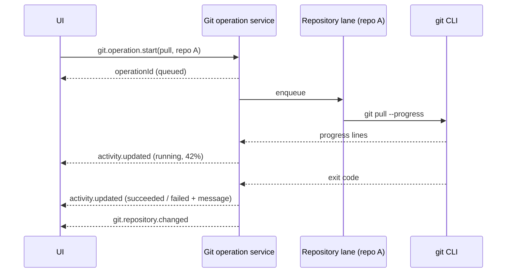

# Concurrent Git operations across repositories

> Approved direction; implementation and shared integration are complete at the final green combined code checkpoint. See [implementation status](#implementation-status-2026-10-18) for evidence and remaining runtime/platform limits. No database/schema changes or operation persistence. Builds on [Rust native boundaries](rust-native-boundaries.md) and pairs with the [activity inbox](activity-inbox.md).

## Goal

A project can contain several Git repositories. A user should be able to push in repository A, switch to repository B, and pull there without waiting for A to finish. Every long Git operation should show progress, report its final success or failure, and allow cancellation where safe.

## Baseline (before this work)

| Area            | Today                                                                                                                                                                                                                | Evidence                                                                           |
| --------------- | -------------------------------------------------------------------------------------------------------------------------------------------------------------------------------------------------------------------- | ---------------------------------------------------------------------------------- |
| Reads           | Repository info, snapshots, ancestry, revisions and document reads use native `gix`.                                                                                                                                 | `packages/native/native/src/git/`, `packages/tools/src/git/read/native-backend.ts` |
| Mutations       | Pull (`--ff-only`), push, fetch (`--prune`), sync and branch changes run the Git CLI.                                                                                                                                | `packages/tools/src/git/git-service.ts`                                            |
| Concurrency     | No application queue or lock. Requests for different repositories can already run concurrently. Requests for the **same** repository are not coordinated either; Git's own `index.lock` failures are the only guard. | `git-service.ts`, `git-method-handlers.ts`                                         |
| Request shape   | Each mutation is one request/response. The UI awaits it and keeps per-repository busy flags.                                                                                                                         | `features/git/api/git.api.ts`, `git-panel-mutations.svelte.ts`                     |
| Limits          | Every CLI command has a fixed 20-second timeout and a 16 MiB output cap; timeout sends `SIGKILL`.                                                                                                                    | `packages/tools/src/git/git-command.ts`                                            |
| Progress/cancel | None. Events are published only **after** success (`git.repository.changed`). Failures produce no event.                                                                                                             | `workbench-server/src/domains/git/git-mutation-publisher.ts`                       |
| Discovery       | Nested repository discovery walks to depth 2. Repository listing and project file status each walk again.                                                                                                            | `git-service.ts`                                                                   |

So cross-repository parallelism is mostly possible already. What breaks the experience is everything around it: one fixed timeout for slow network work, no visible progress, failures that disappear once the request returns, and no protection against two conflicting operations in the same repository.

## Proposal

### 1. Git operations become tracked background operations

Starting a long mutation returns immediately with an operation ID. The work continues on the server and reports through the shared [activity model](activity-inbox.md).

- Short reads stay request/response; they are fast and need no inbox entry.
- Network and potentially slow mutations—fetch, pull, push, sync, PR checkout, clone—use the tracked path.
- Quick local mutations (stage, unstage, commit) may stay request/response but still emit an activity entry on failure.

### 2. One lane per repository, parallel across repositories

- Canonical worktree Git-directory identity is retained, but execution is conservatively serialized by the canonical **common directory**. Linked worktrees share refs and objects as well as some locks; per-worktree Git-dir lanes alone are insufficient. Symlink aliases share identity; submodules retain their own lane.
- **Different common directories run in parallel.** A pull in B does not wait for a push in unrelated A.
- **Conflicting mutations and all CLI reads share the lane**, including lock-taking reads. Whole sync, switch-base/pull and PR-checkout workflows hold it across every step; nested helpers reuse it.
- The global network cap is **four**. Requests are bounded before filesystem identity I/O; excess work is explicitly rejected/reported, never silently dropped. Resolver concurrency and queued/running admission are separately bounded.
- Bulk actions, such as "Fetch all repositories", fan out into one child operation per repository under one parent activity, so one failure does not hide the other results.

This is coordination logic and belongs in TypeScript beside `GitService`. It needs no Rust: parallelism comes from not blocking, not from the implementation language.

### 3. Progress, timeouts and cancellation

- Run network commands with `--progress` and parse Git's stderr progress lines (`Receiving objects: 42% (…)`) into phase and percentage. Unknown output produces indeterminate progress, not an error.
- Replace the fixed 20-second timeout for network operations with an inactivity timeout (no output for N seconds) plus a generous overall ceiling. Local commands keep short timeouts.
- Cancellation sends `SIGTERM` to the managed process tree, then escalates. Cancellation is offered for fetch, pull and clone. For push, the UI warns that the remote may already have accepted the update. The final state says "cancelled", not "failed".
- Use the existing native managed-process host for spawning, so termination and output limits use one implementation.

### 4. Keep mutations on the Git CLI

Do not reimplement pull, push or fetch with `gix`. The CLI honours the user's credential helpers, SSH agent, hooks, signing, LFS/filters, submodules and configuration. Replacing it would silently change behavior and is not needed for parallelism.

### 5. Native batched reads (the Rust part)

Rust improves the **read** side:

- **One discovery result per project.** Walk once, return all repositories with their canonical Git directories, and cache it until the workspace monitor reports a change. Listing and file status reuse the result instead of walking again.
- **Batched repository snapshot.** One native call accepts a list of repositories and returns, per repository: branch, upstream, ahead/behind, status counts and in-progress state (merge/rebase). Repositories are processed concurrently on native workers, with a per-call bound, and each repository's error is reported independently.
- **Async with cancellation.** A newer refresh for the same project supersedes an older one; the older native task stops cooperatively.

Measure before and after: total refresh latency for 1, 5 and 20 repositories, Node event-loop delay and process memory.

## Contracts sketch

Shared schemas live in `packages/contracts`:

- `git.operation.start` → `{ operationId }`, with kind (`fetch | pull | push | sync | switchBaseAndPull | checkout | clone`), repository and options.
- `git.operation.bulk.start` → `{ operationId, childOperationIds }` for fetch/pull-all.
- `git.operation.cancel` → accepted / not cancellable, using the same controller/policy as generic `activity.cancel`.
- Progress and terminal state flow through the generic `activity.updated` event, not a Git-specific event.
- `git.repository.changed` remains the signal to refresh repository state after success.

## Phasing

1. Repository lanes, global cap, inactivity timeouts, failure activity entries (no progress yet).
2. Tracked operations with `--progress` parsing and cancellation; UI switches to operation IDs.
3. Native single-walk discovery and batched snapshot, gated on measurements.
4. Bulk "fetch/pull all" built on child operations.

## Decisions

- **Read locks:** lock-taking reads share the mutation lane/common-dir gate. All CLI reads are conservatively gated. Detailed native snapshots and project batches also retain the gate until the subordinate-read audit proves a narrower nonlocking mode; only established nonlocking native primitives remain outside it.
- **Network concurrency:** global cap four, across Git service instances/projects. Coordination covers this Git service, not independent Git commands launched in terminals, agent shell tools or other applications; Git's own locks remain authoritative for external processes.
- **Mutations:** retain the Git CLI and the actual user's environment, credentials, SSH agent, hooks, filters/LFS and signing. Synthetic fixture isolation never changes production environment behavior.
- **Timeouts:** network inactivity 120 seconds; one 30-minute total deadline starts when a tracked workflow runs, shared across its commands. Local commands retain a 20-second ceiling. TERM escalates after three seconds; lanes are held until actual managed close/native completion, not merely until the caller promise is cancelled.
- **Daemon restart:** memory only. Previously observed running records missing from a reconnect snapshot become client-local interrupted records; the user retries through normal authorization. The daemon cannot reconstruct lost history. No operation persistence is added.

## Implementation status (2026-10-18)

- Tools-owned coordination implements bounded pre-I/O admission, separately bounded/coalesced identity resolution, common-dir FIFO lanes, cap-four network work, whole-workflow reentry, independent per-repository read-head admission, tracked IDs, progress, sanitized terminal errors, dedicated/generic cancellation and independently reported bulk children. Cancelling a parent affects its children, not unrelated work, and the parent waits for their terminal results.
- Git-directory pointer metadata is bounded to 8 KiB regular files, checked on the opened descriptor with nonblocking POSIX open and capped reads even if a file grows. Empty/oversized/device/FIFO metadata is rejected. Shared comparison-only `gitPathKey` reconciles Node/native Windows extended drive/UNC spellings and case/separators while preserving actual I/O paths and POSIX case. Pure Windows fixtures run on Linux; an actual Windows build remains unvalidated.
- Identity resolution has no single global filesystem promise chain. Same-path requests coalesce and retain submission order; canonical lanes are FIFO at admission. **Review boundary:** previously unknown aliases resolve concurrently, so their first admissions can be ordered by identity completion rather than original call time. Strict original-call FIFO across unknown aliases would require delaying unrelated unresolved paths; no such guarantee is claimed.
- Contracts and thin Git handlers define background start/bulk/cancel plus cached issue/PR reads. Git-panel remote actions and PR checkout use background starts; panel progress/cancel and fetch-all/pull-all use Activity IDs instead of keeping start-RPC busy flags alive. Single, bulk parent/child, PR-checkout and post-merge local-update acknowledgements now enter the canonical Activity controller with project/repository scope and parent IDs; no second Git acknowledgement store remains. Post-merge updates announce only that work is queued in Activity, not that the branch has already updated. Obsolete synchronous network/checkout RPCs and app wrappers have been removed after a live-consumer audit; underlying service methods remain behind tracked operations. Activity titles use shared human labels. Quick mutation failures report sanitized activities; repository-change publication occurs only after success and cannot turn publication failure into mutation failure.
- GitHub issue and PR snapshots are bounded to 100 items per project/canonical repository and 64 cache entries per source, with a 60-second freshness interval and coalesced background refresh. Cold/stale reads return immediately; no network request blocks completion typing. Status distinguishes `loading`, `fresh`, `stale` and `unavailable`. Failed warm refreshes retain both old data and the original timestamp; failure backoff is at most 60 seconds. `onRemoteCacheChanged` reports project/source only after live-entry settlement, including failures, and suppresses closed/evicted/replaced generations. Same-project aliases coalesce without cross-project invalidation. Existing PR-detail/list APIs remain available for their existing non-completion callers.
- A bounded project read-generation cache shares discovery and light snapshot results between repository listing and project file status. Invalidation/supersession rejects stale results, including invalidation during later metadata summarization. Success and monitor invalidations must both reach this cache. The optional `refreshCause: "uncertain_poll"` notice is not proof of a change: uncertain invalidation expires data without aborting active reads, joins subsequent demand, and permits one coalesced follow-up for that demand. Deferred results carry `stale: true`; a follow-up invalidated again stays stale and does not recursively retry. Idle poll notices alone never start work. Actual filesystem changes, explicit refresh/supersession and shutdown remain hard invalidations. UI uncertain notices retain a stale indicator and do not force server refresh or cancel kept queries. Initial repository summaries still need existing stable metadata/ancestry reads; light batches do not contain refs, remotes, history or stashes and are not misrepresented as full overview snapshots.
- Native project discovery/batch and the external-filter light helper are wired through the tools backend. Only the explicit external-filter diagnostic selects isolation; other unsupported/corrupt/I/O results remain per-repository errors. Only ready repository heads microbatch into native calls; busy B never causes the refresh to hold A while waiting for B. After native completion, an isolated helper retains only its own repository gate. Metadata, discovery and ready batches share native admission capped at two with a 64-entry waiting bound; helper admission is separately bounded. Native monitors share the native permit budget outside this TS scheduler, so only typed retryable capacity failures receive abortable, bounded backoff (25–250 ms, within the caller deadline and a 120-second native-read ceiling). Nonretryable result overflows and untyped failures are never retried. Cancellation/shutdown await actual helper/native completion before releasing each repository gate. Dispatch requires the typed `isolation_required` diagnostic; an English message under another category never selects isolation. Full reads now compose the explicit status-free metadata API with safe light status under one held repository gate, using the internal single-repository status helper rather than recursively admitting a project batch. Metadata/status identities must agree after canonicalizing actual paths, including symlinked Git directories; post-metadata identity lookups remain inside the bounded native admission. Missing/error status is never represented as clean. Branch/ref/remote/history consumers use metadata only. Legacy `statusLimit: 0` semantics are unchanged and the legacy filter-capable full kernel is used only by the isolated helper. Actual public-backend Linux units pass against the final rebuilt addon: metadata never executes selected filters, overview and checkout preflight use the real helper, unrelated repositories progress, uncertain notices retain active overview work, and hard invalidation/cancellation/shutdown join actual filter/helper closure. These are small synthetic correctness units, not benchmark evidence. The native owner owns `git-isolated-reader*` and its kernel/containment tests.
- Unit tests cover admission overflow/cancellation, independent identity progress, canonical aliases/worktrees/submodules, reentry and independent ready-head batching, network limits, managed close/escalation, inactivity/total timeout, output/error bounds, partial bulk failure, parent cancellation/shutdown, cache generations and UI action/ID policy. Final combined type/lint/format/Svelte validation passed; no browser/cross-platform claims are made from Linux-only unit runs.

### Detailed read latency boundary

Git discovery, project-file-status and overview UI requests allow 120 seconds of client waiting; this is not a server execution guarantee or wire cancellation. Project generations coalesce light reads, and concurrent/retried overview RPCs coalesce the entire detailed snapshot plus diff workflow (bounded to 128 active scopes), including after client timeout. Invalidation marks a crossing overview result stale rather than claiming it fresh. Whole overviews own cancellation and one repository gate across their sequenced reads; uncertain invalidation marks them stale without cancellation, while actual changes/manual refresh/shutdown abort them and await real native/helper/managed completion. Metadata caches own their shared cancellation scope outside workflow context; workflow-owned readers—including unsignalled local workflows—bypass a potentially queued shared load rather than borrowing its permit, deadlocking behind their own lane, or leaking first-caller cancellation. Open/config/filesystem/object decoding/sorting and iterator advancement can still be noninterruptible native sections: these limits are not hard RSS or wall-time guarantees. No C production parent path probes filters with the legacy full snapshot.

### Final checkpoint and remaining limits

Canonical Activity acknowledgements, shared runtime/monitor integration and completion
cache-status/subscription consumption passed the final combined code checkpoint.
Completion aggregation preserves discovery staleness as well as remote-cache staleness,
including empty discovery results; owning bootstrap units cover both empty and nonempty
stale discovery. Actual public-backend synthetic Linux units passed for selected-filter
isolation, overview/checkout preflight, cancellation/shutdown closure and symlinked Git
identity. The artifact-dependent server sync file passed all three tests after coherent
tools dist preparation; the earlier cancelled stale-artifact run is not green evidence.

Root `pnpm fix:focused && pnpm check:focused`, **528 distinct owning tests (475 JS/TS +
53 scoped Rust)** and `git diff --check` passed, with zero Svelte errors/warnings.
Exact commands and logs: `/tmp/nerve-final-validation/HANDOFF.md`. No release-addon
rebuild occurred during final validation.

These Linux synthetic correctness results are not live GitHub/remote workflow,
integration-suite, cross-platform or end-to-end release acceptance. Completion's
whole-service synthetic measurements and manual composer/Activity visual evidence are
separate, owning-proposal evidence—not Git RPC performance measurements. Actual
Windows/macOS filesystem/process behavior remains unvalidated. External Git processes
remain outside service coordination, and the cancellation/noninterruptible-section
limits above still apply.
