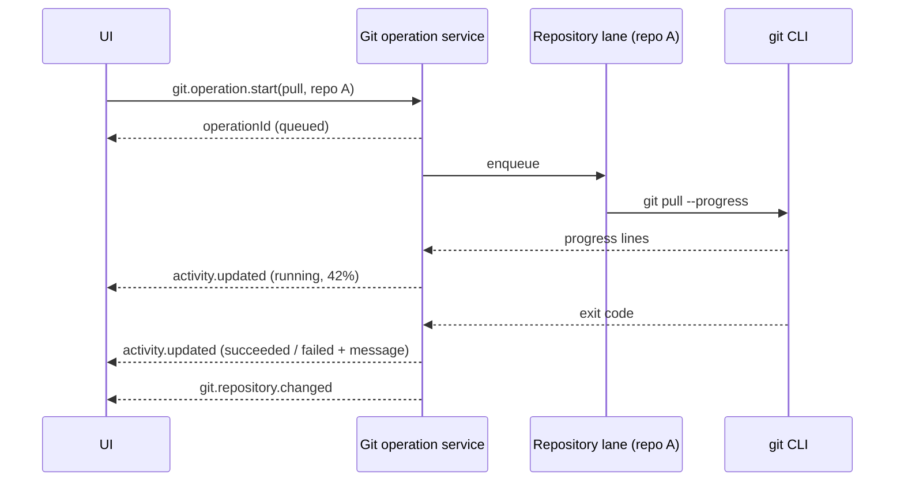

# Concurrent Git operations across repositories

> Proposal for discussion; not yet approved. No database schema changes are proposed. Builds on [Rust native boundaries](rust-native-boundaries.md) and pairs with the [activity inbox](activity-inbox.md).

## Goal

A project can contain several Git repositories. A user should be able to push in repository A, switch to repository B, and pull there without waiting for A to finish. Every long Git operation should show progress, report its final success or failure, and allow cancellation where safe.

## Current behavior

| Area            | Today                                                                                                                                                                                                                | Evidence                                                                           |
| --------------- | -------------------------------------------------------------------------------------------------------------------------------------------------------------------------------------------------------------------- | ---------------------------------------------------------------------------------- |
| Reads           | Repository info, snapshots, ancestry, revisions and document reads use native `gix`.                                                                                                                                 | `packages/native/native/src/git/`, `packages/tools/src/git/read/native-backend.ts` |
| Mutations       | Pull (`--ff-only`), push, fetch (`--prune`), sync and branch changes run the Git CLI.                                                                                                                                | `packages/tools/src/git/git-service.ts`                                            |
| Concurrency     | No application queue or lock. Requests for different repositories can already run concurrently. Requests for the **same** repository are not coordinated either; Git's own `index.lock` failures are the only guard. | `git-service.ts`, `git-method-handlers.ts`                                         |
| Request shape   | Each mutation is one request/response. The UI awaits it and keeps per-repository busy flags.                                                                                                                         | `features/git/api/git.api.ts`, `git-panel-mutations.svelte.ts`                     |
| Limits          | Every CLI command has a fixed 20-second timeout and a 16 MiB output cap; timeout sends `SIGKILL`.                                                                                                                    | `packages/tools/src/git/git-command.ts`                                            |
| Progress/cancel | None. Events are published only **after** success (`git.repository.changed`). Failures produce no event.                                                                                                             | `workbench-server/src/domains/git/git-mutation-publisher.ts`                       |
| Discovery       | Nested repository discovery walks to depth 2. Repository listing and project file status each walk again.                                                                                                            | `git-service.ts`                                                                   |

So cross-repository parallelism is mostly possible already. What breaks the experience is everything around it: one fixed timeout for slow network work, no visible progress, failures that disappear once the request returns, and no protection against two conflicting operations in the same repository.

## Proposal

### 1. Git operations become tracked background operations

Starting a long mutation returns immediately with an operation ID. The work continues on the server and reports through the shared [activity model](activity-inbox.md).

- Short reads stay request/response; they are fast and need no inbox entry.
- Network and potentially slow mutations—fetch, pull, push, sync, PR checkout, clone—use the tracked path.
- Quick local mutations (stage, unstage, commit) may stay request/response but still emit an activity entry on failure.

### 2. One lane per repository, parallel across repositories

- Operations are keyed by the repository's canonical Git directory (so two paths into the same repository share one lane).
- **Different repositories run in parallel.** A pull in B never waits for a push in A.
- **Within one repository, conflicting mutations are serialized** in submission order. The UI shows the queued state instead of failing with `index.lock` errors. Reads are not blocked by the lane.
- A global cap (for example, four concurrent network operations) limits pressure on the machine and remote hosts; excess work is shown as queued, never silently dropped.
- Bulk actions, such as "Fetch all repositories", fan out into one child operation per repository under one parent activity, so one failure does not hide the other results.

This is coordination logic and belongs in TypeScript beside `GitService`. It needs no Rust: parallelism comes from not blocking, not from the implementation language.

### 3. Progress, timeouts and cancellation

- Run network commands with `--progress` and parse Git's stderr progress lines (`Receiving objects: 42% (…)`) into phase and percentage. Unknown output produces indeterminate progress, not an error.
- Replace the fixed 20-second timeout for network operations with an inactivity timeout (no output for N seconds) plus a generous overall ceiling. Local commands keep short timeouts.
- Cancellation sends `SIGTERM` to the managed process tree, then escalates. Cancellation is offered for fetch, pull and clone. For push, the UI warns that the remote may already have accepted the update. The final state says "cancelled", not "failed".
- Use the existing native managed-process host for spawning, so termination and output limits use one implementation.

### 4. Keep mutations on the Git CLI

Do not reimplement pull, push or fetch with `gix`. The CLI honours the user's credential helpers, SSH agent, hooks, signing, LFS/filters, submodules and configuration. Replacing it would silently change behavior and is not needed for parallelism.

### 5. Native batched reads (the Rust part)

Rust improves the **read** side:

- **One discovery result per project.** Walk once, return all repositories with their canonical Git directories, and cache it until the workspace monitor reports a change. Listing and file status reuse the result instead of walking again.
- **Batched repository snapshot.** One native call accepts a list of repositories and returns, per repository: branch, upstream, ahead/behind, status counts and in-progress state (merge/rebase). Repositories are processed concurrently on native workers, with a per-call bound, and each repository's error is reported independently.
- **Async with cancellation.** A newer refresh for the same project supersedes an older one; the older native task stops cooperatively.

Measure before and after: total refresh latency for 1, 5 and 20 repositories, Node event-loop delay and process memory.

## Contracts sketch

Shared schemas live in `packages/contracts`:

- `git.operation.start` → `{ operationId }`, with kind (`fetch | pull | push | sync | checkout | clone`), repository and options.
- `git.operation.cancel` → accepted / not cancellable.
- Progress and terminal state flow through the generic `activity.updated` event, not a Git-specific event.
- `git.repository.changed` remains the signal to refresh repository state after success.

## Phasing

1. Repository lanes, global cap, inactivity timeouts, failure activity entries (no progress yet).
2. Tracked operations with `--progress` parsing and cancellation; UI switches to operation IDs.
3. Native single-walk discovery and batched snapshot, gated on measurements.
4. Bulk "fetch/pull all" built on child operations.

## Decisions

- **Daemon restart:** queued and running operations do not survive a restart. They are reported as interrupted, and the user retries. No persistence is added.

## Open questions

- Should the same-repository lane also serialize long reads that take Git locks (for example `git status` refreshing the index)?
- What is the default global concurrency cap?
