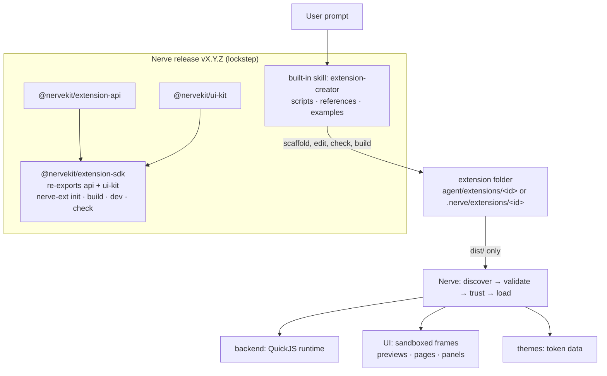
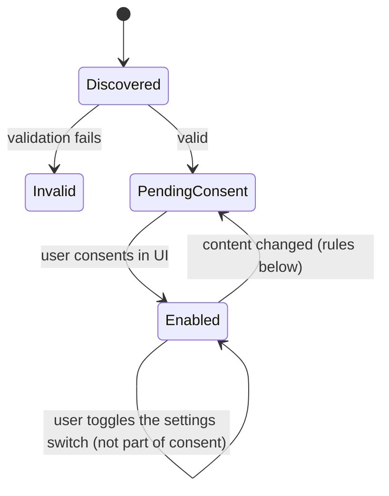

# Installable extensions

**Status:** Draft · **Area:** extensions · **Supersedes:** [#599](https://github.com/ThilinaTLM/nerve/issues/599) · **Depends on:** [#598](https://github.com/ThilinaTLM/nerve/issues/598)

Users build their own extensions by prompting Nerve, keep them as folders next to their skills, and share them the way they share skills. An installed extension can do everything a built-in extension does today, adding `quick_script` namespaces, direct tools, account kinds, settings and host capabilities (see [Agent capabilities](#agent-capabilities)). On top of that it can contribute UI: file previews, custom tab pages, side panels and themes.

The current contract (manifest, `ctx`, security rules, tool views) is in [architecture/extension-platform](../../architecture/extension-platform.md). This proposal extends it; it does not replace it.

## Goals

- **Built with Nerve, by prompting.** A non-technical user asks for "a CSV viewer" and the built-in `extension-creator` skill does the rest. Nerve is the only supported authoring environment.
- **Portable as a folder.** An extension is one self-contained folder. Copying it, committing it to a repo or sending it to someone is all it takes to share it.
- **Custom UI that looks native.** Extensions use the same `ui-kit` components and theme tokens as the app.
- **Safe without reading code.** Users cannot review extension code, so the sandbox and consent are the protection, not code review.
- **One release.** The work ships together, after #598 lands.

## Non-goals (this proposal)

- Authoring outside Nerve (a standalone CLI story, docs for other editors or agents).
- An extension marketplace, registry, signing or single-file packages (`.nerveext`).
- Agent self-verification through screenshots, "Fix with agent" / "Upgrade with agent" buttons and contextual triggers ("No viewer for `.parquet`, build one?"). See [Later](#later).
- Rebuilding existing built-in UI (Mermaid preview, HTML preview) as extensions.
- Custom renderers inside the transcript (fenced code blocks, custom tool-view sections). Tool views stay declarative.
- In-process (host-tier) third-party extensions. Every non-built-in extension runs sandboxed.

## Decisions

| Topic           | Decision                                                                                                                                                   |
| --------------- | ---------------------------------------------------------------------------------------------------------------------------------------------------------- |
| Authoring       | Only through Nerve. Node.js and npm (or pnpm) are prerequisites for building an extension, not for using one.                                              |
| Language        | TypeScript for backend code, TypeScript + Svelte for UI.                                                                                                   |
| Locations       | User: `<NERVE_HOME>/agent/extensions/<id>/`. Project: `<project>/.nerve/extensions/<id>/`. Same pattern as skills and prompt suggestions.                  |
| Folder          | The extension folder is also its source project. Nerve loads only `dist/`.                                                                                 |
| Packages        | `@nervekit/extension-sdk` (one dependency for authors), which depends on `@nervekit/extension-api` and `@nervekit/ui-kit`. All three are published to npm. |
| UI kit          | `@nervekit/ui-kit` is published as is, not a curated copy. The build rejects components that cannot work inside a frame.                                   |
| Versions        | All packages are released in lockstep with Nerve and share its semver. The same version tracks extension compatibility.                                    |
| Backend runtime | QuickJS, one runtime per extension, over `__hostCall` (#598).                                                                                              |
| UI runtime      | A sandboxed iframe with an opaque origin and no network, talking to the host over a message channel.                                                       |
| Themes          | Data only (token values), user level only.                                                                                                                 |
| UI kinds        | File previews (with an optional edit mode), pages (custom tab panes), side panels and themes. Previews, pages and panels need an open project.             |
| UI authority    | Consent to the extension is the grant. Calls from its UI to its backend need no further prompts.                                                           |
| Scaffolding     | A script in the `extension-creator` skill calls the SDK's `init` with the SDK version matching the running Nerve.                                          |
| Examples        | New examples only: a CSV viewer and a theme.                                                                                                               |
| Tests           | Vitest, run by `nerve-ext test` and `nerve-ext check`.                                                                                                     |

## Overview



## Extension folder

```
csv-viewer/
  package.json          # private; depends on @nervekit/extension-sdk at an exact version
  tsconfig.json
  .gitignore            # node_modules/
  src/
    extension.ts        # defineExtension({...}): manifest and backend hooks
    ui/csv-viewer.svelte
  themes/               # optional, theme token files
  docs/                 # optional, agent doc topics for namespaces
  fixtures/             # sample files used by tests and dev
  test/
  dist/                 # build output; the only part Nerve loads
    manifest.json
    backend.js
    ui/<contribution-id>/index.html, *.js, *.css
    themes/*.json
    docs/
    icon.svg
```

- The folder name must equal the extension id: lowercase letters, digits and single hyphens, at most 64 characters (the skill naming rule).
- Discovery honours `.gitignore`, `.ignore` and `.fdignore`, so `node_modules/` is never scanned.
- Project extensions commit `dist/`, so a teammate who clones the repo needs no build step.
- `src/` stays in the folder, so the agent can change an extension in place and users can see what they trust.

### Generated manifest

Authors write one TypeScript definition (`src/extension.ts`, `defineExtension` as today). `nerve-ext build` evaluates it and writes `dist/manifest.json`: the plain-data part of the definition (id, name, version, `sdkVersion`, permissions, settings, account kinds without hooks, contributions, view declarations, doc topics, icon). Hooks (`parse`, `authorize`, `run`, `test`, `availability`, `present`) stay in `dist/backend.js`.

Nerve reads `manifest.json` without running any extension code. Listing, consent and diagnostics therefore work before the extension is trusted. When the backend is loaded, the host compares the definition it exports with `manifest.json` and refuses the extension if they differ, so the manifest cannot understate what the code does.

## Discovery and precedence

Roots, in precedence order:

1. `<project>/.nerve/extensions/` (only the project root; no ancestor walk and no `.agents/extensions`, because extensions are Nerve-only);
2. `<NERVE_HOME>/agent/extensions/`;
3. built-in extensions.

- **First id wins**, the same as skills and suggestions. Settings shows shadowed entries.
- **Built-in ids cannot be shadowed.** A user or project extension with a built-in id fails to load with a diagnostic. With skills, shadowing only changes instructions; with extensions, a shadowing `atlassian` would receive credentials.
- **Account kinds stay unique across all scopes.** A duplicate kind fails the later extension with a diagnostic.
- **Scope limits contributions.** User extensions apply in every project. Project extensions apply only while their project is active. Without an open project there are no extension previews, pages or panels. Themes are user level only; a project extension's theme is ignored with a diagnostic, because the theme is app-wide and the app shows several projects.
- Invalid extensions are omitted, not partially loaded, and are reported as diagnostics in Settings → Extensions.

> **As implemented (step 2).** `manifest.json` is `extensionDefinitionData(definition)` (hooks as `true`) plus `version`, `sdkVersion` and a reserved `ui` object; `manifest.json` rejects unknown fields, `prelude` and settings `migrations`. The comparison is a deep equality of that data with what the bundle registers in a throwaway sandbox runtime, run only after the trust gate says `trusted`. The id must also start with a letter (as `extensionIdSchema` does). Account kinds, namespace ids (not runtime namespaces or host globals) and direct tool names (not core tools) are unique across scopes, and collisions are resolved built-ins, then user, then project, so a repository cannot take over a kind the user's credentials are stored under. Details: [architecture/extension-platform](../../architecture/extension-platform.md#installed-extensions).

### Registry per scope

Today the host builds one registry from the built-in list at startup. It becomes: built-ins plus loaded user extensions (shared), plus the active project's extensions, composed per project. The `quick_script` tool description, direct tools and `sdk.list` read that composed registry, so a project extension's namespaces appear only in that project's conversations.

Adding or changing an extension changes the tool description and therefore the prompt prefix. The change applies to the next prepared request, like other configuration changes.

## Compatibility and versions

- Every published package has Nerve's version. A build writes `sdkVersion` (the exact SDK version) into `manifest.json`.
- Nerve keeps one constant, `oldestCompatibleSdkVersion`. It is raised only when a release breaks the extension API, the UI bridge, the manifest format, `ui-kit` components or theme token names.
- Nerve loads an extension when `oldestCompatibleSdkVersion <= sdkVersion <= running version`. Otherwise the extension is disabled with a diagnostic: "Built with SDK 0.38.0; this Nerve needs 0.41.0 or later. Ask the agent to upgrade it with the extension-creator skill."
- Compatibility is best effort, not guaranteed. The SDK ships `UPGRADING.md`, one section per breaking version with before and after code, so the skill's upgrade workflow can apply the steps between two versions mechanically.
- A check in CI flags changes to the public surfaces above, so raising `oldestCompatibleSdkVersion` is a conscious decision.

## Trust and consent



- **Nothing runs before consent.** A discovered extension is listed with its consent summary; its backend is not loaded and its frames are not served until the user consents.
- **Consent is bound to content and stored as trust.** Storage, the digest, the grant snapshot and the re-approval rules are owned by [trust](../../architecture/trust.md) (an `extension` row of `trusted_resource`, never a file). In short: a project extension needs consent again after any content change, because a repository is an untrusted source; a user extension keeps consent through a code-only change, and a change that adds permissions or contributions requires consent again and shows what is new. Permission rules still apply as written: a broad allow rule also allows new operations, because the user chose it; the notice makes that choice informed.
- **Plain language.** The consent summary is generated from the manifest, for example: "Opens `.csv` files. Reads only the file you open with it. No network access." Broad grants (`*` network, file writes) are called out.
- **Only the user consents.** Consent is a UI action with no agent-reachable route, so an agent cannot enable an extension it wrote.
- **Agent-facing text from extensions is limited and attributed.** Namespace summaries, rules, method descriptions, doc topics and error messages have size limits, and `sdk.list`, `sdk.docs` and the tool description name the source (`csv-viewer, user extension`). Limits live in code ([agent-facing content](../../agent-facing.md)). Static text over a limit makes the extension invalid at load; error messages are cut at run time. Consent names the content hash of the summary the user saw, so files changed after review are refused.

## Backend runtime

Installed extensions always run in QuickJS, using the isolation that #598 establishes for Diagrams. `ctx` is the existing `ExtensionContext` over `__hostCall`, and the security rules in the architecture doc apply unchanged: secrets never reach extension code, credentials are injected host side, the network is the manifest allowlist with the SSRF guard, files are reached only through authorized handles and `ctx.authorize` has the risk ceiling.

### Runtime design (#598)

- **One persistent runtime per extension per run.** A runtime is opened on the first call into an extension during a `quick_script` run (or a direct tool call, an account test, an availability check, a UI call), evaluates the extension bundle once, serves every call of that run and is disposed when the run ends. This matches today's per-run `ExtensionRuntime` and its `session`. Runtimes are never shared between runs or conversations.
- **Native: invoke and dispose.** The native sandbox gains a long-lived mode: `open` (bundle as a classic script, limits), `invoke(fn, args)` (returns a promise; the time limit is re-armed per invocation; the host-call budget is per invocation) and `dispose`. An idle runtime with no pending work is not an error. Extension runtimes have their own concurrency cap, separate from quick_script scripts.
- **All extension code runs in the sandbox, hooks included.** `parse`, `authorize`, `resource`, `configuration`, `present`, `availability`, `test`, `session` and `run` execute in the runtime. Untrusted code never runs in the daemon process. Host-side `prepare` and the script scan become async, because they now call into the sandbox; they still run before any I/O and before approval.
- **Plain data on the wire.** Bytes cross as binary (or base64 until the channel supports binary), `settings.get` reads a snapshot sent with each invocation, and `progress`, `report.*` and `log.*` are fire-and-forget host calls that do not count against the budget.
- **No callbacks or signals across the boundary.** Cancellation is the native cancel of the invocation. The two callbacks in `ctx` are replaced with data: `http.request`'s callback becomes `response: "artifact"` with `artifact: { name?, baseName?, extension?, inlineText? }` (the host names the file and derives the extension from the content type), and `models.vision.explain` reports deltas only through its named `progress` sections.
- **One interface, two adapters.** The host talks to extension code through one async interface. Built-ins use an in-process adapter; Diagrams, and every installed extension, use the sandbox adapter. Moving all built-ins to the sandbox is a later decision.
- **Bundles.** Each sandboxed extension is built into one classic script (esbuild, IIFE) that registers its definition on `globalThis.__nerveExtension`. `@nervekit/extension-api` is not bundled: the runtime library evaluated before the bundle provides it (`globalThis.__nerveExtensionApi`), so the bundle and the runtime share one `ExtensionError`. The SDK's `nerve-ext build` produces the same format.
- **As implemented (Diagrams).** One dispatcher global (`__nerveExtensionInvoke`) serves every `ExtensionCode` operation; the `ctx` in the sandbox forwards each service to `host.call` with a per-invocation token that selects the real host `ctx` of that call (which keeps the `ctx.authorize` ceiling), and the host answers from a fixed method table. Settings are a snapshot per invocation, bytes are base64 in a tagged envelope, `ExtensionError` crosses with its `fix`, and the runtime library supplies `TextEncoder`/`TextDecoder`. The adapter is chosen per extension through the registry (`extensionCodeAdapter`), by a host-side list of sandboxed built-ins. A session's `ctx` is that of the call that opened it. See [Sandbox adapter](../../architecture/extension-platform.md#sandbox-adapter).

## Agent capabilities

An installed extension contributes everything a built-in extension does today, through the same `@nervekit/extension-api` contract. UI contributions are added on top; they do not replace any of this. One extension can combine both, for example a Jira integration with a `jira` namespace, an account kind and a board panel.

| Contribution                  | What it adds                                                                                                                                                                     | Built-in example                    |
| ----------------------------- | -------------------------------------------------------------------------------------------------------------------------------------------------------------------------------- | ----------------------------------- |
| **`quick_script` namespaces** | New SDKs for the agent's scripts: methods with declared risk, `parse`, `authorize` and `run`, shared type declarations, rules and doc topics                                     | `jira`, `confluence`, `diagram`     |
| **Direct tools**              | Tools the agent calls directly, usually bound to a namespace method, with a declarative `ToolView` and live progress sections                                                    | `web_search`, `explain_image`       |
| **Account kinds**             | New credential types: fields, secret, auth scheme (`basic`, `bearer`, header), credential origins and a `test` hook; Settings generates the account list, dialog and Test button | Atlassian, Tavily                   |
| **Settings**                  | Generated settings at user, project and conversation scope, with versioned migrations                                                                                            | Diagrams server, image backend      |
| **Network access**            | Allowlisted origins for `ctx.http`, including templates over account fields and settings                                                                                         | Atlassian site, `kroki.io`          |
| **Host capabilities**         | Declared access to host services such as `models.vision` and `models.image`, using the models the user selected for the extension                                                | Image explanation, Image generation |
| **Availability**              | `enabledBy`, `requires` and an `availability` hook, with generated reasons and fixes                                                                                             | Atlassian without a saved token     |

Everything in [architecture/extension-platform](../../architecture/extension-platform.md) applies unchanged to installed extensions: the risk model, nested authorization of every host call, operation rules (`jira.*`), approvals covering the selected accounts, the script scan, tool-view validation and the security rules for secrets, credential origins and the network. Installed extensions differ from built-ins only in where they come from, how they are trusted and that their code runs in QuickJS. Their agent-facing text (summaries, rules, descriptions, doc topics, errors) is also size-limited and attributed to the extension (see [Trust and consent](#trust-and-consent)).

### Agent actions go through the permission engine

Every agent action on an extension, whether a direct tool call or a `quick_script` host call, is decided by the permission engine exactly as for built-ins. The method's declared risk and the active rule set decide whether it is allowed, denied or asked. Consent decides whether the extension is loaded at all; the permission engine decides each agent action. The extension's own UI calling its own backend is a user action, not an agent action, so it does not go through the engine (see [Calls from UI](#calls-from-ui)).

### The platform owns the building blocks

Extensions compose what the extension API offers: `ctx` services, host capabilities, setting field types, account auth schemes, tool-view section types and bridge APIs. New building blocks are added by Nerve, so each one gets its control, validation, security review and contract once, for every extension.

The API grows from use. After this ships, we build different kinds of extensions (with the `extension-creator` skill and by hand) and collect what they were missing. Each gap becomes an API addition in a Nerve release, and the generated references in the skill pick it up. Additions are backward compatible; a change that breaks existing extensions raises `oldestCompatibleSdkVersion` (see [Compatibility and versions](#compatibility-and-versions)).

## UI contributions

Four kinds, declared in the definition and compiled by `nerve-ext build`:

| Kind             | What it is                                                                          | Example                     |
| ---------------- | ----------------------------------------------------------------------------------- | --------------------------- |
| **File preview** | A rendered view of a file type, shown in the file's tab, with an optional edit mode | CSV table, PDF viewer       |
| **Page**         | A tab pane with fully custom content, not bound to a file                           | Calendar, data visualizer   |
| **Panel**        | A dock panel like Files or Git                                                      | CSV summary, service status |
| **Theme**        | Colour token values                                                                 | Solarized Dark              |

```ts
defineExtension({
  id: "csv-tools",
  // ...
  ui: {
    previews: [
      {
        id: "table",
        label: "Table",
        match: { extensions: [".csv", ".tsv"] },
        entry: "src/ui/csv-table.svelte",
        edit: "custom",
      },
    ],
    pages: [
      {
        id: "explorer",
        label: "CSV explorer",
        icon: "chart-bar",
        entry: "src/ui/explorer.svelte",
      },
    ],
    panels: [
      {
        id: "summary",
        label: "CSV summary",
        icon: "table",
        entry: "src/ui/summary.svelte",
      },
    ],
    themes: [
      {
        id: "solarized-dark",
        label: "Solarized Dark",
        file: "themes/solarized-dark.json",
      },
    ],
  },
});
```

**A project is always open.** Previews, pages and panels exist only inside an open project, like every other workbench feature. User extensions contribute them to every project; project extensions only to their own. Themes are the one app-wide contribution.

### Frames

Previews, pages and panels run in frames with the same isolation as the HTML preview (`html-preview.service.ts`, `HtmlPreviewPane.svelte`):

- `<iframe sandbox="allow-scripts">`: opaque origin, no same-origin access, no popups, no modals, no top navigation, no forms.
- The daemon serves `dist/ui/<contribution>/` under a per-extension path with a strict CSP: scripts, styles, images and fonts only from that path; `connect-src 'none'`; `worker-src` from that path and `blob:` (for libraries such as pdf.js); `frame-src`, `object-src` and `form-action` `'none'`.
- **No network from frames.** A frame that needs remote data calls its own backend method, which uses `ctx.http` under the manifest allowlist.
- **The host owns all chrome.** Tab title, close, dirty marker, the preview/edit toggle, panel header and errors are drawn by the host. A frame cannot draw outside its rectangle, so it cannot imitate approval prompts.
- Frames work the same in the desktop app and in a browser against a hosted daemon.

The frame isolation protects Nerve from extension code (the daemon session, the app, other extensions). It does not restrict what a consented extension may do with its own declared permissions.

### Bridge API

The frame gets a typed client from `@nervekit/extension-sdk/ui`. Every message is plain data, matching rule 2 of the platform. The host validates every message against the contribution that owns the frame.

| API                                                                      | Available in                   | Purpose                                                                                                                           |
| ------------------------------------------------------------------------ | ------------------------------ | --------------------------------------------------------------------------------------------------------------------------------- |
| `host.file.info()`, `host.file.read({ offset?, length? })`               | previews                       | The file the preview was opened on, read through the host with range reads for large files.                                       |
| `host.file.write(content)`, `host.mode` (`preview` or `edit`)            | previews with `edit: "custom"` | Write the edited content and follow the host's preview/edit toggle (see [File previews](#file-previews)).                         |
| `host.call(method, args)`                                                | all frames                     | Call one of this extension's own backend methods (see [Calls from UI](#calls-from-ui)).                                           |
| `host.settings.get()`                                                    | all frames                     | The extension's resolved, non-secret settings.                                                                                    |
| `host.viewState.get()`, `host.viewState.set(json)`                       | all frames                     | Small JSON state (scroll position, sort column, selected date) kept with the tab or panel, so frames can be unloaded when hidden. |
| `host.ui.confirm(...)`, `host.ui.showMenu(items)`, `host.ui.notify(...)` | all frames                     | Dialogs, menus and toasts drawn by the host with real `ui-kit` components.                                                        |
| `host.openFile(path)`, `host.openPage(id, params?)`                      | all frames                     | Open a project file, or one of this extension's pages, in a tab. Paths must be inside the project.                                |
| `host.project.info()`                                                    | all frames                     | The open project's id, name and directory.                                                                                        |
| `host.composer.insert(text)`                                             | all frames                     | Insert text into the composer; the user decides whether to send it.                                                               |
| `host.onThemeChange`, `host.onFileChange`, `host.onModeChange`           | all frames                     | Change notifications.                                                                                                             |

### Calls from UI

`host.call` runs the extension's backend method with the authority the user granted at consent: its network origins, its accounts and capabilities, and the files of the open project. There is no further prompt per call and permission rule sets do not apply, because no conversation and no agent is involved. Users choose which extensions to trust, and most extensions are written by the user's own agent.

The `ctx` security rules still hold, because they protect secrets rather than restrict the user: credentials are injected host side and never returned, credentials go only to their account kind's origins, the network is the manifest allowlist with the SSRF guard, and file access stays inside the open project.

### Look and feel

- The host injects the active theme's tokens, the base CSS and the fonts into every frame, so frames follow theme changes without a rebuild.
- Components come from `@nervekit/ui-kit` and are compiled into the extension. The build runs Tailwind with Nerve's preset, so extensions use the same utilities (`bg-card`, `text-muted-foreground`, `text-ui`) and the same style rules as `workbench-app`.
- Components that cannot work inside a frame fail the build with a hint to use the host API instead: dialog, alert dialog, sheet, context menu, dropdown menu and sonner. Select and tooltip stay allowed; they are clipped to the frame, which is acceptable at tab and panel sizes.
- Heavy `ui-kit` dependencies (Mermaid, Shiki) stay behind lazy imports so a simple preview does not bundle them.

### File previews

A file preview works like the Markdown file pane today: the tab shows the rendered file, and a button in the tab header toggles edit mode. The extension chooses how editing works with `edit`:

| `edit`                              | Edit mode                                                                                                                                                                   |
| ----------------------------------- | --------------------------------------------------------------------------------------------------------------------------------------------------------------------------- |
| `"source"` (default for text files) | Nerve's own source editor for the file. The preview re-renders from the saved content.                                                                                      |
| `"custom"`                          | The frame switches to its own editor (`host.mode` is `edit`) and writes through `host.file.write`. Suits structured or binary formats, such as editing CSV cells in a grid. |
| `"none"`                            | No edit toggle (default for binary files).                                                                                                                                  |

- Matching is by file extension. When several previews match a file, the tab header offers them next to the built-in views; the last choice per file extension is remembered with the existing file-viewer preferences.
- The host owns saving and the dirty state in both edit modes, and reports external changes with `onFileChange`.
- A preview is a render kind of the existing file tab, not a new tab kind, so moving, renaming and closing files keep working as today.

### Pages

A page is a tab pane whose content is entirely the extension's, for anything not bound to a file: a calendar, a dashboard, a visualizer.

- A page is a new center-tab kind that hosts the frame; the host draws the tab with the page's label and icon.
- Pages open from the extension's entry in the workbench (Settings → Extensions lists its pages, and the extension's panel can call `host.openPage`) and from `host.openPage` in any of the extension's frames. `params` (small JSON) let one page open in several tabs, such as one per calendar.
- Open page tabs are restored with the workspace like other tabs; `host.viewState` restores their content.

### Side panels

- An extension panel is a dock panel like Files or Git, with the extension's label and icon. The host draws the `PanelHeader`; the frame fills the content area.
- Hidden panels unload their frame after a short delay; `host.viewState` restores them.

### Themes

- A theme file is data: `{ id, label, kind: "light" | "dark", tokens: { ... } }`. The token set is the colour inputs `ui-kit/src/styles/theme.css` defines in every theme block (eight core colours and nine syntax roles; the derived surfaces, borders and terminal colours follow from them), a test keeps the list in sync; missing or unknown tokens fail validation. The numeric `--step-*` and `--mix-*` tuning tokens are not settable by extensions.
- The contrast rules of `theme-contrast.test.ts` run when the theme is loaded. A theme that fails is rejected with the failing pairs.
- No arbitrary CSS. Themes only set token values, so they cannot hide or restyle host UI.
- `colorThemeSchema` changes from a closed enum to built-in ids plus `ext:<extension-id>/<theme-id>`. The client caches the resolved tokens of the selected theme for the pre-paint bootstrap in `index.html`, so a custom theme does not flash. If the extension disappears, the theme falls back to `nerve-dark`.
- Settings → Theme shows extension themes as preview cards after the built-ins.

## SDK and build tooling

`@nervekit/extension-sdk` is the only dependency an extension project has. It contains:

- `@nervekit/extension-sdk`: re-exports `@nervekit/extension-api` (definitions, types) and the fake `ctx` for tests (`extension-api/testing`).
- `@nervekit/extension-sdk/ui`: the bridge client and re-exports of `@nervekit/ui-kit`.
- The `nerve-ext` CLI:

| Command                                                               | Does                                                                                                                                                              |
| --------------------------------------------------------------------- | ----------------------------------------------------------------------------------------------------------------------------------------------------------------- |
| `nerve-ext init <id> --kind preview\|page\|panel\|theme\|integration` | Write the project from a template and install dependencies.                                                                                                       |
| `nerve-ext build`                                                     | Bundle the backend with esbuild into one ESM file, build each UI entry with Vite (Svelte and Tailwind preset), copy themes, docs and icon, write `manifest.json`. |
| `nerve-ext check`                                                     | Type check, validate the manifest and themes, reject frame-incompatible imports, run tests (Vitest), build. One command for the agent.                            |
| `nerve-ext test`                                                      | Run the tests with Vitest: backend tests against the fake `ctx`, and Svelte component tests in a DOM environment with a fake bridge.                              |
| `nerve-ext dev`                                                       | Watch the sources and rebuild on change.                                                                                                                          |

Validation errors are written for the agent: what is wrong, where, and the fix.

`@nervekit/extension-api` and `@nervekit/ui-kit` become public packages: `private` is removed, their exports are reviewed and `ui-kit` keeps shipping sources (`.ts` and `.svelte`), which the SDK's build compiles.

### Dev loop

Nerve has no configuration file watchers, and this stays true:

- `nerve-ext dev` rebuilds `dist/`; the daemon does not watch extension folders.
- Settings → Extensions and the extension's tabs and panels offer **Reload**, which re-reads the extension and applies the trust rules above.
- The agent reloads through a built-in `quick_script` namespace `extensions` with `reload(id)` and `status(id)`. `status` returns validation diagnostics and recent runtime errors (backend exceptions and frame console errors), so the agent can fix problems without the user copying them. Reload never grants consent; an extension pending consent stays pending.

## `extension-creator` skill

A built-in skill next to `skill-creator` in `packages/workbench-server/src/builtin-skills/builtin/`. Disabled by default like other built-in skills.

```
extension-creator/
  SKILL.md
  scripts/
    create-extension.mjs   # check node/npm, run `npx @nervekit/extension-sdk@<nerve version> init`, then `nerve-ext check`
    upgrade-extension.mjs  # bump the SDK to this Nerve's version, print the UPGRADING.md sections in between
  references/
    manifest.md            # definition fields, permissions, contributions
    backend.md             # ctx services, risks, authorize, errors, tests with the fake ctx
    ui.md                  # previews, pages, panels, bridge API, ui-kit usage and frame limits
    themes.md              # token list, contrast rules
    security.md            # what consent shows, least privilege, what the sandbox forbids
    sharing.md             # user versus project location, committing dist/, updates
  examples/
    csv-viewer/
    theme/
```

- The scripts know the running Nerve's version, so a new or upgraded extension always targets the SDK of the Nerve that runs it.
- Workflow in `SKILL.md`: check prerequisites → ask user or project scope → scaffold → implement with the least permissions → `nerve-ext check` until green → reload → ask the user to review and consent in Settings.
- Reference content is generated from the source where possible (manifest schema, `ctx` types, bridge API, token list) and checked in CI, so it does not drift.
- Everything in the skill is model-facing and follows [agent-facing content](../../agent-facing.md).

## Settings → Extensions

- Grouped by source: Built-in, User, Project (#599 planned this once `metadata.source` exists).
- Each installed extension shows its state (badges for pending consent, incompatible, invalid and shadowed; enabled shows none, the switch says it), its folder and diagnostics. A pending extension opens a consent review (Allow / Not now; for an update, only what is new). The row's switch is the same settings `enabled` value the detail header uses (scoped user, project and conversation, like a built-in), separate from consent; a loaded extension opens its settings. Reload re-reads all installed extensions; consent can be revoked per row. Contributions are listed in the detail view once UI contributions exist.
- Settings and accounts keep working as today: generated from the manifest, stored in `config/extensions.json` and the account store.

## Work breakdown

All of this ships in one release, after #598.

1. **Runtime isolation (#598).** QuickJS runtime per extension over `__hostCall`, with limits.
2. **Packaging and loading.** (Implemented.) Folder format, generated manifest and the definition match check, discovery in both roots, precedence and collision rules, per-project registry composition, compatibility check, diagnostics.
3. **Trust and consent.** (Implemented: consent stored as `extension` rows of `trusted_resource` ([trust](../../architecture/trust.md)), the consent operations, limits and attribution, and the Settings → Extensions groups, states, consent review, switch and Reload.) Content hashes, consent records, the update diff, plain-language summaries, limits and attribution for agent-facing text.
4. **Packages and SDK.** Publish `extension-api` and `ui-kit`; create `extension-sdk` with `nerve-ext init`, `build`, `check`, `test` and `dev`, templates, `UPGRADING.md` and the release pipeline for lockstep publishing; the public-surface check.
5. **UI host.** Frame serving and CSP, the bridge, file previews with both edit modes and preview selection, the page tab kind, extension dock panels, theme loading, validation and pre-paint caching.
6. **Settings.** Source groups, states, consent, reload, diagnostics.
7. **`extension-creator` skill.** Scripts, references, the CSV viewer and theme examples, and the `extensions` quick_script namespace for reload and status.
8. **Docs.** Update [architecture/extension-platform](../../architecture/extension-platform.md); add a public guide (build an extension with Nerve) and a reference (locations, precedence, trust, compatibility) to the website.
9. **Try it out.** Build extensions of different kinds (integration with an account kind, direct tool, preview with custom editing, page, panel, theme) and record what the API was missing. The gaps become follow-up API additions.

## Later

- Agent self-verification: render a preview, page or panel with a fixture and return a screenshot to the agent.
- "Fix with agent" on runtime errors and "Upgrade with agent" on incompatible extensions.
- Contextual entry points: unknown file type, "Create theme…" in the theme picker.
- Single-file sharing (`.nerveext`), install from a git URL.
- Transcript renderers and custom tool-view sections.
- Smaller installs: split `ui-kit`'s heavy renderers (Mermaid, Shiki) out of the default install. Ease of use comes first; measure before optimizing.
- Built-in extensions in the same folder format, once the format has proven itself, so there is one loading path. They stay built in and trusted.
- Panels and pages without an open project (user-level workbench UI).
