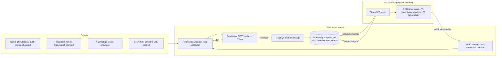

# Live pull request sync

> **Status:** Proposal. This document describes intended behavior, not shipped functionality.

## Summary

Move pull request state ownership to the Workbench server. One server-side sync service per daemon keeps an in-memory snapshot of each watched repository's pull requests and their checks. It refreshes that snapshot from GitHub using cheap conditional probes and pushes `github.pr.changed` events to connected clients. The workbench app replaces its scattered PR copies and polling loops with a thin, shared PR store that mirrors the server snapshot and declares what is on screen.

Users should never need to press refresh to see a newly created pull request, a check finishing, a merge, or a new push. The design also has to stay well within GitHub's rate limits.

## Problems today

- **New pull requests appear late.** Nerve has no PR-creation operation. PRs are created in the browser (from the compare URL) or by agents running `gh pr create`. The client only re-reads PRs after Nerve's own Git mutations or on window focus. Focus refreshes are gated by a 60s staleness check and a 30s cooldown, and reads go through a 30s client query cache. An agent's `git push` from a shell only produces a filesystem invalidation, which refreshes the Git overview but not PRs.
- **The Git Changes tab never refreshes checks.** Pending-check polling in `workbench-git-panel-adapter.svelte.ts` only runs while the Pull Requests panel is visible, and only for the filtered list. The current-branch PR card (`refreshCurrentBranchPr`) reuses a possibly stale list entry and is never polled.
- **The same PR is duplicated in client state.** One PR can live in the filtered list (`prs`), `currentBranchPr`, `prHeads`, and the PR tab's `core`/`checks`. These copies are kept in sync by hand (`applyPrCore`, `applyPrChecks`, `applyPrSummary`, `syncOpenPrViews`, `removeOpenPr`, merged-PR tombstones). Two independent pollers (the adapter effect and `git-refresh-coordinator`) each update only some copies.
- **GitHub requests are duplicated.** Each window and mobile client polls independently. Every poll is a GraphQL query that costs rate-limit points even when nothing changed.

## Goals

- Pull request lists, the current-branch PR, branch PR badges, and open PR tabs show the same data and update together.
- A new PR becomes visible within seconds when Nerve has a signal for it (push, agent `gh pr create`, compare-URL click), and within about a minute otherwise while visible.
- Pending checks update every ~10s while anything that shows them is on screen, including the Git Changes tab.
- GitHub traffic scales with what users are looking at, not with the number of windows. Unchanged data should cost no rate-limit budget.
- No new database tables or columns. All sync state is in memory and is rebuilt after a restart.

## Non-goals

- GitHub webhooks. A local daemon has no public endpoint; a relay or GitHub App can be considered later.
- Offline persistence of PR data across daemon restarts.
- Real-time sync of heavy PR detail sections (files, diffs, full conversation) while they are not visible.
- Changing PR mutation flows (merge, checkout) beyond publishing the resulting changes.

## Architecture



### Ownership

- **`packages/contracts`:** Watch, snapshot, and refresh request/response schemas; the `github.pr.changed` event; extended PR summary fields.
- **`packages/tools/src/git`:** Probe and fetch primitives on the existing `GithubApiClient` (conditional `rest` requests with ETags), alongside the existing GraphQL reads.
- **`packages/workbench-server/src/domains/git`:** The PR sync service: snapshots, scheduler, watch registry, signal intake, and event publication. Watch demand follows the same per-connection model as `git.repository.monitor.sync` (`WorkbenchConnection`), so a disconnected client releases its demand.
- **`packages/workbench-app/src/lib/features/git/state`:** A single `pr-store.svelte.ts` that mirrors snapshots and exposes selectors and watch helpers.

## Server snapshot

Per `(projectId, repo)` the service keeps:

- `revision`: a monotonically increasing number, bumped whenever published data changes.
- `prs`: the canonical set of open PRs (capped, e.g. 100), plus recently closed or merged PRs that are still watched (an open tab, or the current branch). Each entry is the existing `GithubPr` summary, extended with the fields needed to filter locally (labels, review-request state for the viewer, head SHA).
- `heads`: derived from `prs`, which replaces the separate `github.pr.heads.list` read.
- `checks`: the checks summary per watched head SHA.
- Probe bookkeeping: ETags, `x-poll-interval`, last-success and last-failure times, and backoff state.
- `status`: `fresh | refreshing | stale | rate_limited | unauthenticated | error`, plus `updatedAt`.

Clients filter the canonical set locally (author, drafts, title, labels, head, sort, review requested). When a repository has more open PRs than the cap, the snapshot is marked `truncated`, and filtered lists fall back to the existing server-side search query. That query runs only on demand and is never polled.

The existing `github.pr.cached.list` (composer completions) is served from the same snapshot, so there is one PR cache instead of two.

## How updates are detected without spamming GitHub

GitHub's REST best practices recommend authenticated conditional requests for polling. A `304 Not Modified` response to an authorized conditional request does not count against the primary rate limit. GraphQL has no such mechanism, so every GraphQL poll costs points. The service therefore uses REST probes to detect changes, and GraphQL only to fetch details after a change.

**Repository probe** (new or updated PRs, pushes, merges, closes, title, label, and review changes):

```text
GET /repos/{owner}/{repo}/pulls?state=all&sort=updated&direction=desc&per_page=30
If-None-Match: <etag>
```

- `304` means nothing changed, at no cost.
- `200` means the service compares `updated_at` and state per number. It then fetches summaries for only the changed PRs with one batched GraphQL query, publishes them, and stores the new ETag.

**Checks probe** (one per watched head SHA that has pending checks or is shown):

```text
GET /repos/{owner}/{repo}/commits/{sha}/check-runs?per_page=100
GET /repos/{owner}/{repo}/commits/{sha}/status
If-None-Match: <etag>
```

- `200` means the checks summary is recomputed from the response directly; no GraphQL call is needed.
- Probes stop for a SHA once its checks are complete and nothing new is expected, until a new head SHA arrives.

### Cadence tiers

The scheduler computes each repository's next probe time from current demand and signals:

| Tier        | When                                                                                                    | Repository probe                                                                   | Checks probe               |
| ----------- | ------------------------------------------------------------------------------------------------------- | ---------------------------------------------------------------------------------- | -------------------------- |
| Hot         | A visible surface shows a PR whose checks are pending                                                   | 30s                                                                                | 10s for the pending SHAs   |
| Awaiting PR | Within 10 min after a push, a compare-URL click, or an agent `gh pr create` for a branch with no PR yet | 10s, backing off to 30s                                                            | None until the PR appears  |
| Warm        | A PR surface (Git Changes card, PR panel, branch popover, PR tab) is visible                            | 60s                                                                                | When shown and not settled |
| Cold        | Watched, but no client reports visibility (all windows hidden or panels closed)                         | None. The next demand serves the cached snapshot and revalidates if older than 60s | None                       |

Rules that apply to every tier:

- Respect `x-poll-interval` when it is longer than the tier interval.
- Run requests serially per GitHub host through the existing network permit, which also avoids secondary rate limits.
- Coalesce work: signals inside a short debounce window (~2s) result in a single probe, and each repository has at most one fetch in flight.
- Watch the budget headers. Below 20% remaining, stretch intervals 4×. On a secondary limit, `429`, or `403` rate limit, back off for at least 60s (or `retry-after`) with exponential growth. In both cases, publish `status: rate_limited` so the UI can say updates are paused.
- Signals bypass the interval but not backoff: they trigger an immediate probe unless the repository is rate limited.
- Unauthenticated or non-GitHub repositories are never probed.

### Budget estimate

Take one visible repository with two pending PRs, worst case for 10 minutes:

- Hot: 20 repository probes and 120 checks probes. Most return `304` and cost nothing against the primary limit.
- Changes: each real change costs one REST `200` plus at most one small GraphQL query.
- Multiple windows or a phone add no GitHub traffic, because demand is merged on the server.

Today, each window runs a GraphQL list query every 10s while checks are pending (about 360 points per hour per window), even when nothing changes.

## Signals

These are push signals; they make updates feel instant without faster polling:

- **Nerve Git mutations.** `push`, `syncBranch`, `mergePr` and `checkoutPr` already publish `git.repository.changed`. The PR sync service subscribes on the server. `push` starts the Awaiting PR tier for the pushed branch when it has no PR. `mergePr` updates the snapshot immediately from the mutation result.
- **Agent and terminal pushes.** When the repository monitor sees remote-tracking refs change (for example `refs/remotes/origin/<branch>`), the service runs an immediate repository probe and starts Awaiting PR for that branch. If the monitor cannot tell which refs changed, a cheap probe is still acceptable.
- **Agent `gh pr create`.** `ReferenceExtraction` already detects a `created` pull request reference from the command output. The server matches it to a project repository by its GitHub remote, probes immediately, and fetches that PR by number.
- **Compare URL opened.** The client sends a `github.pr.expect` hint `{projectId, repo, branch}` when the user opens the compare URL. This starts Awaiting PR for that branch.
- **Manual refresh.** `github.pr.refresh` forces an immediate probe and fetch while respecting backoff. The UI keeps a refresh button, but it should rarely be needed.

## Protocol

Illustrative names; final names follow the operation catalog conventions:

- `github.pr.watch.sync` `{ projectId, repo, visible, interests }`: sets this connection's demand. `interests` may include `list`, `branch: string`, and `prs: number[]` (open tabs; `active` marks the focused tab). It replaces the client-side pollers and is cleared on disconnect or by `github.pr.watch.clear`.
- `github.pr.snapshot.get` `{ projectId, repo, sinceRevision? }`: returns the in-memory snapshot (or the changes since a revision). It never calls GitHub synchronously; a cold or stale snapshot schedules revalidation and returns what is cached, with `status`.
- `github.pr.refresh` and `github.pr.expect`, as described above.
- Event `github.pr.changed` `{ projectId, repo, revision, changed: number[], removed: number[], checksChanged: number[], status }`: an invalidation-style event, consistent with `git.repository.changed`. Clients read the snapshot from the server's memory, which costs no GitHub requests. When a client sees a revision gap or reconnects, it re-reads the full snapshot. Event delivery follows the same per-connection demand filter as `git.repository.*` events.

`github.pr.list` (server-side search) remains for truncated repositories and explicit search. `github.pr.heads.list` and the client-side query caches for lists, heads and the current-branch PR are removed.

## Client store

`pr-store.svelte.ts` is the single PR state for the app:

- **Entities.** One reactive entry per `(projectId, repo, number)`, holding the summary and checks from the snapshot. When a PR tab loads core or checks, it writes into the same entry, so the list, card, and tab always render the same object.
- **Selectors:**
  - `repoPrs(projectId, repo, filters)`: the local filter over the canonical set, or the server search when the snapshot is truncated.
  - `branchPr(projectId, repo, branch)`
  - `pr(projectId, repo, number)`
  - `repoPrStatus(projectId, repo)` for freshness, "updates paused", and loading states.
- **Watch helper.** `watchPullRequests(() => interest)` is called from component or adapter `$effect`s and returns its cleanup. It merges all local interests per repository, adds document visibility, and sends a debounced `github.pr.watch.sync`.
- **Event intake.** On `github.pr.changed`, the store reads the snapshot changes. Open PR tabs listed in `changed` reload `core` (and `checks` when they are visible). Heavy sections (files, commits, conversation) reload only if the head SHA or `updatedAt` changed and the section is visible. Otherwise they are marked stale and reload when opened.
- **Removed:**
  - From `GitPanelRepoState`: `prs`, `prHeads`, `currentBranchPr`, `prsRequest`, `loadingPrs`, `loadingPrHeads`, `prsError`, the PR fingerprints and the tombstones.
  - The `apply*`/`sync*` PR helpers.
  - The adapter's pending-poll and current-branch effects.
  - `pollActivePr` in `git-refresh-coordinator`.
  - The PR prefetch scheduler, whose job becomes a `branch` interest across repositories.
- **Kept:** PR filter persistence (`localStorage`) stays where it is.

Every surface uses the same store: desktop Git Changes card, Pull Requests panel, branch popover badges, PR details tab, project tree PR icons where applicable, and the mobile hosts.

## User experience

- Updates arrive silently; there is no freshness text or live dot. The refresh icon spins while a refresh runs. A rate limit or authentication problem shows one quiet inline notice, not a toast per poll.
- A newly created PR appears in the Git Changes card and the PR list without interaction. While Awaiting PR is active, the card can show "Waiting for pull request…" with the compare link.
- Pending checks animate in place: the Checks tab label spinner, the Checks tab summary and rows, and the PR row/card check indicators all read from the same store entry.

### PR details page

The wireframe is at `/dev/wireframes/pr-details` (local, gitignored `design-lab/wireframes/pr-details.svelte`):

- **Header:** three lines.
  - Line 1: state icon, title, then `#number` followed by copy-link and open-in-browser icons. Refresh sits in the top-right corner.
  - Line 2: author, relative time, `head → base`, and a checked-out icon.
  - Line 3: file count with +/− totals on the left, the primary action on the right (Merge split-button, Ready for review, or Check out).
  - There is no status sentence; check state lives in the Checks tab.
- **Tabs:** the shared ui-kit `Tabs`, restyled to the editor/dock tab-strip language on the `chrome-track` token. Counts are plain muted numbers.
- **Conversation:** the description is a document-style opening post. Under an Activity heading, comments and reviews are bordered `card` blocks with a header strip; system events are small muted rail lines, grouped when consecutive.
- **Details column:** shows only sections with content, as bordered `card` lists.
  - Reviewers, each with a short state.
  - Labels as `Badge` chips.
  - Conversations linked to the PR (see below).
- **Commits:** grouped by day into bordered `card` lists. Each row shows the message (regular weight), author and time, +/−, and the short SHA.
- **Checks:** a summary block (headline, proportional status bar, "N of M complete · K required not passing"), then every status group as a bordered `card` list. All groups stay expanded.
  - Failed rows show the first failure line.
  - The open-details icon is always visible.
- **Files changed:** a resizable file tree and a unified diff, with a path bar above the diff. There is no filter, viewed state, split view, or external link. Under narrow widths the tree becomes a file picker.

Data the page needs beyond today's reads:

- **Per-commit additions and deletions:** from the existing GraphQL commits query.
- **First failure line for failed checks:** from check-run `output.title`, which the checks probe already returns.
- **Linked conversations:** from the client's existing `ConversationSummary.references`.
  - Match on the PR resource key `host/owner/repo#number` (lowercased), built from the PR URL.
  - Order: the `created` relationship first, then `referenced`, newest first.
  - Each row reuses `summaryActivity`, `ConversationActivityIndicator` and `conversationRowStatusLabel`, so its glyph and text match the conversation list.
  - No server change is needed. Only conversations in projects loaded in the workspace can appear.

## Alternatives considered

- **Client-only store and scheduler.** Smaller change, but each window and phone polls separately, the client cannot see agent signals directly, and polling would still use GraphQL. It solves consistency within one window only.
- **Server-side caching without probes (GraphQL TTL polling).** Simple, but every poll costs points whether or not data changed, so polling cannot be fast without burning the budget.
- **Webhooks or GitHub App.** Best freshness and zero polling, but they need a public endpoint or relay and app installation. They are out of scope for a local-first daemon; the sync service could later accept webhook input as one more signal.
- **Pushing full PR payloads in events.** This saves one in-memory read per change, but makes events larger and complicates replay and reconnect. Invalidation plus snapshot reads matches the existing `git.repository.changed` pattern.

## Delivery and validation

1. **Spike (done 2026-11-01, `ThilinaTLM/nerve`, `gh` OAuth token).**
   - Conditional requests to `pulls?state=all&sort=updated`, `commits/{sha}/check-runs` and `commits/{sha}/status` all return `304`.
   - An isolated run of 9 conditional requests left `X-RateLimit-Used` unchanged.
   - ETags were weak (`W/"…"`) and stayed stable for 3 minutes of 15s polling (36/36 `304`), past the `Cache-Control: max-age=60` window.
   - No `X-Poll-Interval` was returned.
   - Check runs include `output.title`, which provides the failure line.
   - **Latency on real changes** (temporary draft PR #489, created and closed through the API):
     - A new PR appeared in the pulls probe within 1.6s (first poll).
     - A push to the PR branch changed the pulls probe within 4.9s.
     - A check-run state change on the new head appeared within 3.4s.
     - The `max-age=60` header does not delay authorized conditional requests, so an immediate probe after a signal sees the change.
   - A new head SHA already has queued check runs about 5s after the push, so the checks probe can start right after the pulls probe reports the new head.
2. **Server sync service.**
   - Contracts, snapshot, scheduler (a pure, unit-tested policy like `GitAutoRefreshScheduler`), watch registry, probes and fetch, and `github.pr.changed` publication.
   - Serve `github.pr.cached.list` from the snapshot.
3. **Client store.** Add `pr-store.svelte.ts` and move every surface to it, desktop and mobile. Delete the old client PR state, pollers and query keys in the same change; no compatibility layer.
4. **Signals.** Mutation events, remote-tracking ref changes, agent `created` references, the compare-URL hint, and the Awaiting PR UI.
5. **PR details redesign.** Implement the agreed wireframe on top of the store. The shared `Tabs` restyle and the `chrome-track` theme token have already landed alongside the wireframe.

Unit tests at the owning layer:

- **Scheduler:** tier selection, backoff, rate-limit stretching, signal coalescing.
- **Snapshot:** diffing and revision bumps, truncation fallback.
- **Watch registry:** connection cleanup.
- **Client store:** local filtering and entity merging.
- **Signal intake:** reference-to-repository matching.

Rate-limit behavior must be validated manually against a real repository before release (probe counts and the `x-ratelimit-remaining` trend over a session).

## Decisions

- **Demand channel.** Separate `github.pr.watch.sync` / `github.pr.watch.clear` methods, independent of `git.repository.monitor.sync`. A PR tab can be open while the repository's Git panel is closed, and filesystem and GitHub demand have different costs.
- **Canonical set and filtering.** The server keeps up to 100 open PRs per repository, and the app filters locally.
  - The PR summary gains a viewer-specific `reviewRequested` flag to support the "To review" filter.
  - Repositories with more than 100 open PRs are marked `truncated` and fall back to the server-side search query, which is never polled.
- **Merged and closed PRs.** The snapshot keeps the current branch's most recent PR after it is merged or closed, until the branch changes. The Git Changes card shows it as Merged or Closed. It also keeps closed or merged PRs that are open in tabs.
- **Agent and terminal pushes.** These are detected from changes to remote-tracking refs (`refs/remotes/<remote>/<branch>`) in the repository monitor. That covers agents, terminals and external tools alike. `git push` output in shell results is not parsed.
- **Why merge is unavailable.** There is no status text on the PR page.
  - The Merge button's colour follows mergeability: `success` when ready, `outline` while waiting for checks or reviews, `destructive` when blocked (conflicts, changes requested, failing required checks). It is disabled whenever merging is unavailable.
  - A tone icon to the left of the button (clock in `warning` while waiting, X in `destructive` when blocked) and the button itself share one tooltip with the reason, for example "Merge conflicts with main · Changes requested · 1 check failing".
  - No new button variants are introduced.

## Open decisions

- Tier intervals (10s, 30s, 60s) and the Awaiting PR window (10 min). The spike showed changes are visible within seconds, so these intervals bound freshness directly. Start with them and tune after use.
