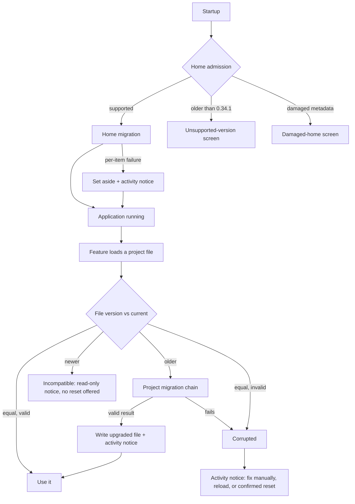

# Migration and configuration resilience

> **Status:** Implemented on branch `feat/migration-config-resilience` (2026-10-30, against root package version 0.37.0), except the follow-ups listed below. No database schema change was made.

## Goal

A small problem must never make the whole application unusable. A broken conversation, a hand-edited project file, or a settings document from a different version should affect only that item. The application keeps running, tells the user what is wrong, and offers a way to fix it.

Hardening must not make upgrades slower or noisier. In the normal case, migrations convert everything silently. The user is involved only when something needs a decision, and only after the application is usable.

## Two migration systems

User-level storage and project-level configuration have different owners, different lifetimes, and different failure modes, so they get separate migration systems that never share a run.

|                     | Home migration                                                                                                                 | Project migration                                                                                                                                     |
| ------------------- | ------------------------------------------------------------------------------------------------------------------------------ | ----------------------------------------------------------------------------------------------------------------------------------------------------- |
| **Scope**           | The Nerve home: database, conversation history, assets, user-level settings in `config/`, and credentials.                     | Files under a project's `.nerve/`: launch definitions, permission overlays, agent profiles, subagents, capabilities, and the other per-project files. |
| **When it runs**    | At startup, once per upgrade, before the workbench opens.                                                                      | Lazily, when a feature loads a file whose schema version is older than the current one.                                                               |
| **Unit**            | Ordered steps recorded in the home manifest ledger ([existing framework](../../architecture/migrations.md)).                   | A version chain per configuration type (v1 → v2 → v3). The file's own `version` field is the only record; there is no central ledger.                 |
| **On item failure** | Set the item aside, report it after startup, continue.                                                                         | Treat the file as corrupted and offer a confirmed reset.                                                                                              |
| **Blocks startup?** | Only for home-level problems: untrusted manifest or ledger, failed database integrity check, or a step that cannot run at all. | Never.                                                                                                                                                |

After both migrations, a **runtime safety net** handles files that become invalid later, mostly through hand edits. It does not convert anything. It validates, reports, and offers fix or reset.

## Principles

1. **Degrade the item, not the application.** An invalid record or file is isolated and reported. Unrelated conversations, projects, and settings keep working.
2. **Migrations own every format change.** Feature loaders contain no conversion code. They accept the current schema only and hand everything else to the project migration framework or the safety net.
3. **Version decides migrate versus corrupt.** An older version is migrated. A current version that fails validation is corrupted, and so is a file whose migration fails. Corrupted files are never repaired heuristically.
4. **Never destroy user data silently.** Reset always needs user confirmation. Originals are preserved in quarantine before any reset or project migration write.
5. **Permissions stay fail-closed.** An invalid permission overlay blocks execution in its scope until it is fixed or reset, and is never replaced with something more permissive.
6. **No compatibility layers for unsupported homes.** Homes older than the 0.34.1 baseline are not converted. The user gets a clear choice instead.

## Documents

| Document                                                              | Contents                                                                                              |
| --------------------------------------------------------------------- | ----------------------------------------------------------------------------------------------------- |
| [Unsupported and damaged homes](./unsupported-homes.md)               | The 0.34.1 baseline, "upgrade through 0.34.1" versus "start fresh, keep providers", admission errors. |
| [Home migration](./home-migration.md)                                 | Startup migration scope, set-aside rule, removal of project handling from steps 0001/0002.            |
| [Project migration and recovery](./project-migration-and-recovery.md) | Lazy per-type migrations, corrupted-file handling, the runtime safety net, reset semantics.           |
| [Conversation isolation](./conversation-isolation.md)                 | Follow-up investigation: one unreadable conversation must not break the application.                  |
| [Evidence](./evidence.md)                                             | Migration rehearsals, the slot-5 blocker, and code findings behind this proposal.                     |

## Decisions recorded

- Home and project migrations are separate systems. Home migration never reads or writes project files.
- Project migrations run lazily, per configuration type, triggered by the file's schema version.
- A file with the current version that fails validation, or a file whose migration fails, is corrupted. It is reset only after user confirmation.
- Project-level notices use the header activity list.
- An invalid project permission overlay is reset by removing it, so the user-level policy applies.
- The archive from "start fresh" is kept until the user deletes it, and its location is shown in settings.
- Broken-conversation isolation stays here as a follow-up investigation.

## Follow-ups

- Conversation isolation: an **Unavailable** list entry with Export raw data / confirmed Delete, a typed missing-asset response, and conversation-level configuration notices ([details](./conversation-isolation.md)). Startup, list, and replay containment are implemented.
- Add a check that every event name the server publishes exists in the public event catalog. A missing registration was only logged as a warning, which hid a live-update bug during QA.

## Implementation order (as delivered)

1. **Small isolated fixes:** isolate failures in permission rule-set listing, and correct the manifest version message ([unsupported homes](./unsupported-homes.md), [project recovery](./project-migration-and-recovery.md#known-gaps)).
2. **Remove project handling from home steps 0001/0002** (both still draft). This also removes the slot-5 blocker. Rerun the slot-5 and slot-6 rehearsals.
3. **Project migration framework**, plus the first chain for launch definitions. Move the launch v1 → v2 conversion out of the repository into that chain, and add a legacy-source step for `tasks/definitions.json`.
4. **Project activity notices** and confirmed reset. Start with launch definitions.
5. **Chains for the remaining types:** permission overlays, agent profiles and subagents, capabilities, scoped agent settings, prompt suggestions. These carry the legacy-file conversions removed from 0001/0002.
6. **Typed admission failures** and the desktop unsupported/damaged screens.
7. **Set-aside rule** across home steps, plus the after-startup activity notice.
8. **Conversation isolation investigation.**

Steps 2 and 5 must ship in the same release. Otherwise projects coming from 0.34.1 or 0.37.0 lose their legacy project configuration between releases.

## Open questions

- Whether the server or the UI owns project-resource health state. Today home health is computed on the server, and project diagnostics are mostly reported per feature.
