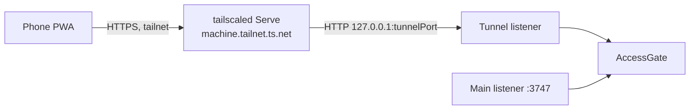

# Mobile workbench: focused scope, private tunnel, push

Status: phases 1 and 2 implemented; phase 3 in progress. Delete this file when implemented (see [docs/README.md](../README.md#where-documentation-belongs)).

## Problem

The phone surface is a port of the desktop. It reaches every desktop area, including the full user settings tree (providers, extensions, accounts, catalog, storage, background jobs…) and per-project settings. Most of that is configuration you don't do from a phone, and it costs layout and maintenance work for every new settings page.

The phone is for quick use away from the desk: checking running conversations, answering an agent, reviewing and shipping changes, restarting a dev server. Three things get in the way:

1. **Scope.** Configuration screens crowd the things that matter on a phone.
2. **Connection.** Reaching the daemon needs the LAN, the local CA installed on the phone and the mobile HTTPS listener. Away from home there is no supported path except running your own reverse proxy (`publicUrl` + `trustProxy`).
3. **Attention.** Notifications are delivered only by an open client ([conversation state and attention](../architecture/conversation-state-and-attention.md): "no delivery while the app is closed"). On a phone the PWA is usually suspended, so "agent needs you" goes unseen.

## Goals

- The phone manages conversations, Git/GitHub and launches as well as the desktop does.
- No complex user- or project-level configuration on the phone.
- Pairing a phone and using it away from home takes minutes, with no CA install and no public exposure by default.
- The phone gets a system notification when a conversation needs input, fails or finishes, even with the PWA closed.

## Non-goals

- A native or wrapped (Capacitor) app. Revisit only if the PWA stays insufficient after these phases.
- Public-internet tunnels (Cloudflare, ngrok, Tailscale Funnel) in this effort. The design keeps room for them (see [Later: public tunnels](#later-public-tunnels)).
- Changes to the desktop layout.

## Phases

| Phase | Outcome                                    | Touches                                   |
| ----- | ------------------------------------------ | ----------------------------------------- |
| 1     | Mobile scope: conversations, Git, launches | `workbench-app` only                      |
| 2     | Built-in Tailscale Serve tunnel            | `workbench-server`, `contracts`, settings |
| 3     | Web Push                                   | `workbench-server`, `contracts`, PWA      |

Each phase ships on its own. Phase 2 makes phase 3 useful away from home: a push can arrive anywhere, but opening it needs a reachable daemon.

## Phase 1: mobile scope

The phone shell lives in [`app/shell/mobile/`](../../packages/workbench-app/src/lib/app/shell/mobile/); its screens are the `MobileRoute` union in [`mobile-routes.ts`](../../packages/workbench-app/src/lib/app/shell/mobile/mobile-routes.ts).

### Keep

| Area          | Mobile surface                                                                                                      |
| ------------- | ------------------------------------------------------------------------------------------------------------------- |
| Conversations | Inbox, Activity, project conversation lists, the conversation screen (Chat, Changes, Files, PR), new chat, branches |
| Agent input   | Approvals, questions, trust prompts raised by a conversation, stop/interrupt, queueing                              |
| Git           | Changes, commit, branches, worktrees as today                                                                       |
| GitHub        | Pull requests: list, open, status/checks, create from a conversation                                                |
| Launches      | List, start/stop/restart, output                                                                                    |
| Files, notes  | Kept as they are (file viewing supports reviewing changes; notes are quick capture)                                 |

### Remove

| Route                                        | Replacement                                    |
| -------------------------------------------- | ---------------------------------------------- |
| `settings`, `settings-page` (all user pages) | A small **Phone settings** screen (below)      |
| `project-settings`, `project-settings-page`  | None. The project home loses its Settings tile |
| `logs`                                       | None                                           |

**Phone settings** is one mobile screen, not the settings registry, containing:

- **This device:** name, sign out (revokes this device's credential).
- **Devices:** the paired-device list with revoke, and **Pair a device** (needed to pair a second phone/tablet while away).
- **Remote access:** tunnel status and URL (phase 2, read-only on the phone; set up on the desktop).
- **Notifications:** enable push for this device, test (phase 3), and the existing sound/notification preferences that apply to a phone.
- **Appearance:** theme.
- **Open full settings on desktop:** a hint.

Anything that routes to a removed screen (a desktop share link, a `center` tab of kind `settings` or `logs`, a settings action inside a transcript) opens a small "Available on desktop" screen instead of failing. `mobileRouteForCenterTab` is the single place that maps those.

Model and agent pickers in the composer stay: choosing a model for a new chat is conversation use, not configuration. Editing the catalog behind them is not.

### Cleanup

Delete the mobile-only code paths for the removed routes, their tests and any mobile-specific settings layouts. Run `pnpm knip` before pushing. Desktop settings components are unaffected.

## Phase 2: Tailscale Serve tunnel

### Why Tailscale Serve first

- **Private.** Only devices on the owner's tailnet can connect. Nothing listens on the public internet.
- **Real certificate.** Serve gets a publicly trusted certificate for `<machine>.<tailnet>.ts.net`, so the phone needs no local CA. This removes the most fragile step of today's setup.
- **Stable origin.** The hostname does not change between daemon restarts, so device cookies (and passkeys, if used) keep working. Random-URL tunnels fail this requirement.
- **No process to run.** `tailscale serve --bg` persists its configuration in `tailscaled`; Nerve configures it and reads its status, it does not supervise a tunnel process.

Requirements on the user's side: Tailscale installed and logged in on the host and the phone, MagicDNS and HTTPS certificates enabled for the tailnet. Nerve detects each and explains what is missing.

### Design: a dedicated tunnel ingress listener

Rather than pointing Serve at the main port and trusting loopback forwarding headers, the daemon opens a **tunnel listener**: a separate loopback-only port used only as the Serve backend.

Requests on the tunnel listener resolve to a fixed client shape in [`resolveClient`](../../packages/workbench-server/src/domains/access/client-info.ts):

- `secure: true` and `origin` = the tunnel origin, including the port when it is not 443 (TLS is terminated by `tailscaled` on the same host).
- `localEligible: false` and never the local principal, even though the TCP peer is loopback.
- `ip` from `X-Forwarded-For`, which Serve sets to the client's tailnet address. Only used for throttling and audit.
- Host allowlist: only the tunnel host and port. Serve passes the original `Host` through unchanged (`X-Forwarded-Host` carries the same value).

Why a separate listener:

- **Header trust is scoped.** Trusting `X-Forwarded-*` from loopback on the main port would let any local process claim to be a forwarded HTTPS client. On the tunnel port that is the definition of the port.
- **No restart dance.** `publicUrl` is a daemon-restart setting that also turns on the owner passkey gate. The tunnel origin is runtime state owned by the tunnel service, so enabling or disabling the tunnel opens or closes the listener without a restart and without changing `publicUrl` semantics for self-hosted reverse proxies.

### Flow

1. **Desktop → Settings → Devices → Remote access → Enable private access (Tailscale).**
2. The daemon checks `tailscale status --json`: CLI present, `BackendState` is `Running`, a MagicDNS name (`Self.DNSName`), HTTPS available (`CertDomains` contains that name; it is empty until Serve is enabled for the tailnet), and permission to change Serve. Each failure maps to one actionable message.
   - **Locating the CLI:** `tailscale` on `PATH`, then the platform's app location (macOS: `/Applications/Tailscale.app/Contents/MacOS/Tailscale`).
   - **Permission (Linux):** `tailscale serve` needs root unless the user is the tailnet operator. The message gives the one-time fix, `sudo tailscale set --operator=$USER`; Nerve never runs `sudo` itself.
   - **Serve not enabled on the tailnet:** `tailscale serve` does not fail; it prints an approval URL (`https://login.tailscale.com/f/serve?node=…`) and blocks until an admin approves. The daemon runs it with a timeout, extracts the URL and shows "Enable Serve on your tailnet" with that link, then retries when the user returns.
3. The daemon opens the tunnel listener, then runs `tailscale serve --bg --https=<port> http://127.0.0.1:<tunnelPort>`. Port 443 is preferred; if 443 is already served for something else, it offers 8443 or 10000 instead of overwriting it.
4. **Certificate warm-up.** The first HTTPS request after enabling waits for certificate issuance (about 35 s observed; later requests take milliseconds). The daemon makes that first request itself and shows "Getting a certificate…" until it succeeds, so the phone's first load is not the slow one.
5. The pairing dialog offers the tunnel URL as a QR target (`https://machine.tailnet.ts.net/#pair=CODE`) next to the LAN addresses, preselected when the tunnel is on. No "first time on this device" CA step is needed for it.
6. **Disable** removes only the Serve entry Nerve created and closes the listener.

On daemon start, an enabled tunnel reopens its listener at the same port (so the persisted Serve entry still matches) and re-checks Serve status; drift (entry removed or pointed elsewhere) shows as a warning in Remote access, not a silent repair.

Drift detection reads `tailscale serve status --json`. Nerve's entry is `TCP["<port>"].HTTPS == true` plus `Web["<host>:<port>"].Handlers["/"].Proxy == "http://127.0.0.1:<tunnelPort>"`; any other value at that port is someone else's, and Funnel enabled for that port is reported as an error (the tunnel must stay private).

### Security

- **Pairing is still required.** Being on the tailnet grants nothing by itself; every device redeems a pairing code and gets its own revocable credential. All existing throttling, revocation and audit apply.
- **The owner passkey gate is not applied** to the private tunnel. It exists for public URLs; tailnet reachability plus per-device pairing is enough here.
- **Tailscale identity headers** (`Tailscale-User-Login`, `Tailscale-User-Name`, sent on HTTP and WebSocket requests) are recorded in the access audit log when present. They are not used for authentication: any local process can connect to the tunnel listener and set them.
- The tunnel is off by default and enabled only from the desktop's Remote access settings (no CLI).

### Storage

- **Tunnel settings** (`enabled`, Serve HTTPS port, tunnel listener port; Tailscale is the only provider, so there is no provider field yet) go in the [scoped configuration](../architecture/configuration.md) under `application.network`, next to `publicUrl`. Unlike the other `network` settings, they apply immediately (restart target `none`): the tunnel service opens or closes its listener and Serve entry on save.
- **Tunnel origin and health** are runtime state, exposed in the status contract.
- No database change.

### Verified on a real tailnet

Checked with Tailscale 1.104.7 (Linux) against a header-echo backend on loopback through `tailscale serve --bg --https=8443`:

- The certificate is publicly trusted (default trust store, no CA install).
- Backend sees a loopback peer; `Host` and `X-Forwarded-Host` are `<machine>.<tailnet>.ts.net:8443`, `X-Forwarded-Proto: https`, `X-Forwarded-For` the client's tailnet IP.
- WebSocket upgrades pass through, with `Origin: https://<host>:8443` preserved; frames echo both ways.
- `serve status --json` has the shape used for drift detection above.
- Unapproved Serve blocks with an approval URL; the first request after enabling waits for the certificate (both handled in the flow above).

### Later: public tunnels

The tunnel listener is provider-agnostic. A public provider (a named Cloudflare Tunnel, Tailscale Funnel) would add a provider adapter and would require the owner passkey gate on that origin. Random-hostname quick tunnels stay out of scope because origins must be stable.

## Phase 3: Web Push

### Delivery

- **VAPID key pair** generated once into `secrets/` (0600, like `devices.json`).
- **Subscriptions** attach to the device record in `secrets/devices.json`: one per device, replaced on re-subscribe, deleted with the device. Revoking a device ends its pushes. No database change.
- The daemon sends encrypted Web Push messages (RFC 8291) directly to the browser vendor's push service, using the [`web-push`](https://www.npmjs.com/package/web-push) package in `workbench-server`. This is outbound only, so it works even when the phone cannot reach the daemon.
- **Payload:** conversation id, project name, conversation title and the reason (needs input / failed / interrupted / finished). No transcript content, tool arguments or file paths.
- The service worker shows the notification, tagged per conversation so updates replace rather than stack, and opens the conversation on tap.

### Server-side attention edges

Push follows the desktop's [attention edges](../architecture/conversation-state-and-attention.md#attention-edges-and-unseen-results) exactly: a push is what the desktop's "away" system notification would have been. Today the edges are detected in the client ([`ConversationAttention`](../../packages/workbench-app/src/lib/application/activity/conversation-attention.ts), [`attention-policy`](../../packages/workbench-app/src/lib/application/notifications/attention-policy.ts)); push needs the daemon to detect the same edges from server-owned conversation summary state.

- **Edges:** the same four as desktop, on root conversations only: new pending input, failure, interruption, and finished (running/waiting/pending work → idle with nothing pending, so a turn ending while sub-agents still work is not "finished"). Sub-agent outcomes do not push.
- **Urgency:** coinciding edges collapse to the most urgent (input > failure/interruption > finished), as on desktop.
- **Baseline:** daemon start and subscription creation establish a quiet baseline; old state is never replayed as pushes.
- **One implementation.** Edge detection and urgency move out of `workbench-app` into a shared, transport-neutral module that both the client controller and the daemon use, so the bell, the inbox, desktop notifications and push cannot disagree. This is an extraction, not a move: `conversation-attention.ts` currently imports client-only code (`attention-delivery.svelte`, `presentation/conversations/conversation-activity`), so the pure edge logic and its inputs must be separated from title formatting and delivery first. Placement follows [codebase architecture](../architecture/codebase.md), with the shared types in `contracts`.
- **Presence (any device):** while any connected client reports "watching" or "elsewhere" (as `classifyPresence` defines them), no device gets a push; you are at a screen, and that client already delivers the toast or notification. Pushes go out only when every client is away or disconnected.
- **Presence and mute reporting:** each client sends its presence and mute state to the daemon on change, over the existing socket. This is a new client-to-daemon message defined in `contracts`; the daemon keeps it in memory per socket and drops it on disconnect.
- **Mute:** when any client reports mute, pushes are suppressed too, matching the desktop's mute behavior.
- **Stop suppression:** a Stop suppresses the following finished/interrupted edge, within the desktop's suppression window.

### Enabling

iOS delivers Web Push only to a home-screen-installed PWA, and every browser requires a user gesture for permission. After pairing, the phone shows a one-time **Enable notifications** prompt. On iOS in a browser tab it shows "Add to Home Screen first" instead. Phone settings → Notifications has the toggle and a test button.

## Decisions

- **Passkey on the private tunnel:** not required. Pairing alone, since the tunnel is reachable only from the tailnet and every device is individually revocable.
- **Files and notes on mobile:** kept as they are.
- **Push events:** identical to desktop attention (input, failure, interruption, finished), not a separate rule set.
- **Tunnel control:** desktop settings only; no `nerve tunnel` CLI.
- **Push across devices:** no push while any device is in active use (the simplest rule; duplicate alerts across devices are acceptable either way).
- **Push mute:** clients report mute to the daemon; desktop mute also silences push.
- **Push library:** `web-push`.

## Testing

- **Phase 1:** update `mobile-routes` tests for removed routes and the "Available on desktop" fallback; QA the phone flows with the [nerve-qa skill](../../.nerve/skills/nerve-qa/SKILL.md).
- **Phase 2:** unit tests for tunnel-listener client resolution (never `localEligible`, fixed origin, host allowlist) and for the Tailscale status parser and error mapping; manual run against a real tailnet.
- **Phase 3:** unit tests for server-side edge derivation (parity with the client rules), suppression and payload contents; manual iOS (installed PWA) and Android Chrome checks.
- Update the [full QA plan](../runbooks/full-qa-plan.md) mobile section and the public [LAN and mobile](../../packages/website/src/content/docs/operations/lan-mobile.md) guide when each phase lands.
