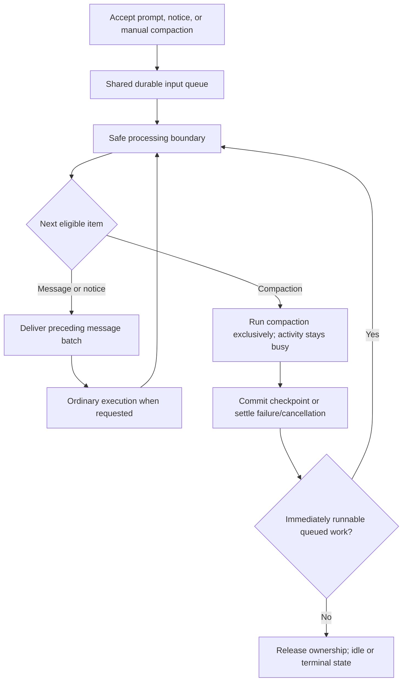

# Queued compaction

> Proposed direction. Investigation and design only; no runtime implementation or database schema change is included in this proposal.

## Goal

Treat manual and automatic compaction as real conversation work, admitted through the same durable input queue as user prompts and system notifications. Accept follow-up prompts while compaction runs, preserve transcript ordering, and report the conversation as running until all immediately runnable work finishes.

Manual compaction alone must not trigger an ordinary agent response. A queued prompt or wake-enabled system notification can trigger that response after manual compaction finishes. Automatic compaction must resume the existing unfinished work through an explicit queued continuation, even when no external input is waiting.

## Current implementation

- Manual compaction requires a quiescent conversation with no unfinished tool calls. It reserves the same scheduler slot as ordinary execution, but does not create an execution-state event.
- Conversation status is derived from execution events and outstanding tool calls. Compaction has a separate operation lifecycle, so the transcript can show compaction running while the sidebar and tab show idle.
- User prompts, including inline `/bash` commands, are rejected while compaction is active rather than accepted into the queue.
- Subagent completion, async bash completion, and launch notifications already enter the durable `input_queue`. They do not directly append their results to the transcript during compaction. Wake-enabled notices can start processing after the scheduler releases the compaction slot, unless the conversation is paused.
- Input delivery occurs at execution-start and turn boundaries and is blocked while tool calls remain outstanding. Delivery appends transcript events and removes queue rows transactionally.
- Automatic threshold/overflow compaction runs inside an existing execution. Inputs arriving during it remain queued until a later turn boundary; they are not delivered between compaction and the resumed model attempt.
- Compaction drafts and operation status are runtime-only. A successful compaction appends a durable checkpoint; failed or cancelled attempts do not.

### Code owners

| Concern                                     | Current owner                                                                           |
| ------------------------------------------- | --------------------------------------------------------------------------------------- |
| Public compaction and input admission       | `packages/conversation-core/src/core.ts`                                                |
| Exclusive scheduler ownership and wake/stop | `packages/conversation-core/src/runtime/scheduler.ts`                                   |
| Execution and compaction processing         | `packages/conversation-core/src/runtime/conversation-runner.ts`                         |
| Queue admission, eligibility, and delivery  | `packages/conversation-core/src/inputs/input-queue.service.ts`                          |
| Durable queue representation                | `packages/conversation-core/src/storage/input-queue.repository.ts`, `storage/schema.ts` |
| Conversation status                         | `packages/conversation-core/src/runtime/status.ts`                                      |
| Compaction operation progress               | `packages/conversation-core/src/runtime/compaction-operations.ts`                       |
| Activity presentation                       | `packages/workbench-app/src/lib/presentation/conversations/conversation-activity.ts`    |
| Existing lifecycle coverage                 | `packages/conversation-core/src/runtime/compaction-lifecycle.test.ts`                   |

## Agreed behavior

1. Manual and automatic compaction requests use the **same durable input queue** as prompts and system notifications, not a separate compaction queue.
2. A compaction request is a **typed operation**, not a fake user message, system notice, or model tool call.
3. Manual compaction counts as running conversation work. Active/stopping compaction must never appear idle.
4. User follow-ups are accepted into the queue while compaction runs. They do not modify the transcript being compacted.
5. When compaction completes, a queued prompt is delivered and starts ordinary agent processing automatically, subject to explicit pause/stop policy.
6. If no queued work requests a response, successful manual compaction returns the conversation to idle without an ordinary model turn.
7. Handoff from compaction to an immediately runnable queued prompt must not publish an intermediate idle state.
8. Automatic compaction also uses the shared queue, but preserves the current execution's obligation to continue. It must run before retrying a request that requires compaction, rather than waiting behind work that needs that same context capacity.
9. After successful automatic compaction, enqueue a linked, synthetic user-role continuation input even if no follow-up prompt or system notice is waiting. This resumes unfinished work; it is not attributed to the human user and must not create a second execution or a duplicate response.

## Processing model

Example queue:

```text
1. User prompt A
2. Manual compaction request
3. Subagent completion notice
4. User prompt B
```

Process prompt A normally. At the next safe input boundary, consume the compaction request and run compaction exclusively. Only after it settles may the later notice and prompt B enter the transcript and drive subsequent processing.



The diagram describes scheduling, not a requirement to make a separate model request for every queued message. Existing message batching can remain, but must stop at an eligible compaction boundary.

### Admission and boundaries

- Accept a manual compaction request while ordinary execution or tools are running; wait for the next safe boundary. Do not interrupt a provider request or split an assistant/tool-result span to compact.
- Deliver preceding eligible messages before the checkpoint is computed. They are part of the context considered by compaction, although the retention policy may keep them unsummarized.
- Do not deliver later items past the compaction boundary. Preserve command-preparation blocking and existing delivery-target semantics; this is not a blanket replacement of eligibility rules with unconditional FIFO.
- Keep one owner of transcript processing per conversation. Queue acceptance is allowed concurrently; transcript delivery, head changes, and compaction commit must remain fenced.
- Keep head selection blocked during active compaction. Pending operations must have a defined relationship to branch selection before implementation is complete.
- Repeated transport submissions with the same request ID must be idempotent. Distinct requests must not accidentally execute in parallel.

### Automatic compaction and continuation

Both threshold and context-overflow triggers submit a typed compaction operation to the same queue. Unlike a manually requested operation waiting for a future safe boundary, automatic compaction is a prerequisite for the current model attempt. Dispatch it at the current safe boundary before retrying that attempt. Queue acceptance sequence still records arrival order; eligibility and prerequisite ordering must explicitly support this case without draining unrelated later messages ahead of it.

On successful automatic compaction, atomically settle the operation and persist one linked continuation input in the same queue. The continuation is system-authored but delivered with a user-role model representation, for example: “Continue the unfinished work using the compacted context.” It must not pretend to be a new human prompt. Reuse an appropriate typed input representation rather than overloading human source attribution.

Process that continuation within the existing execution, even if the queue otherwise has no prompts or notifications. Preserve any real follow-ups and notices and their delivery policies; batch eligible inputs when safe, but do not let a synthetic continuation bypass cancellation, a newer replacement prompt, or an explicit pause. Do not both resume the old attempt independently and schedule a second response from the continuation: it represents one continuation obligation.

Use stable linkage to the originating compaction and execution so retry/recovery cannot enqueue the continuation twice. Automatic-compaction failure or cancellation must not enqueue a successful-compaction continuation. The precise prerequisite-dispatch and durable continuation representation are detailed-design requirements, not permission to introduce a second queue.

**Current behavior differs:** `conversation-runner.ts` directly awaits automatic compaction and retries the same logical turn. `context/context-projection.ts` projects the checkpoint through `createCompactionSummaryMessage`, and `packages/harness/src/messages/messages.ts` converts that summary to a user-role model message. There is no separate queued “continue working” prompt in this path today. The proposal replaces the implicit control-flow continuation with an explicit queued continuation while retaining the same unfinished execution.

### Transcript and tool semantics

Accepting a compaction request does not append it as a user message. The successful result remains a dedicated `compaction` checkpoint event with a safe retained-history boundary.

Do not route compaction through ordinary model tool-call handling. It does not need a fabricated assistant proposal, approval interaction, or tool response. Reuse scheduler ownership, queue admission, cancellation, and operation tracking instead.

Inline user commands currently bypass normal prompt delivery. Audit their admission explicitly: commands accepted during compaction must wait behind its boundary rather than append tool results concurrently. Preserve their command semantics rather than turning them into ordinary model prompts.

### Activity and lifecycle

Activity must account for active compaction and queued-work handoff, not only open model executions and tool rows. Preserve the separate compaction progress lifecycle for streaming previews, stopping, and terminal outcomes.

Do not fix the status mismatch by blindly emitting ordinary execution-completion events for standalone compaction. Subagent assignment reporting listens to those events; compaction must not generate a false assignment-completed notice or final agent response.

Use the same activity meaning across sidebar, tabs, transcript, and controls, including conversations without an open transcript. Local transcript-only state is insufficient for global activity indicators.

### Completion and continuation

After a successful standalone compaction:

| Remaining work                                | Outcome                                                                        |
| --------------------------------------------- | ------------------------------------------------------------------------------ |
| None                                          | Return to idle; no ordinary agent response                                     |
| Eligible user prompt                          | Deliver and start ordinary execution without an idle gap                       |
| Eligible wake-enabled system notice           | Resume processing under the existing notice wake policy                        |
| Only non-waking or currently ineligible input | Retain it; do not invent a response or override delivery targets               |
| Explicitly paused conversation                | Retain queued input until existing resume/new-prompt policy permits processing |

A compaction request encountered between turns of an existing execution must not by itself terminate that execution or manufacture an extra response. After compaction, continue according to the execution's existing continuation rules.

## Persistence and recovery

Use the existing queue as the durable admission authority. Shared queue/operation contracts belong in `packages/contracts`; scheduling and processing belong in `packages/conversation-core`. Transport lifecycle remains transport-neutral in `packages/protocol`.

**No table or column change is approved by this proposal.** First evaluate a typed operation representation using the existing JSON content and queue metadata. Do not disguise an operation as a textual system notice merely to bypass existing contracts. If existing storage cannot represent this cleanly, discuss alternatives and obtain explicit approval before planning schema or migration changes.

Queue removal, operation ownership, and checkpoint commit need a durable recovery design. Deleting the request before computation without a durable claim would lose it on restart; keeping it without commit deduplication could execute it twice. Streaming drafts can remain transient, but accepted requests must not silently disappear.

### Decisions to settle during detailed design

- **Recovery:** How to distinguish pending, interrupted, and already-committed compaction requests using existing storage. Prefer stable request/checkpoint identity and atomic settlement; define whether interrupted work retries automatically or requires explicit action.
- **Cancellation:** How queued compaction cancellation differs from stopping active work. Stop must preserve queued follow-ups unless explicitly cancelled, respect the pause gate, and prevent the scheduler from immediately restarting cancelled work.
- **Failure:** Whether a failed compaction blocks later work or releases it with a visible failure. Preserve later prompts; never silently retry forever or silently discard the request.
- **Duplicate requests:** Whether distinct pending manual requests are coalesced or processed separately. In either case, define the response when no safe advancing compaction boundary remains.
- **Delivery targets and branches:** Define eligible-operation ordering alongside `next_turn`, `specific_execution`, and `next_execution`, including automatic-compaction prerequisite dispatch and linked continuations; define pending requests when the user selects another transcript head.
- **API acknowledgement:** Separate durable acceptance from eventual completion. A long-running request must remain observable after reconnect without resubmitting duplicate work.

## Implementation outline

1. Specify typed queue items, operation identity, boundary selection, acknowledgement, and recovery semantics. Resolve the decisions above before storage changes.
2. Extend queue admission and dispatch so messages can batch up to, but never across, an eligible compaction operation.
3. Execute manual and automatic compaction under exclusive scheduler ownership. Route automatic triggers through the shared queue with prerequisite dispatch, preserve safe tool-span retention, and persist a linked continuation on automatic success.
4. Accept follow-up prompts during compaction and implement continuation without an idle gap. Audit inline commands and all transcript mutation entry points.
5. Align shared activity projection and UI controls with compaction and handoff; preserve assignment-completion semantics.
6. Add focused unit coverage at each owning layer and review cancellation/recovery behavior before rollout.

## Acceptance criteria and validation

- Manual compaction shows busy in sidebar and tab as well as the transcript, including stopping state.
- Standalone manual compaction alone commits one checkpoint and returns idle without making an ordinary agent-response request.
- A follow-up accepted during compaction remains queued until settlement, is delivered once, and starts ordinary execution automatically without an intermediate idle projection.
- Subagent, async bash, and launch notices arriving during compaction stay queued; wake-enabled notices are processed afterward under the existing pause policy.
- Queue batching cannot drain later messages across a compaction boundary. Preparation blocking and execution-target eligibility remain correct.
- Compaction requested during a model/tool turn waits for a safe boundary and does not split assistant/result spans.
- Inline commands accepted during compaction cannot execute through the fence.
- Stop/cancel fences late provider chunks, preserves unrelated queued prompts, and does not restart work against the pause gate.
- Failure and restart preserve accepted work according to the selected policy; retry/reconnect cannot duplicate checkpoint commit.
- Standalone child compaction does not emit a false assignment-completed notification.
- Threshold/overflow compaction enters the same queue and dispatches as a prerequisite of its current model attempt, without deadlocking behind work requiring context capacity.
- Successful automatic compaction creates exactly one linked synthetic user-role continuation input, even when no external inputs are queued; processing resumes in the existing execution.
- Checkpoint commit and automatic continuation persistence cannot leave a crash window that loses unfinished work or duplicates continuation. Failure/cancellation creates no success continuation.
- Real follow-ups, replacement prompts, pause, and stop retain their intended precedence; the synthetic continuation does not force a second response.

Implementation validation should run unit tests only for touched behavior, followed by `pnpm fix:focused && pnpm check:focused`. Integration/browser suites are not part of this proposal's validation unless explicitly requested.

## Non-goals

- Changing the summarization prompt, summary format, or retention algorithm.
- Representing compaction as an ordinary tool call in the transcript.
- Automatically resuming every idle conversation after compaction.
- Introducing a second queue or pre-approving a database schema expansion.
