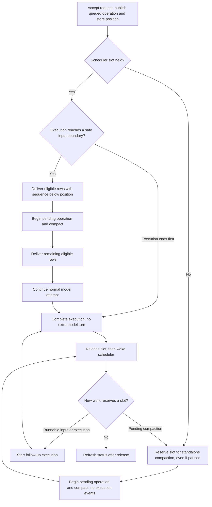

# Queued compaction

## Goal

Accept manual compaction at any time and run it at the next safe input boundary, with strict ordering around the checkpoint. Prompts accepted before the request go before the checkpoint; prompts accepted afterwards wait behind it, subject to existing delivery eligibility rules.

A pending request is visible and cancelable. Prompts remain accepted during compaction. The conversation stays running while its scheduler slot is held, including handoff to follow-up work, without an idle flash. Manual compaction alone never triggers an agent response.

## Current implementation

The baseline being changed has these mechanics:

- `ConversationCore.compact` requires a quiescent conversation (no execution, tool rows, or active compaction) and awaits `ConversationScheduler.compact` to completion.
- The scheduler reserves the same slot used for execution, but standalone compaction emits no `execution_state` events. `StatusService.refresh` derives status from execution events and tool rows, not slot ownership, so standalone compaction can appear idle in the sidebar and tabs.
- Slot cleanup releases ownership and calls `wake()` to launch follow-up work separately. Execution completion can publish idle before that handoff.
- `submitInput` rejects prompts and inline commands during active compaction. System notices already enter `input_queue` and wait for delivery.
- Queue delivery uses acceptance order, delivery targets, and command-preparation blocking, and refuses delivery while tool rows remain open.
- Threshold and overflow compaction run inline before a model attempt. The retry reuses the logical turn, and the retained tail already contains the pending user message or tool result: no continuation prompt is needed.
- `CompactionOperations` is runtime-only. Success appends a durable `compaction` event with `id = operation.id` and `inputId = null`; failure and cancellation leave no durable event.

The approved design changes admission, boundary delivery, and status timing without changing the queue's content contract or storage schema.

## Code owners

| Concern                                                  | Owner                                                                                                                                                    |
| -------------------------------------------------------- | -------------------------------------------------------------------------------------------------------------------------------------------------------- |
| Operation status and RPC contracts                       | `packages/contracts/src/domains/core/{compaction-operation,core-operations}.ts`                                                                          |
| Public admission and status wiring                       | `packages/conversation-core/src/core.ts`                                                                                                                 |
| Quiescence and head selection                            | `packages/conversation-core/src/conversations/conversation.service.ts`                                                                                   |
| Slot ownership, wake, pause, stop, and request admission | `packages/conversation-core/src/runtime/scheduler.ts`                                                                                                    |
| Boundary delivery and compaction execution               | `packages/conversation-core/src/runtime/conversation-runner.ts`                                                                                          |
| Queue eligibility and bounded delivery                   | `packages/conversation-core/src/inputs/input-queue.service.ts`                                                                                           |
| Persisted conversation status                            | `packages/conversation-core/src/runtime/status.ts`                                                                                                       |
| Pending operation and private queue position             | `packages/conversation-core/src/runtime/compaction-operations.ts`                                                                                        |
| Transport handlers                                       | `packages/workbench-server/src/adapters/protocol/conversation-channel.ts`                                                                                |
| Transcript notice projection and rendering               | `packages/workbench-app/src/lib/presentation/state/{transcript-types,transcript}.ts`, `presentation/transcript/notice/CompactionNoticeCard.svelte`       |
| UI request/cancel actions                                | `packages/workbench-app/src/lib/features/conversations/state/core-conversation-store.svelte.ts`, `app/composition/centers/ConversationCenterHost.svelte` |

## Decisions

| Topic                              | Decision                                                                                                                                                                                                                                                                   |
| ---------------------------------- | -------------------------------------------------------------------------------------------------------------------------------------------------------------------------------------------------------------------------------------------------------------------------- |
| Representation                     | Runtime-only pending request: `CompactionOperation.status = "queued"` plus a private stored queue position in `CompactionOperations`. No `input_queue` row, DB change, or new queue content type.                                                                          |
| Queue position                     | Capture `afterInputSequence = conversation.nextInputSequence` at request time. Rows with `acceptanceSequence < afterInputSequence` go before the checkpoint; all other rows go after it.                                                                                   |
| Boundary                           | Execution start, or a turn boundary with no open tool rows. When idle, run immediately as standalone compaction.                                                                                                                                                           |
| Held rows                          | Paused inputs, unfinished command preparation, and different target executions retain their existing rules. Ordering applies only to rows eligible at that boundary.                                                                                                       |
| Paused conversation                | The pending request still runs. The conversation remains paused and queued prompts remain held.                                                                                                                                                                            |
| End of execution                   | A pending request never keeps an execution alive. Complete the execution, then run standalone compaction without another model turn.                                                                                                                                       |
| Duplicates                         | A request while an operation is queued, running, or stopping does nothing.                                                                                                                                                                                                 |
| Automatic compaction               | Remains inline. Threshold or overflow compaction takes over an existing queued manual operation, producing one operation/checkpoint. After manual boundary compaction, skip the threshold check for the same model until a provider attempt, as with automatic compaction. |
| Failure                            | Settle as `failed` using the existing transient notice. Inside an execution, non-abort failure does not fail the execution: delivery and the model attempt continue. No durable failure event.                                                                             |
| Cancel                             | `conversation.cancelCompaction` cancels only queued requests. Running compaction uses existing Stop. Stop and force-push also cancel queued requests before aborting, preventing the pause exemption from restarting work.                                                 |
| Restart                            | Pending requests are lost; this is accepted.                                                                                                                                                                                                                               |
| `conversation.compact`             | Returns on acceptance, not completion. Params and the `null` result shape stay unchanged.                                                                                                                                                                                  |
| Status                             | A held scheduler slot counts as `running`. After releasing a slot, attempt to start follow-up work before refreshing status; publish no idle state between compaction and execution or between consecutive executions. `waiting` retains priority.                         |
| Inline commands and head selection | Inline commands remain rejected during active compaction. Head selection remains blocked during active compaction; a queued request compacts whichever head is current when it runs.                                                                                       |

## Processing model

Admission creates and publishes a queued manual operation, stores its queue position privately, and wakes the scheduler. While queued, `startedAt` is the request time; beginning compaction resets it to the actual start time. Beginning, cancellation, settlement, and deletion clear the stored position as applicable. The operation ID becomes the checkpoint event ID on success.

### Boundary delivery

At execution start and at each safe turn boundary, the runner checks for a pending request. Without one, delivery is unchanged. With one, it delivers eligible rows using `beforeSequence = afterInputSequence`, compacts, then delivers the remaining eligible rows. A non-abort compaction failure still releases later delivery and the normal model attempt.

The limit changes neither delivery targets nor preparation blocking. Ineligible or held rows are not forced into the checkpoint. `hasDeliverable` still counts only message rows; the end-of-execution check remains `!calls.length && !hasDeliverable(turn)`. A request arriving during the final turn therefore runs standalone after completion rather than causing an extra response.

### Standalone work and activity

The scheduler checks pending compaction after its enabled, ownership, conversation-existence, and open-tool-row checks, but before pause and wake-input gates. With no slot held, pending compaction takes precedence over starting or resuming an execution. Standalone compaction emits no execution-state events and does not deliver queued messages itself; follow-up delivery belongs to the next execution.

`StatusService` receives a scheduler `processing(id)` callback. Open executions, tool rows, or a held slot count as running, with waiting tool rows taking priority. Failed/interrupted status applies only when none of those running conditions holds. Slot reservation refreshes status; cleanup deletes the slot, wakes unless stopping, and refreshes only if no replacement slot was reserved. This is a release-and-reacquire handoff, not a new unified runner loop. Synchronous execution-finished listeners can still observe running while cleanup holds the slot.

Prompts and notices accepted during compaction wait in the existing queue and are delivered once afterwards. The workbench renders a tail notice, “Compaction pending,” with a cancel action invoking `conversation.cancelCompaction`; running compaction retains Stop. Sidebar and tabs continue reading persisted conversation status.

## Acceptance criteria

- An idle request returns on acceptance, commits one checkpoint, makes no agent-response request, reports running while holding the slot, and then returns to idle.
- At a safe boundary, eligible prompt A accepted before the request appears before the checkpoint, and prompt B accepted after it appears afterwards, before the normal model attempt. No assistant/tool-result span is split.
- A request during the last turn does not extend execution; standalone compaction follows without another model turn or child assignment-completed notification.
- Prompts submitted during compaction are accepted and delivered once after it. Wake-enabled notices also wait until after the checkpoint. Handoff to follow-up execution publishes no intermediate idle status.
- Existing delivery targets and command-preparation blocking remain correct. Held rows are not forced across eligibility gates to satisfy ordering.
- Pending compaction runs while paused without unpausing or delivering held prompts.
- Cancel removes a queued request only. Stop cancels running compaction and any queued request; force-push also cancels queued requests. Neither leaves a pending request able to restart stopped work.
- Duplicate requests coalesce while queued, running, or stopping. Automatic compaction can take over the queued operation without a second checkpoint.
- Boundary compaction failure produces the existing transient failed notice and lets execution continue. Standalone failure settles without an unhandled rejection; aborts retain cancellation behavior.
- Inline commands remain rejected during active compaction. Head selection rules remain unchanged.
- Restart loses pending requests and transient failures; successful checkpoints remain durable.

## Trade-offs

- **Lost on restart:** neither the pending request nor its queue position is persisted. Automatic compaction still protects context capacity; durable manual-request recovery is intentionally omitted.
- **Transient failure:** failures remain runtime notices, not transcript events. This avoids new event types and recovery/deduplication mechanics but loses failure history on restart.
- **Eligibility-scoped ordering:** acceptance position is strict for eligible rows, not a promise to deliver paused, unprepared, or differently targeted rows early.
- **Broader status timing:** all executions now remain running until slot cleanup and handoff finish. Consumers must not assume an execution-finished callback already implies idle.

## Alternatives considered

The earlier proposal represented compaction as a typed `input_queue` row. It was rejected because compaction is a long, fallible operation, not a deliverable message. A row would force queue-contract, eligibility, deduplication, pause, and stop special cases, plus durable recovery/failure semantics. A runtime operation with a stored queue position supplies the required ordering without changing queue content or storage.

## Non-goals

- Changing summarization prompts, summary format, retention, or checkpoint persistence.
- Persisting manual requests, queue positions, or failure notices, or retrying them after restart.
- Queuing automatic compaction, inline commands, or synthetic continuation prompts.
- Representing compaction as a message, notice, tool call, or queue row.
- Adding database tables, columns, migrations, or new queue content types.
