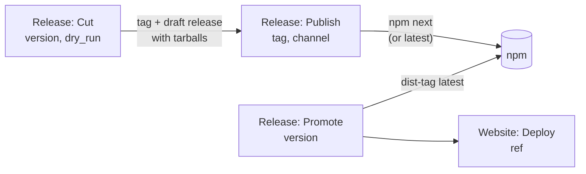

# Release channels

**Status:** Draft · **Area:** release

Every release goes to a **staging** channel first. A maintainer later **promotes** a staging version to **stable** once it has had time to show bugs. Releases are cut, tested, published and promoted by GitHub workflows, and nothing is tagged until it has passed the full test suite.

```text
Stable    0.41.0 ───────────────────────────────────────▶ 0.42.3
                 ╲                                          ▲
Staging           0.42.0 ──▶ 0.42.1 ──▶ 0.42.3 ─────────────┘ promote
```

Current procedure: [release runbook](../../runbooks/release.md), [`release.yml`](../../../.github/workflows/release.yml), [`tag-release.ts`](../../../scripts/release/tag-release.ts).

## Problem

- **Every release reaches every user at once.** A tag publishes to npm `latest`, so `npx @nervekit/desktop@latest` picks it up straight away. There is no period in which early users can find bugs before everyone else gets them.
- **Tags come before tests.** `pnpm release:tag` pushes the bump commit and the tag together. The release workflow then waits for CI and runs the package smokes. If those fail, the tag already exists and the version number is used up.
- **Releasing needs a local machine.** It needs a clean `main`, a signing key and the script, and the push is irreversible.
- **The extension packages are published by hand** after the release, outside the tested pipeline.
- **The website is deployed with every tag.** The docs therefore describe whatever was tagged last, not what `@latest` installs.

## Decisions

Settled with the project owner.

| Topic              | Decision                                                                                                                                                                                                                                   |
| ------------------ | ------------------------------------------------------------------------------------------------------------------------------------------------------------------------------------------------------------------------------------------ |
| Version numbers    | Plain SemVer for every release (`0.42.1`). No `-rc`/`-beta` suffixes. A staging version becomes stable unchanged.                                                                                                                          |
| Channels           | Two npm dist-tags: `latest` (stable) and `next` (staging). `next` is the npm convention and is already used by `release.yml`.                                                                                                              |
| Promotion          | Moves the `latest` dist-tag to an already published version. Nothing is rebuilt, so stable users run the exact bytes staging users tested. There is no minimum time on staging; a version can be published straight to stable when needed. |
| Test before tag    | The bump commit is tested in full (CI and release smokes on Linux, Windows and macOS) before `main` moves and before the tag exists.                                                                                                       |
| Build once         | The tarballs built and tested at cut time are the ones published. Publishing does not rebuild.                                                                                                                                             |
| Branching          | Trunk-based. Every release is cut from `main`. Stable fixes go forward through `main` as a new staging version and are promoted. There are no maintenance branches.                                                                        |
| Tag creation       | Tags are created only by the Cut workflow. A tag ruleset blocks pushing `v*` tags by hand. The local `pnpm release:tag` is removed.                                                                                                        |
| Extension packages | `@nervekit/extension-api`, `@nervekit/ui-kit` and `@nervekit/extension-sdk` are built and tested by Cut, published by Publish and promoted by Promote, on the same channels as the desktop. They are no longer published by hand.          |
| Version meaning    | Minor versions bring features and improvements; patch versions bring bug fixes.                                                                                                                                                            |
| Website            | Deployed by its own workflow, separate from publishing.                                                                                                                                                                                    |

## Workflows



| File                  | Name             | Trigger                                                         | Does                                                                                                      |
| --------------------- | ---------------- | --------------------------------------------------------------- | --------------------------------------------------------------------------------------------------------- |
| `release-cut.yml`     | Release: Cut     | manual: `version`, `dry_run`                                    | Bump commit, full tests, packaging, then fast-forward `main`, tag, draft GitHub release                   |
| `release-publish.yml` | Release: Publish | manual, run from a tag: `channel` (`staging` default, `stable`) | Publishes the draft release's tarballs to npm and publishes the GitHub release                            |
| `release-promote.yml` | Release: Promote | manual: `version`                                               | Moves `latest` to `version` for all ten packages, marks the GitHub release as latest, deploys the website |
| `website-deploy.yml`  | Website: Deploy  | manual: `ref`; called by Promote                                | Builds the website from `ref` and deploys GitHub Pages                                                    |
| `ci.yml`              | CI               | pull requests, `main` pushes, **called by Cut**                 | Unchanged jobs; checks out the ref it is given                                                            |

`release.yml` is removed. Its release-specific jobs (native prebuilds, package build and smokes) move into `release-cut.yml`, and its `require-ci` polling job is no longer needed.

### Release: Cut

1. **Prepare** (Ubuntu). Read `main` HEAD as the base. Check that `version` is canonical SemVer, is greater than the current version, and that tag `v<version>` does not exist. Run the bump (the logic that `tag-release.ts` has today, moved to `scripts/release/prepare-release.ts`): workspace manifests, `Cargo.toml`/`Cargo.lock`, Discover news stamping, draft migration release, `pnpm migrations:check`.
2. **Commit.** Create branch `release/v<version>` at the base. Commit the changed files to it with the GraphQL `createCommitOnBranch` mutation. GitHub signs commits it creates through the API, which satisfies the `main` ruleset's signature rule without a signing key in CI.
3. **Test** the release commit, in parallel:
   - `ci.yml` through `workflow_call` with `ref` set to the commit. Called from a non-pull-request event, its impact step already selects full coverage.
   - Native prebuilds for the six targets, then build, smoke and pack on Ubuntu, and the package smokes on Windows and macOS (today's `release.yml` jobs).
   - The extension packages: `pnpm pack` for `extension-api`, `ui-kit` and `extension-sdk` (which rewrites `workspace:*` to the exact version), then the SDK end-to-end test (`pnpm --filter @nervekit/extension-sdk e2e`) against those tarballs.
4. **Finalize**, only if everything passed and `dry_run` is false:
   - Fast-forward `main` to the release commit (`PATCH refs/heads/main`, `force: false`). If `main` moved during the run, this fails. Rerun the workflow; the tag must always point at the commit that was tested.
   - Create the annotated tag `v<version>`, using the release app's token (see [Tag protection](#tag-protection)).
   - Create a **draft** GitHub release for the tag. Attach the ten tarballs (seven desktop, three extension) and a `SHA256SUMS` file.
5. **Clean up.** Delete `release/v<version>` whether the run passed, failed or was a dry run.

Everything except creating the tag works with `GITHUB_TOKEN`. Its pushes do not start other workflows, and nothing here needs them to: CI is called directly, and publishing is a separate manual step. The cost is that the fast-forwarded `main` commit gets no `push` CI run of its own. It has already passed the same jobs.

### Tag protection

A tag ruleset on `refs/tags/v*` restricts creation, update and deletion. Its only bypass actor is a small GitHub App owned by the maintainer (`nerve-release`, contents write on this repository). Repository admins are not on the bypass list, so the maintainer cannot push a release tag by hand either.

`GITHUB_TOKEN` cannot be added to a ruleset's bypass list, which is why the tag needs the app. Cut's finalize job gets an installation token with `actions/create-github-app-token`. The app ID and private key live in a `release` environment that only `release-cut.yml` uses. The app creates only the tag; the commit and the `main` fast-forward keep using `GITHUB_TOKEN`.

Publish still checks for the Cut-made draft release, as a second guard.

### Release: Publish

Run from the tag (the GitHub "Use workflow from" selector).

1. Refuse unless the ref is a `v*` tag with a draft GitHub release holding ten tarballs and a `SHA256SUMS` that match.
2. Check that each tarball's name and version match the tag.
3. `npm publish --provenance --access public --tag <next|latest>` in dependency order: the six platform packages, then `@nervekit/desktop`, then `extension-api` and `ui-kit`, then `extension-sdk` (it depends on both at the exact version). Versions already published are skipped, so a partial failure can be rerun.
4. Publish the GitHub release: marked as a pre-release for `staging`, and as the latest release for `stable`.

`channel: stable` skips staging. Use it when a release should not wait, such as an urgent fix. Normal releases go to `staging`.

### Release: Promote

1. Check that `version` is published for all ten packages and is greater than the current `latest`. A `rollback` input allows moving `latest` back to an older version deliberately. There is no minimum time on staging.
2. `npm dist-tag add <pkg>@<version> latest` for the ten packages, in the same order as Publish.
3. Edit the GitHub release: not a pre-release, marked latest. Regenerate its notes from the previous **stable** tag, so stable notes cover every staging version they include.
4. Call `website-deploy.yml` with `ref: v<version>`.

`next` is left in place; it keeps pointing at the newest staging version.

### npm trusted publishing

Trusted publishers are bound to a workflow filename. Each of the ten packages needs these configurations on npmjs.com (updated for the seven desktop packages, new for the three extension packages):

- `release-publish.yml` with **npm publish** allowed.
- `release-promote.yml` with **npm dist-tag** allowed only. OIDC dist-tag operations need npm CLI 11.21.0 or later ([npm docs](https://docs.npmjs.com/trusted-publishers#managing-dist-tags-with-trusted-publishing)).

No npm token is stored.

## Consequences

### Installing

| Who                | Command                                    |
| ------------------ | ------------------------------------------ |
| Everyone           | `npx @nervekit/desktop@latest` (unchanged) |
| Staging users      | `npx @nervekit/desktop@next`               |
| A specific version | `npx @nervekit/desktop@0.42.1`             |

`npm view @nervekit/desktop dist-tags` shows what each channel points at. Because staging versions are plain SemVer, a range such as `^0.42.0` matches them. That does not affect `npx` users, who install by tag. It matters for the extension packages (below).

### Storage migrations

Each staging version is a real release: Cut marks draft migration steps released, as `tag-release.ts` does today. The rule "all unreleased data changes since the latest release belong in one migration step" then applies per staging version. A bug in a step that staging users have already applied is fixed by a new step.

Promotion is safe: stable users moving from `0.41.0` to `0.42.3` apply the same steps in the same order as staging users did.

**Going back from staging is not supported.** A home that a staging version migrated cannot be opened by an older stable version: the ledger rejects applied step IDs it does not know ([`ledger.ts`](../../../packages/workbench-server/src/infrastructure/migrations/framework/ledger.ts)). The staging install docs must say so and recommend a separate `NERVE_HOME` for trying staging next to stable.

### Discover news

Announcements are stamped with the staging version they shipped in. [`policy.ts`](../../../packages/workbench-app/src/lib/app/discover/policy.ts) groups them by release line (`major.minor`), which matches the version meaning: features land in a minor version, so its announcements are stamped `0.42.0`, and patch versions add fixes. A stable user who jumps from `0.41.0` to `0.42.3` sees the `0.42` line as a whole. Confirm this with a policy test during implementation.

### Fixes while staging is ahead

If stable is `0.41.0`, staging is `0.42.1` and stable has an urgent bug, fix it on `main`, cut `0.42.2`, and promote it (or publish it with `channel: stable`). There is no `0.41.1`: a maintenance branch would need its own migration ordering and is not worth it at this release pace. If `main` contains work that is not ready, finish or revert it first.

### Extension packages

`@nervekit/extension-api`, `ui-kit` and `extension-sdk` carry Nerve's version, because the version tracks extension compatibility. An extension built against a staging SDK may need a host that stable users do not have yet. Following the desktop's channels keeps them aligned: installing the SDK without a tag gets the stable SDK, which matches the stable host. Authors who target staging install `@nervekit/extension-sdk@next`.

A caret range such as `^0.42.0` in an extension's `package.json` can resolve to a staging-only patch version. That is acceptable: patch versions are bug fixes and do not change the extension contract.

## Documentation changes

- [Release runbook](../../runbooks/release.md): rewritten around Cut, Publish, Promote and Deploy, including the one-time setup (the `nerve-release` app, the `release` environment, the tag ruleset, the trusted publishers). The manual extension-publish section is removed. The local commands remain for validating a release, not for tagging.
- [`packages/extension-sdk/UPGRADING.md`](../../../packages/extension-sdk/UPGRADING.md) and the extension developer docs: mention `@next` for staging hosts.
- [`scripts/README.md`](../../../scripts/README.md): `release:tag` removed, `prepare-release.ts` added.
- Website: a short "Staging channel" section in [install](../../../packages/website/src/content/docs/start/install.md), with the one-way migration warning.
- `AGENTS.md`: "the root `package.json` version is the latest release" still holds; every staging version counts as a release.

## Implementation order

1. Move the bump logic from `tag-release.ts` to `prepare-release.ts` and cover it with the existing release tests.
2. Make `ci.yml` callable with a `ref` input and pass it to every checkout.
3. Add `release-cut.yml` and test it with `dry_run` on a branch.
4. Create the `nerve-release` app, the `release` environment and the `v*` tag ruleset.
5. Add `release-publish.yml`, `release-promote.yml` and `website-deploy.yml`. Configure the trusted publishers for all ten packages on npmjs.com before the first publish.
6. Remove `release.yml`, `tag-release.ts` and the `release:tag` script. Update the documentation.
7. First release through the new path: cut to staging, publish, promote.
