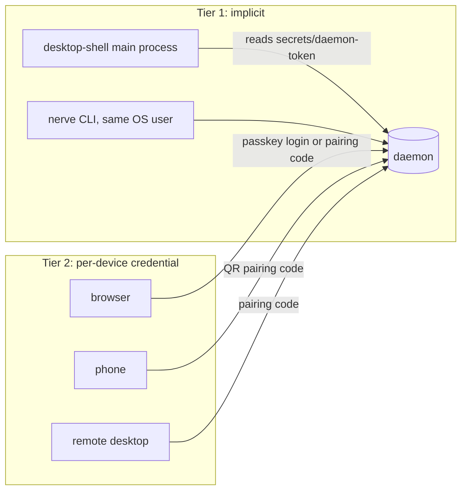

# Remote access authentication: per-device credentials, pairing and owner login

> **Status:** Proposal. Covers `packages/contracts` (new `access` domain), `packages/workbench-server` (auth enforcement, device store, pairing, passkeys), `packages/desktop-shell` (zero-friction local path, remote connections, share/mobile URLs) and `packages/workbench-app` (pairing, login and device UI). Supersedes the "bootstrap code" sketch in `backend-hardening-and-structure.md` item (c), which becomes phase 0 here. **No DB schema change** is proposed (see "Storage").

Nerve will be hostable on a server and opened from browsers. The daemon exposes shell/tool execution and file access, so whoever authenticates owns the machine. Scope: **one owner** (self-hosting), no users, roles or sharing.

---

## Problem

### Current model (evidence)

One secret, `nt_<32 random bytes>`, lives at `secrets/daemon-token` (`workbench-server/src/infrastructure/storage-bootstrap/local-token.ts:21-61`, created 0600, path in `storage-bootstrap/paths.ts:71`). It is the only credential; everything else derives from it:

| Surface                 | How the token is used                                                                                                                                                                                                                                                                                                                                                                                  |
| ----------------------- | ------------------------------------------------------------------------------------------------------------------------------------------------------------------------------------------------------------------------------------------------------------------------------------------------------------------------------------------------------------------------------------------------------ |
| HTTP API                | `createApiAuthMiddleware` (`adapters/http/auth-middleware.ts:47`, mounted for `/api/*` at `app/server.ts:187`) accepts `Authorization: Bearer <token>` or cookie `nerve_token` by plain `===` (`auth-middleware.ts:8-16`)                                                                                                                                                                              |
| WebSocket               | `isWebSocketAuthorized` (`auth-middleware.ts:88-98`) accepts bearer, cookie **or `?token=`**; called from `adapters/protocol/protocol-websocket.ts:80`                                                                                                                                                                                                                                                 |
| Cookie                  | `cookieHeader` (`auth-middleware.ts:81`): `HttpOnly; SameSite=Strict; Max-Age=31536000`, `Secure` only if the caller asks                                                                                                                                                                                                                                                                              |
| Share / mobile links    | `desktop-shell/src/daemon/urls.ts:66-110` embeds `?token=` in the share URL (plain `http://<lan-ip>`), the secure share URL and the mobile-setup URL. `server.ts:23-41` redeems `?token=` into the 1-year cookie; `server.ts:44-69` validates it and **re-emits it** into the HTTPS URL and the setup page HTML (`:120`)                                                                               |
| Desktop → local daemon  | `daemon/adapters/daemon-discovery.ts:55-70` reads the file; `settings/desktop-settings.ts:38-52` `installDaemonCookie` sets the same 1-year `nerve_token` cookie in Electron's default session (re-run on every daemon `ready`, `app/desktop-runtime.ts:619`). The token is not in the window URL.                                                                                                     |
| Desktop → remote daemon | `daemon/connection.ts:54-81`: `--connect <url>` plus `--token` (`app/cli-options.ts:67-75`) or `NERVE_DAEMON_TOKEN`, i.e. the shared token on a command line / environment                                                                                                                                                                                                                             |
| Browser isolation       | `isBlockedBrowserApiRequest` (`auth-middleware.ts:35-45`) rejects `Origin: null`, cross-site and same-site fetches for HTTP. Not applied to WebSocket upgrades.                                                                                                                                                                                                                                        |
| Exposure                | Default bind is loopback; `main.ts:177-181` refuses a non-loopback host unless `allowRemote` (`NERVE_ALLOW_REMOTE`, `application-configuration.ts:181-210`, schema `contracts/.../settings/application-configuration.ts:60`). `--mobile-https` adds a second HTTPS listener (`main.ts:447-495`) with a local CA (`infrastructure/tls/lan-certificate.ts:49,89`; CA key 0600 at `:296`, cert is public) |
| PWA                     | `workbench-app/vite.config.ts:118-125` keeps `/api/`, `/ws`, `/mobile-setup`, the CA download and any `[?&]token=` URL out of the service-worker navigation fallback. The app has no token handling of its own; it relies on the cookie.                                                                                                                                                               |
| html-preview            | `/html-preview/<64-hex>/…` (`html-preview.service.ts:213` `randomBytes(32)`) is an unauthenticated capability URL with its own CSP/sandbox and `no-referrer` (`html-preview-routes.ts:60-65`). Acceptable as is; noted because it is a second bearer-in-URL.                                                                                                                                           |

### Weaknesses we can evidence

1. **One long-lived secret everywhere.** Desktop, every phone, every share link and every remote desktop hold the same value. There is no per-device identity, no device list, no `last seen`, no revocation, and rotation means deleting the file and restarting (`ensureLocalToken` never regenerates). Cookie lifetime is 1 year.
2. **Secret in URLs/QR.** `?token=` is built in `urls.ts`, accepted by `server.ts:23` and `auth-middleware.ts:97`, re-emitted by `server.ts:59,120`. It reaches history, referrers, proxy logs and clipboards. The share URL is plain HTTP on the LAN, so the bearer crosses the network in clear.
3. **The UI cookie is handed out unauthenticated.** `static-files.ts:128-133,157-162` sets the full-privilege cookie on **every static response** when the daemon is bound to loopback or the _peer address_ is loopback. Consequences: any local OS user can `curl /` and obtain the token; behind a same-host reverse proxy every internet client appears as `127.0.0.1` and receives it for free; DNS rebinding (below) turns into a full takeover.
4. **No Host validation → DNS rebinding.** Nothing checks `Host`. A page at `evil.example` that rebinds to `127.0.0.1:43967` is same-origin with the daemon from the browser's point of view, passes `isBlockedBrowserApiRequest` (`sec-fetch-site: same-origin`), receives the cookie via point 3, and can then call the API and open a WebSocket.
5. **WebSocket upgrades have no Origin/site check** (`protocol-websocket.ts:62-84`). `SameSite=Strict` is _site_-scoped, not origin-scoped, so any other web app on `localhost`/`127.0.0.1` (a dev server on :3000, or XSS in it) can open `/ws/workbench` with the cookie and drive the daemon. The HTTP path blocks same-site (`auth-middleware.ts:39`); the WS path does not.
6. **Non-constant-time compare**, no failed-attempt throttling, no auth audit trail (`auth-middleware.ts:12,60-72` log only a warning line). `grep timingSafeEqual workbench-server/src` finds nothing.
7. **`Secure` is opt-in**; the static-file cookie (`static-files.ts:132`) is never `Secure`, so on an HTTPS listener it can also travel over the HTTP listener.
8. **Token readable by any holder of the file** is fine for the same OS user, but the same value is also the remote credential, so one leaked screenshot of a share link equals permanent remote shell.
9. **Renderer exposure.** Cookie is `HttpOnly` (good, XSS cannot read it), but the CSP (`static-files.ts:125`) allows `connect-src 'self' ws: wss: https:`, so XSS in the renderer can still _use_ the session and exfiltrate over HTTPS. Not fixable by credential design alone; see Phase 3.

---

## Goals / non-goals

**Goals**

- Desktop ↔ its own local daemon: no prompt, no credential in any URL, nothing new for the user to do.
- Every other client (browser on a self-hosted server, phone on the LAN, desktop connecting to a remote daemon) holds a **per-device credential** with identical strength regardless of network.
- Pairing via short-lived one-time code (QR) and, for self-hosted web, passkey owner login.
- Revocable, listable, auditable devices; credentials hashed at rest; TLS required off-loopback; no secret in URLs, logs or referrers.
- File-based storage; no DB schema change.

**Non-goals**

- Multi-user, roles, per-device permission scopes (a paired device is the owner; scoping is a later extension of the `Device` record).
- Making a public-internet daemon safe against a compromised owner device; this is access control, not sandboxing (tool permissions already exist separately).
- Built-in TLS termination for servers (`--tls-cert/--tls-key`) or ACME: self-hosted servers use a reverse proxy.
- OAuth/OIDC federation.

---

## Threat model

| Threat                            | Today                                                                | After                                                                                                                                        |
| --------------------------------- | -------------------------------------------------------------------- | -------------------------------------------------------------------------------------------------------------------------------------------- |
| LAN attacker sniffing/probing     | Share URL is plain HTTP with the bearer in the query                 | Device credentials never sent over plaintext non-loopback; pairing code redeemed only over TLS and carried in the URL fragment; rate-limited |
| Stolen/lost phone                 | Holds the master token for a year, undetectable                      | Revoke that device in the list (live sockets closed); credential is useless elsewhere; absolute 180-day expiry plus 30-day idle expiry       |
| Leaked share link / QR screenshot | Permanent full access                                                | Code is single-use, ~2 min TTL, invalidated after 5 wrong guesses; a leaked used code is inert                                               |
| XSS in renderer                   | Cookie HttpOnly; session usable; CSP allows exfil                    | Same (session can be _used_), but the secret cannot be read, is per-device revocable, and Phase 3 tightens `connect-src`                     |
| Malicious website → localhost     | Blocked for HTTP fetch; **not** for WS from same-site pages          | Origin + Host allowlist on HTTP _and_ WS upgrade; no ambient cookie issuance; credential not issued to unauthenticated loopback clients      |
| DNS rebinding                     | Open (no Host check, free cookie)                                    | Host header must match loopback names or the configured public host; cookie never issued without pairing                                     |
| CSRF on WebSocket / mutating HTTP | Strict cookie only                                                   | Origin required and checked for cookie-authenticated requests and WS; bearer-authenticated native clients exempt (no ambient credential)     |
| Online guessing of pairing/login  | Unlimited token guesses (256-bit, infeasible) but no throttle at all | Per-IP and global limits with backoff on pairing, login and failed bearer attempts; audit events                                             |
| Same-host other OS user           | Reads cookie from any `GET /`                                        | `secrets/daemon-token` 0600 is the only local trust root; no unauthenticated issuance                                                        |
| Reverse-proxy misconfiguration    | Proxy peer is loopback → free cookie                                 | Local credential refused when `X-Forwarded-*` is present or a public URL is configured and `Host` is not loopback                            |
| Stolen server disk / backup       | Token in clear                                                       | Device secrets are stored only as SHA-256 hashes; local token file unchanged (same exposure as `master.key` beside it)                       |

Out of scope: malware running as the owner's OS user (it can read `secrets/` anyway), compromised TLS roots, compromised passkey authenticator.

---

## Design

### Trust tiers



**Tier 1 – `local` principal.** The existing `secrets/daemon-token` is retained but **demoted to a local-only trust root**: filesystem read access by the same OS user _is_ the proof of ownership (the same boundary that already protects `secrets/master.key`). It is accepted only when all of: the TCP peer is loopback, `Host` is a loopback name, and no `X-Forwarded-*` header is present. It is never put in a URL, QR, share link or settings file, and is never issued to a browser by the static server. The desktop shell keeps reading it (`daemon-discovery.ts`) and keeps installing it into Electron's session from the main process (`installDaemonCookie`), which is already invisible to the renderer (HttpOnly, not in the URL). Lifetime shortens from 1 year to session; the shell re-installs on every `ready` anyway. Desktop users see no change.

**Tier 2 – `device` principal.** Anything else must present a device credential obtained by pairing or owner login. Both paths mint the same record.

### Credential format and verification

```ts
// @nervekit/contracts/access  (schemas only; no node:crypto)
export const deviceKindSchema = z.enum(["browser", "mobile", "desktop", "cli"]);

export const deviceSchema = z.object({
  id: z.string(), // "dev_<16 hex>", public, not secret
  name: z.string().min(1).max(80), // "Pixel 8", "Work laptop (Firefox)"
  kind: deviceKindSchema,
  createdAt: z.number(),
  lastSeenAt: z.number(),
  lastSeenIp: z.string().optional(), // as seen by the daemon or trusted proxy
  userAgent: z.string().max(200).optional(),
  method: z.enum(["pairing", "passkey", "legacy-token"]),
  expiresAt: z.number(), // absolute cap: createdAt + 180 days, fixed
});
export type Device = z.infer<typeof deviceSchema>;
```

- Wire credential: `nd_<deviceId>.<secret>` where `secret` is 32 random bytes base64url. The `deviceId` prefix gives O(1) lookup; the verifier hashes the presented secret with SHA-256 and `crypto.timingSafeEqual`s against the stored hash. SHA-256 (not scrypt/argon) is appropriate because the secret is 256-bit random, not a human password.
- Browsers: sent as cookie `nerve_session` (name `__Host-nerve_session` when served over HTTPS), `HttpOnly; Secure (whenever the request is HTTPS or non-loopback); SameSite=Strict; Path=/`, **no `Max-Age` beyond the device `expiresAt`**, sliding up to the device expiry. Native clients (remote desktop, CLI): `Authorization: Bearer nd_…`.
- **Rotation:** on any request where the credential is >24 h old the server issues a new secret (new cookie / `x-nerve-credential` rotation header for bearer clients) and keeps the previous hash valid for 60 s to absorb parallel in-flight requests. **Lifetime (decided):** 180 days absolute from pairing plus 30 days idle; whichever comes first ends the device, after which it must re-pair. Neither is extended by rotation or activity beyond the idle window. Expired records are pruned on load and shown as "Expired" in the Devices list until dismissed.
- One device = one secret = one revocation unit. Revoking deletes the record and closes that device's live WebSockets (sessions carry the `deviceId`, see below).

### Storage: file vs DB table

AGENTS.md requires explicit approval and justification before touching the DB schema. Options:

| Option                                   | For                                                                                                                                                                                                                                                                                                                                                         | Against                                                                                                                                                            |
| ---------------------------------------- | ----------------------------------------------------------------------------------------------------------------------------------------------------------------------------------------------------------------------------------------------------------------------------------------------------------------------------------------------------------- | ------------------------------------------------------------------------------------------------------------------------------------------------------------------ |
| **`secrets/devices.json` (recommended)** | Same pattern and trust location as `local-token.ts` (0600 file in 0700 `secrets/`); available _before_ migrations run (the token is resolved first precisely so lifecycle requests authenticate during storage upgrade, `local-token.ts:14-20`); tens of rows, no queries/joins; no migration step; trivially recoverable (delete file = revoke everything) | Not transactional with the DB (irrelevant: nothing else references it); needs atomic write (temp + rename) and an in-process mutex                                 |
| New `devices` table                      | Familiar CRUD                                                                                                                                                                                                                                                                                                                                               | Violates "schema must stay small"; auth would depend on migrations having completed, breaking upgrade-time auth; needs the single unreleased migration step edited |

Recommendation: **file**. Shape:

```ts
interface DevicesFile {
  version: 1;
  devices: Array<{
    device: Device;
    secretHash: string; // sha256 hex of current secret
    previousHash?: string; // valid until previousUntil
    previousUntil?: number;
  }>;
  owner?: { passkeys: PasskeyRecord[] }; // phase 2
}
```

Lives next to `masterKeyPath`/`localTokenPath` as `devicesPath` in `storagePaths` (`paths.ts:68-71`). Writes: `writeFile(tmp, {mode: 0o600})` → `rename`; `lastSeenAt` updated in memory and flushed at most every 5 minutes and on shutdown to avoid write churn. Pairing codes and rate-limit counters are **memory only** (a daemon restart invalidates pending codes, as item (c) already assumed). The home manifest/state-layout admission (`state-layout.ts`) must tolerate the new file; verify when implementing. The audit log (Phase 3) is a JSONL file under the existing logs area, not the DB.

### Pairing flow (mobile, remote desktop, headless first-run)

```ts
export const pairingCodeCreateSchema = z.object({
  purpose: z.enum(["mobile", "browser", "desktop"]),
  ttlSeconds: z.number().int().min(30).max(300).default(120),
});
export const pairingCodeSchema = z.object({
  code: z.string(), // 8 chars Crockford base32 (~40 bits), shown as XXXX-XXXX
  expiresAt: z.number(),
});
export const pairRedeemSchema = z.object({
  code: z.string(),
  deviceName: z.string().min(1).max(80),
  kind: deviceKindSchema,
});
// -> { device: Device, credential?: string }  credential only for bearer clients;
//    browsers receive Set-Cookie and never see the secret.
```

Routes live under a new **`/api/access/*`** namespace (not `/api/auth/*`, which already means provider credentials: `routes/auth-routes.ts:15`). `app/server.ts:187` gains an explicit allowlist of unauthenticated routes: `POST /api/access/pair`, `GET /api/access/session`, and (phase 2) `POST /api/access/login/*`. Everything else stays behind the middleware.

1. An already-authorized client (desktop tray "Share to phone…", a paired device's _Devices_ panel, or `nerve pair` on the server for headless setups) calls `POST /api/access/pairing-codes`.
2. The code is shown as text and QR. The QR URL is `https://<host>/#pair=ABCD-EFGH`. The **code is in the fragment**: never sent to the server on navigation, not in the `Referer`, not in access logs, and the service-worker `[?&]token=` denylist entry (`vite.config.ts:124`) is no longer needed.
3. The web app sees `#pair=`, immediately clears the fragment (`history.replaceState`), prompts for a device name (prefilled from UA), and `POST`s the redeem. The server checks TLS, `Origin`, rate limits, then single-use deletes the code and mints the device.
4. Rate limiting: ≤ 5 failed redeems per code (then the code dies), ≤ 10 failed redeems per IP per 10 min, ≤ 30 global per 10 min with exponential backoff; counters in memory. `Retry-After` is returned; every failure becomes an audit event.
5. The issuing UI gets a live `device paired: "Pixel 8"` notice so an unexpected redemption is visible immediately. **No confirmation tap on a trusted device (decided)**: the single-use, short-lived, rate-limited code is the authorization; the notice plus one-tap revoke is the safety net.

**LAN/mobile with the local CA.** The phone first needs the CA before TLS works. Keep the existing HTTP bootstrap page (`/mobile-setup`, `/nerve-local-ca.pem` – the CA cert is public by design) but it no longer needs or emits a secret: its URL is `http://<lan-ip>:<port>/mobile-setup#pair=…`; the page's inline script copies the fragment onto the "Open secure Nerve" link (`https://…/#pair=…`). The code is therefore only redeemed over HTTPS. `mobileSetupPage` (`server.ts:44-69`) stops validating a query token (nothing sensitive is on the page). The daemon **refuses** `/api/access/pair` and any device-authenticated request over plaintext from a non-loopback peer (response explains "enable mobile HTTPS"), which also removes today's plain-HTTP share URL.

### Owner login for self-hosted web (Phase 2): passkeys

**Recommendation: WebAuthn passkeys as the single primary login, with CLI-based recovery. No password, no TOTP.**

| Option               | Assessment                                                                                                                                                                                                                                                                                                               |
| -------------------- | ------------------------------------------------------------------------------------------------------------------------------------------------------------------------------------------------------------------------------------------------------------------------------------------------------------------------ |
| **Passkey (chosen)** | Phishing-resistant (bound to RP ID), nothing guessable to rate-limit or leak from the server (only public keys stored), no password-manager dependence, native UX on every current browser and phone, naturally single-owner. Needs a secure context and a stable public origin/RP ID, which a hosted server has anyway. |
| Password + TOTP      | Two secrets to store (Argon2 hash, TOTP seed), phishable, needs lockout logic, recovery codes. More code and more at-rest risk for a weaker result.                                                                                                                                                                      |

Flow: `POST /api/access/login/options` → browser `navigator.credentials.get` → `POST /api/access/login/verify` → server verifies (challenge in memory, 2 min TTL, origin and RP ID from configured `publicUrl`), creates a `method: "passkey"` device, sets the cookie. Use a maintained library (`@simplewebauthn/server`) rather than hand-rolling CBOR/COSE; it is the only new dependency and is server-only.

- **Enrollment / first run.** If remote access is enabled and no passkey exists, the daemon prints a one-time **setup code** (same code mechanism, `purpose: "browser"`, 10 min) to its log and `nerve pair --enroll`; the first visitor redeems it and registers a passkey. Physical/shell access to the host is the ownership proof, mirroring how Jupyter and Grafana bootstrap. Register at least two passkeys (UI nudges after the first).
- **Recovery.** Lost all passkeys: on the server, `nerve access reset` (CLI, filesystem-gated like the local token) clears passkeys and prints a new setup code. Deliberately no email/SMS recovery (no mail infrastructure, and it would be the weakest link).
- Passkey login and pairing coexist: a phone can be paired by QR instead of registering a passkey.
- **Scale note:** the _single owner_ model means `owner.passkeys` is a flat list, no user table.

### Enforcement in `workbench-server`

One resolver replaces the token comparisons, used by both HTTP and WS so the rules cannot diverge:

```ts
// workbench-server/src/domains/access/principal.ts
export type Principal =
  | { kind: "local" }
  | { kind: "device"; deviceId: string; via: "cookie" | "bearer" };

export interface AccessGate {
  authenticate(req: GateRequest): Promise<Principal | GateFailure>;
}
export interface GateRequest {
  method: string;
  url: URL;
  headers: Headers;
  peerAddress: string; // socket remote
  secureTransport: boolean; // TLS, or trusted proxy says so
}
```

Rules, applied in order, for HTTP `/api/*` and WS upgrades (`protocol-websocket.ts:80`) alike:

1. **Host allowlist:** loopback names + `network.publicUrl` host + mobile-HTTPS hosts (`main.ts:688`). Else 421/400. Defeats DNS rebinding.
2. **Transport:** non-loopback peer without TLS → reject device auth.
3. **Browser isolation:** existing `isBlockedBrowserApiRequest` logic extracted and also run on WS upgrades; cookie-authenticated requests must carry a matching `Origin` (or `sec-fetch-site: same-origin`) for non-GET methods and always for WS. Bearer-only requests are exempt (no ambient credential, so no CSRF).
4. **Throttle** failed attempts per IP.
5. **Credential:** `local` (loopback conditions above) or `device` (hash + `timingSafeEqual`, expiry, rotation).
6. WS sessions record `deviceId`; revoke closes matching sockets using the existing `sessionSets` (`main.ts:235-265,468-497`).

Remove: `?token=` in `isWebSocketAuthorized`, the `shouldIssueLocalUiCookie` path (`static-files.ts:128-133,157-162`) and the `StaticFileContext.storage.localToken` dependency. The reverse-proxy case is explicit config: `network.publicUrl` (and `trustProxy`) – one optional field on the existing network settings object (`application-configuration.ts:60`), not a table. When set, forwarded client IP / proto are read only from the configured proxy.

TLS: loopback may stay HTTP (desktop). Off-loopback: LAN/mobile uses the existing local CA listener (unchanged). **Self-hosted servers are reverse-proxy only**: the daemon stays bound to loopback (or a private interface) behind Caddy/nginx/Traefik holding a real certificate. There is no built-in `--tls-cert/--tls-key` and no ACME in the daemon. Bind defaults unchanged: loopback unless `allowRemote`.

Required configuration when behind a proxy (`network`, one optional object on the existing settings, no table):

```ts
network: {
  publicUrl?: string;      // "https://nerve.example.com": RP ID, Origin, Host and cookie scope
  trustProxy?: { // only honored when publicUrl is set
    peers: string[];       // proxy peer addresses or CIDR ranges, default ["127.0.0.1", "::1"]
  };
}
```

- `trustProxy.peers` accepts single addresses and CIDR ranges (e.g. a Docker bridge network, or the Tailscale/cloudflared peer on the same host). There is no blanket "trust the first hop" mode.
- Forwarded headers (`X-Forwarded-For`, `X-Forwarded-Proto`, `X-Forwarded-Host`) are read **only** from `trustProxy.peers`; from anyone else they are ignored and, for the `local` principal, their presence causes refusal.
- The proxy must pass the original `Host` (or the daemon must see `X-Forwarded-Host` equal to `publicUrl`'s host), set `X-Forwarded-Proto: https` and `X-Forwarded-For`, and support WebSocket upgrades on `/ws/*` with long idle timeouts.
- Caddy needs only `nerve.example.com { reverse_proxy 127.0.0.1:43967 }` (it handles certificates, `Host`, forwarded headers and WebSocket upgrades by default); nginx needs `proxy_set_header Host/X-Forwarded-*`, `proxy_http_version 1.1`, `Upgrade`/`Connection` headers and a raised `proxy_read_timeout`. The hosted-server doc (Phase 2) ships these as copy-paste recipes, including "do not expose port 43967 directly".
- With `allowRemote` on but no TLS and no `publicUrl`, settings shows an explicit warning rather than a silently unusable server.
- **Passkey gate:** while `publicUrl` is set and no passkey is enrolled, the daemon accepts **no non-loopback request** except the setup-code enrollment endpoints (`/api/access/login/*`, `/api/access/pair` for the setup code, static assets, `/health`). Pairing codes minted for other devices are only available once an owner passkey exists, so a server can never be reached through a code that was minted before the owner identity was established.

### Where things live

| Package                         | Responsibility                                                                                                                                                                                                                                                                                                                                                                                                                             |
| ------------------------------- | ------------------------------------------------------------------------------------------------------------------------------------------------------------------------------------------------------------------------------------------------------------------------------------------------------------------------------------------------------------------------------------------------------------------------------------------ |
| `contracts` (`domains/access/`) | `Device`, pairing, session-info, passkey request/response schemas, `access.*` events (`device_paired`, `device_revoked`). Transport-neutral, no crypto.                                                                                                                                                                                                                                                                                    |
| `workbench-server`              | `domains/access/` (device store, pairing, passkeys, rate limiter, `AccessGate`), `infrastructure/storage-bootstrap/devices-file.ts`, `adapters/http/routes/access-routes.ts`, rewritten `auth-middleware.ts`, WS gate in `protocol-websocket.ts`, `nerve pair` / `nerve access reset` CLI hooks                                                                                                                                            |
| `desktop-shell`                 | Tier-1 path unchanged (`daemon-discovery.ts`, `installDaemonCookie`); `buildShareUrls` stops taking a token and instead asks the daemon for a pairing code on demand (`supervisor.ts:150` currently computes URLs once at ready; codes expire, so URLs become lazily built at tray-click); remote connections (`connection.ts:54-81`) replace `--token` with pairing, storing the device credential with Electron `safeStorage` per remote |
| `workbench-app`                 | Pairing page (fragment handling), passkey login screen, 401 → login/pair routing, _Settings → Devices_ (name, kind, last seen, current-device marker, revoke, "pair a phone" QR). SW denylist: drop `[?&]token=` after migration (`vite.config.ts:124`); `/api/` is already excluded.                                                                                                                                                      |

---

## Rollout

**Phase 0 – hygiene (no new credentials; ships before everything else).** Extends item (c) of `backend-hardening-and-structure.md`.

**0a. FIRST, standalone PR: close the DNS-rebinding / cross-site-WebSocket / ambient-cookie gap.** Severity: **high**. Today a web page the user merely visits can reach a daemon that exposes shell and file access (weaknesses 3-5 above): rebinding a hostname to `127.0.0.1` passes the same-origin checks and collects the full-privilege cookie from any static `GET`; any other localhost web app (or XSS in it) can open a WebSocket with the `SameSite=Strict` cookie. It needs no credential and no LAN position, and it affects the desktop app's default configuration, so it is not folded into later phases and does not wait for the device model. Scope, deliberately minimal and independent of Phase 1:

1. **Host-header allowlist** (loopback names, the bound host, mobile-HTTPS hosts from `main.ts:688`, and `network.publicUrl` once it exists) enforced for HTTP routes (including static files and `/health`) and for WebSocket upgrades. Mismatch → 421. Implemented as a small pure function shared by `server.ts` and `protocol-websocket.ts`, which Phase 1 later moves into `AccessGate` unchanged.
2. **Stop issuing the cookie from static responses** (`static-files.ts:128-133,157-162`, plus the `localToken` field on `StaticFileContext`). The desktop shell already installs its own cookie; dev proxies inject bearer (`auth-middleware.ts:34` note). Plain browsers on localhost obtain access via the one-time bootstrap from (c) or, once available, `nerve pair`.
3. **Origin/site check on WS upgrades**: reuse the `isBlockedBrowserApiRequest` rules (`auth-middleware.ts:35-45`) in `protocol-websocket.ts:62-84`; requests without `Origin` (native clients, bearer) are allowed, requests with a non-matching `Origin` or `sec-fetch-site` other than same-origin get 403.
4. **Drop `?token=` from `isWebSocketAuthorized`** (`auth-middleware.ts:97`); bearer and cookie only.
   Tests (unit, in `workbench-server/test/adapters/http/` next to `server-auth.test.ts` and `auth-middleware.test.ts`): rebinding host (`Host: evil.example` with a valid cookie) rejected on API, static and WS; static `GET /` from a loopback peer sets no `set-cookie`; WS with foreign `Origin`, with `Origin: null`, and with same-site/different-port `Origin` rejected; WS with matching `Origin`, and with no `Origin` plus bearer, accepted; WS `?token=` rejected; desktop path still works (cookie + `Host: 127.0.0.1:<port>`). Release note: browsers on localhost need the bootstrap link once. Effort: S-M.

**0b. Remaining hygiene (separate PR(s)).**

1. Stop re-emitting `?token=` in `mobileSetupPage`; make `remoteUiAuthRedirect` (`server.ts:23`) a one-time bootstrap (as in (c)).
2. `timingSafeEqual` for the token comparisons; `Secure` whenever HTTPS; cookie lifetime 1 y → 30 d sliding.
3. `Referrer-Policy: no-referrer` on app responses.
4. Update `website/.../operations/lan-mobile.md`, `scripts/release/smoke-workbench-release.mjs`, `tests/browser/workbench-startup.spec.ts`, `scripts/development/slot-preflight.mjs`, which reference `?token=`/`nerve_token`/`daemon-token`.
   Effort: M.

**Phase 1 – per-device credentials and pairing.** Contracts `access` domain; `devices.json` store; `AccessGate`; `/api/access/*`; pairing UI + Devices list; desktop share/mobile URLs become fragment codes; remote desktop pairing replaces `--token` (flag remains one release, marked deprecated, as a bootstrap-only alias for `NERVE_DAEMON_TOKEN`). Effort: L.

**Phase 2 – owner login.** Passkey enrollment/login, setup code at first remote start, `nerve access reset`, `publicUrl`/`trustProxy` settings, hosted-server documentation (Caddy example). Effort: M-L.

**Phase 3 – hardening.** JSONL audit log (`pair`, `login`, `failed`, `revoked`, `rotated`, with IP/UA, never secrets); Devices UI shows recent auth events; "revoke all" and "rotate local token" actions; tighten renderer CSP `connect-src` to `'self'` plus an explicit list (needs a check of what the app fetches over `https:` today); optional idle-device alerts. Effort: M.

### Migrating existing share links and mobile setups

- Phase 1 release: legacy `?token=` is still _redeemable_ once per link: the redirect now **mints a device** (`method: "legacy-token"`, name "Legacy link", listed in Devices, revocable) and sets the new cookie, then redirects to the clean URL. Existing bookmarked/QR links and phones therefore convert themselves on first open, and the owner sees them. Only over TLS or loopback; plain-HTTP legacy links show a "switch to HTTPS pairing" page.
- Direct `Authorization: Bearer <daemon-token>` from non-loopback peers is accepted for **one release** behind a warning log and Devices-panel banner, then removed (Tier 1 stays loopback-only).
- On upgrade, offer (not force) "rotate local token" since it has been spread widely; the desktop shell picks the new value from the file on the next `ready`.
- Release notes: share links minted before upgrade work once; QR from the new tray flow replaces them.

---

## Deleted / simplified

- `?token=` handling in four places (`server.ts:28,50,59`, `auth-middleware.ts:97`, `urls.ts:76,94,100`) and the token-in-HTML on the setup page.
- `shouldIssueLocalUiCookie` and its `clientAddress` plumbing through `serveStatic`.
- Duplicate WS-vs-HTTP credential logic (`isAuthorized` vs `isWebSocketAuthorized`) → one `AccessGate`.
- The `[?&]token=` SW denylist entry and `--token`/`NERVE_DAEMON_TOKEN` remote config (after the deprecation release).
- Also removes the plain-HTTP share URL (`urls.ts` `remoteShareUrl`) as a credential carrier.

Added: ~one small domain in `workbench-server`, one contracts domain, one dependency (`@simplewebauthn/server`, Phase 2 only), one JSON file.

---

## Risks & open questions

**Risks**

- Lock-out on a headless server: mitigated by CLI recovery, but the CLI entry point must exist before Phase 2 is exposed; do not enable `allowRemote` + passkey-only without it.
- Phase 0 changes the plain-browser-on-localhost story (no free cookie). Developers using `pnpm dev:ui` are fine (proxy bearer); tests/scripts listed above need the bootstrap path.
- Electron `session` bearer/cookie behavior for WS handshakes when pointed at a **remote** origin should be verified early (the local path already works through the cookie).
- Reverse-proxy header trust is easy to misconfigure; default is _do not trust_ forwarded headers, and the local credential is refused whenever they appear.
- `devices.json` loss = all devices revoked (acceptable, safe-fail); concurrent writers impossible because the home lock admits one daemon.
- `lastSeenIp` is personal-ish data in a local file; keep it, but never log it beyond the audit file.

**Decisions taken (formerly open)**

- Phase 0a (Host allowlist, static cookie, WS Origin, WS `?token=`) ships first, standalone.
- Device lifetime: 180 days absolute + 30 days idle, then re-pair.
- Servers: reverse proxy only; local CA stays for LAN/mobile; no built-in TLS/ACME.
- Pairing: no confirmation tap; the one-time code suffices.
- `publicUrl` requires an enrolled passkey before any non-loopback request is accepted.
- Proxy trust: `trustProxy.peers` takes addresses and CIDR ranges; no "trust the first hop" mode.
- Private deployments without `publicUrl` (LAN, mobile, VPN/tailnet) stay pairing-only; the owner passkey gate applies once `publicUrl` is set.

No open questions remain.
