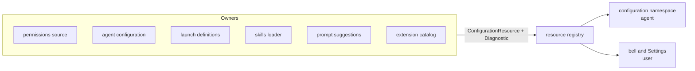

# Self-configuration

**Status:** Draft · **Area:** configuration

Users shape Nerve by talking to it: skills, extensions, prompt suggestions, launch definitions, agent profiles and permissions. The built-in `configure-nerve` skill does the work. This proposal makes that loop safe and cheap for the agent, keeps the user informed about what is broken or waiting for their approval, and tidies the code that carries it.

It replaces the installable-extensions proposal, whose shipped parts are in [extension platform](../../architecture/extension-platform.md) and [trust](../../architecture/trust.md). What that proposal left open is under [Carried over](#carried-over).

## Problem

- **The skill describes what the agent cannot see.** Tool names as rules match them, the selected rule set, the applied profile and the available profiles and rule sets are static prose. Under some providers the agent even sees different tool-name casing than rules match, so a copied name silently never matches.
- **One bad edit locks the agent out.** `configuration.reload` activates an invalid permission file; every later tool call then waits for the user.
- **Each configurable thing has its own loader, validator and diagnostic shape.** There are eight diagnostic types. The agent port re-validates permission files with logic that differs from the policy source.
- **Skills and prompt suggestions have no check, and prompt suggestions are not in the skill at all.**
- **The user learns about problems in several places.** Only settings files reach the bell. Trust is decided in Settings → This project → Trust, Settings → Suggestions and Settings → Extensions; skill diagnostics show only in Settings → Skills; and project-level pages are hard to find from the gear, which opens user settings.
- **Extension compatibility is coarse.** One version floor covers five surfaces, so one break invalidates unrelated extensions, and nothing fails when the public surface changes by accident.

## Decisions

Settled with the project owner; the topic files build on them.

| Topic                     | Decision                                                                                                                                                                                                                               |
| ------------------------- | -------------------------------------------------------------------------------------------------------------------------------------------------------------------------------------------------------------------------------------- |
| Primary use of extensions | A user builds extensions for themselves by conversation. Sharing is secondary.                                                                                                                                                         |
| Backward compatibility    | Design so that little breaks. When a break is unavoidable, old extensions stop loading and the user upgrades them in a conversation. The host keeps no adapters, no upgrade-on-read and no second implementation for older extensions. |
| Builds                    | Nerve never builds or installs an extension on its own, including after an update or at consent time. A build runs only as an agent command the user asked for, through the permission engine.                                         |
| Shared extensions         | Shared as source. `dist/` and `node_modules/` stay out of version control; whoever receives an extension has it built in their own conversation.                                                                                       |
| Packaging                 | No single-file extension package and no install from a URL. An extension is a folder of sources.                                                                                                                                       |
| Project skills            | Need the user's approval before they are used, because a skill can carry scripts the user never read.                                                                                                                                  |
| Permission model          | Stays as it is: rules match by risk first, by tool or group when one capability must be singled out. No new matching concept.                                                                                                          |
| Launches                  | Project scope only. No user-scope catalog.                                                                                                                                                                                             |
| Skill review              | Shows what the agent is told and the file list with scripts marked, not the full `SKILL.md`.                                                                                                                                           |
| Settings entry            | The gear keeps opening user settings; the bell and guide rows lead to project settings.                                                                                                                                                |
| Visibility                | The user is told what is broken and what waits for their approval, for every kind of resource and for both user and project scope.                                                                                                     |
| Database                  | No table or column changes. Everything here is computed from files, memory and the existing `trusted_resource` rows.                                                                                                                   |

## Design in one page

Three concepts carry the design:

1. **One diagnostic and one resource shape** for everything configurable, defined in `packages/contracts`.
2. **The owner validates; the registry aggregates.** Each owner lists its resources, checks files on disk and activates them. The agent namespace and the user's view read the same registry and add no validation of their own.
3. **Validate, then activate.** An invalid file never replaces a valid active one.

Topic files:

- [Configuration model](configuration-model.md): diagnostics, resource providers, the `configuration` namespace, launch writes, permission identity.
- [Extension contract](extension-contract.md): public surface, compatibility, breaking cleanly, safe builds.
- [User visibility](user-visibility.md): what is broken and what waits for approval, finding project settings, and the Design Lab wireframes.
- [`configure-nerve` skill](skill.md): structure and content after the code changes.
- [Codebase organization](codebase-organization.md): packages and folders.

## Work breakdown

Each step is one reviewable change and leaves the product working. Steps 2 to 4 remove the lockout and can ship without the rest.

| Step | Change                                                                                                                                 | Depends on | Detail                                                 |
| ---- | -------------------------------------------------------------------------------------------------------------------------------------- | ---------- | ------------------------------------------------------ |
| 1    | Folder moves only: group `core-host` by concern, move the extension host out of `quick-script`                                         | —          | [organization](codebase-organization.md#folder-moves)  |
| 2    | Shared `Diagnostic` contract with `level`; convert the existing shapes                                                                 | 1          | [model](configuration-model.md#diagnostic)             |
| 3    | Permission source owns validation and keeps the previous policy when a reloaded file is invalid                                        | 2          | [model](configuration-model.md#validate-then-activate) |
| 4    | `configuration.check`; `reload` reports what stayed on the previous version; remove `status`; update the skill text in the same change | 3          | [model](configuration-model.md#agent-namespace)        |
| 5    | Warnings for mistakes that load cleanly                                                                                                | 2          | [model](configuration-model.md#warnings)               |
| 6    | Resource registry with providers for every kind, including skills and prompt suggestions                                               | 2          | [model](configuration-model.md#resource-providers)     |
| 7    | `configuration.describe`, `list`, `tools`, `explain`                                                                                   | 6          | [model](configuration-model.md#agent-namespace)        |
| 8    | Bell entries for every resource kind; scope guides in Settings; project skills as a trust kind                                         | 6          | [visibility](user-visibility.md)                       |
| 9    | Launch write methods for the agent                                                                                                     | —          | [model](configuration-model.md#launch-writes)          |
| 10   | Shared permission groups for a direct extension tool and its script operation                                                          | —          | [model](configuration-model.md#permission-groups)      |
| 11   | Extension surface: explicit exports, single author import, host-owned prefixes, provider names out of public types                     | —          | [contract](extension-contract.md#public-surface)       |
| 12   | Extension compatibility: floor per surface, version check before schema check, public-surface snapshot test                            | 11         | [contract](extension-contract.md#compatibility)        |
| 13   | Extensions shared as source; build scripts hardened                                                                                    | —          | [contract](extension-contract.md#builds-and-sharing)   |
| 14   | Skill restructure, prompt suggestions and `AGENTS.md` coverage, generated catalogs, smaller schemas                                    | 4, 7, 9    | [skill](skill.md)                                      |
| 15   | Validate with traces, then decommission this proposal into architecture                                                                | 14         | [skill](skill.md#validation)                           |

## Carried over

From the installable-extensions proposal and its try-out, still open:

- Publishing `extension-api`, `ui-kit` and `extension-sdk` to npm ([release runbook](../../runbooks/release.md)); until then extensions build only against a checkout.
- Running the remaining built-ins in the sandbox ([#598](https://github.com/ThilinaTLM/nerve/issues/598)), and later loading built-ins from the installed folder format so there is one load path.
- Agent self-verification of UI: rendering a frame with a fixture, or `nerve-ext dev` serving frames against the fake bridge, so the agent can see its work before the user consents.
- "Fix with agent" and "Upgrade with agent" entry points: covered by the bell entries in [user visibility](user-visibility.md).
- Contextual entry points (unknown file type, "Create theme…").
- Pages and panels without an open project.
- Skill gaps found in the try-out: [skill](skill.md#from-the-extension-try-out).

Not planned: single-file packages (`.nerveext`), install from a git URL, a marketplace or registry, custom transcript renderers.

## Open questions

1. **Inlining `extension-api` into the SDK package** ([organization](codebase-organization.md#packages)): removes one published name at the cost of bundling declarations. Recommended: not now.
