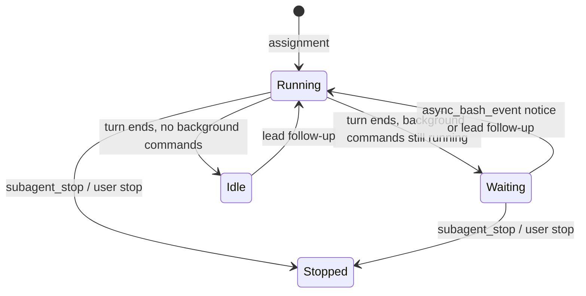

# Agent interface

Part of the [sub-agent profiles proposal](README.md).

The lead pays for this interface on every turn: tool definitions and guidelines are always in context, and call arguments, results and notices stay in history until compaction. Every part is sized for that.

## Tools

Three tools in the `subagents` capability group replace `explore` and the five current `subagent_*` tools. Results are plain text, never JSON, and never echo the prompt.

### `subagent_prompt`

```text
subagent_prompt({
  context?: string,                          // shared, written once, prepended to every prompt
  assignments: [                             // 1–10
    { name: string, profile?: <enum>, prompt: string }
  ]
})
```

Description, kept roughly this short:

> Assign work to sub-agents. A new name creates one from `profile`; an existing name queues a follow-up. Sub-agents run asynchronously in your worktree and cannot see your conversation; completion notices wake you.

Behavior:

- **New name:** creates the sub-agent from `profile`, which is then required (see [child configuration](child-configuration.md#creation)). The first assignment is `context` + `prompt`.
- **Existing name:** queues `prompt` (with `context`) as a follow-up.
  - A `profile` that differs from the sub-agent's profile fails the call.
  - Idle and waiting sub-agents start a new execution.
  - A running sub-agent picks it up at its next turn boundary.
  - A stopped sub-agent is resumed, because prompting it is explicit intent.
- **All-or-nothing validation:** the whole batch is checked before anything starts. Duplicate names in the batch, an unknown, disabled or untrusted profile, a missing profile for a new name, and a profile mismatch all fail the call with every reason listed. Nothing is created or queued, so the lead never has half a team.
- **Profile enum:** each turn, the host rewrites the definition with an enum of usable profiles and their one-line descriptions:

  ```text
  profile: explore — Read-only codebase and web research; returns a report with paths and evidence.
           developer — Implements, tests and fixes code in the shared worktree within an assigned scope.
  ```

  Only enabled and trusted profiles are listed. With none, all three tools are hidden.

- **Result:** one line per assignment:

  ```text
  auth-research (explore): created
  token-store (explore): created
  refresh-fix (developer): follow-up queued (running)
  ```

### `subagent_status`

```text
subagent_status({ name?: string })
```

> Check sub-agents. Without a name, one line each; with a name, its final response or recent activity. Not needed after assigning: notices wake you.

**Without a name**, one line per sub-agent, newest activity first:

```text
auth-research · explore · running · ctx 34% · active 20s ago
token-store · explore · idle · ctx 12% · 4m ago
refresh-fix · developer · waiting: 1 background command · ctx 51% · 1m ago
```

**With a name:**

- A header line: name, profile, model, state, context `tokens/window`, and the current execution's run time.
- Then, depending on state:

| State                        | Body                                                                                                                                                                  |
| ---------------------------- | --------------------------------------------------------------------------------------------------------------------------------------------------------------------- |
| Idle with a final response   | `Final response:` and the text, under the [report cap](#report-cap)                                                                                                   |
| Running                      | `Recent activity:` the last 6 items, oldest first, one line each (≤120 characters), e.g. `✓ read src/auth.ts`, `… bash "pnpm test" (3m)`, `text: "The refresh path…"` |
| Waiting on background work   | The final response, plus one line per running background command with its command and run time                                                                        |
| Failed, stopped, interrupted | The outcome and the error message                                                                                                                                     |

The recent-activity view lets the lead notice a stuck sub-agent, then stop it or send a follow-up.

### `subagent_stop`

```text
subagent_stop({ names: string[] })
```

> Stop the current execution of sub-agents. They remain and can be prompted again.

Stopping also ends the sub-agent's background commands, as conversation stop already does. Result: one line per name.

## Completion notices

The existing `sub_conversation_event` input is sent to the lead each time a sub-agent's execution finishes. It wakes the lead when idle. Notices queued together are delivered in the same lead turn.

```text
Sub-agent "auth-research" (explore) completed.
<final response>
```

**Stops and configuration changes:**

- **Stopped by the user** from the sub-agent's transcript: the lead gets a notice, `Sub-agent "<name>" (<profile>) was stopped by the user.`, followed by the last response if there is one. A lead waiting on that sub-agent is woken and can decide what to do.
- **Stopped by the lead** with `subagent_stop`: no notice, because the tool result already reports it.
- **Stopped because the lead was stopped** (the stop cascades): no notice. The lead is paused, and a notice would only add tokens to its next turn.
- **Configuration changes** by the user (model, reasoning level, rule set, tools, skills, compaction, instructions): never reported. The lead sees the current values through `subagent_status`.

Variants of the first line:

- `failed: <error>` / `interrupted` / `was stopped by the user`, followed by the last response if there is one.
- `is waiting on 1 background command and accepts follow-ups:` followed by one line per command (`"pnpm test" running 3m`), then the response. See [async bash](#async-bash-in-sub-agents).

### Report cap

- **Inline limit:** the final response is included in full up to **16 KB** (about 4k tokens).
- **Over the limit:** the notice carries the first 16 KB and ends with `[truncated; full response: <path>]`. The full text is written to `data/conversations/<childId>/reports/<executionId>.md` and can be read with `read`.
- **Why 16 KB:** in 432 existing Explore reports, the median was 6.5 KB, the 95th percentile 10.6 KB and the largest 15.4 KB, so 16 KB keeps all of them inline. The cost is that a batch of 10 can add up to about 40k tokens to the lead. Profile instructions that ask for short, structured reports are the main control.

The same cap and file apply to `subagent_status` with a name.

## Async bash in sub-agents

Sub-agents keep `bash` background runs and promotion and the `async_bash` tool. They need this for long builds, test runs and dev servers.



- **Ending the turn while commands run:** a sub-agent that ends its turn with background commands still running finishes its execution as usual. The lead receives a notice in the _waiting_ form, so it knows the response is provisional and that more is coming.
- **Command finishes:** its `async_bash_event` wakes the sub-agent, which starts a new execution and later sends a new notice.
- **Follow-ups while waiting:** the sub-agent is not busy, so a follow-up starts an execution immediately, as it does for an idle one.
- **What the lead sees:** `subagent_status` shows `waiting: N background commands`, and the side panel shows the existing hourglass state.

## Prompt guideline

One paragraph in `<tool_rules>`, replacing the current teammate guideline:

> Sub-agents run asynchronously and share your worktree. For parallel work, use one `subagent_prompt` batch with non-overlapping scopes and put shared background in `context`. Include paths, constraints and the expected outcome. Then continue independent work or end your turn; completion notices wake you. Use `subagent_status` only for long or suspicious work. Follow up by prompting the same name.

## Token budget

| Cost                      | How often                 | Measure                                                                                              |
| ------------------------- | ------------------------- | ---------------------------------------------------------------------------------------------------- |
| Definitions and guideline | Every lead turn           | 3 tools instead of 6; short descriptions; only usable profiles listed, one line each                 |
| Arguments                 | Once, but kept in history | Shared `context` written once per batch                                                              |
| Results                   | Per call                  | One line per assignment or sub-agent; no echo                                                        |
| Notices                   | Per finished execution    | 16 KB cap with the full response in a file; concise profile instructions                             |
| Polling                   | Avoided                   | Notices wake the lead; the guideline discourages status checks                                       |
| Sub-agent turns           | Every sub-agent turn      | Profiles remove unneeded tools and skills; human-in-the-loop and delegation tools are always removed |

**Acceptance check:** the lead's sub-agent tool definitions plus guideline must cost fewer tokens than today's `explore` and five `subagent_*` definitions plus guideline. This is measured before and after the change.

## Decided questions

| Question        | Decision                                                                                                                                   |
| --------------- | ------------------------------------------------------------------------------------------------------------------------------------------ |
| Waiting notices | The lead is notified when a sub-agent ends a turn with background commands still running, in the waiting form, and again when it finishes. |
| Activity window | 6 items.                                                                                                                                   |
