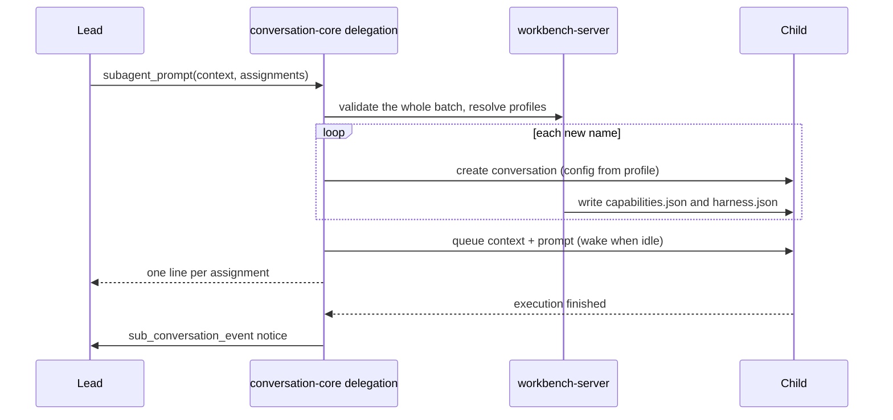

# Child configuration

Part of the [sub-agent profiles proposal](README.md).

## Creation

When `subagent_prompt` names a new sub-agent, its profile is applied once, through the same configuration a lead uses.

| Profile field       | Copied into                                                                                                           |
| ------------------- | --------------------------------------------------------------------------------------------------------------------- |
| `model`, `thinking` | `conversation_config.model` and `reasoning_level`. `lead` copies the lead's current values.                           |
| `permission`        | `conversation_config.permission_rule_set_id` (`read_only` or `autonomous`)                                            |
| Body (instructions) | `conversation_config.instructions` (new column, see [instructions](#instructions))                                    |
| `tools`, `skills`   | `data/conversations/<childId>/config/capabilities.json`: the lead's conversation overrides plus the profile's changes |
| `compaction`        | `data/conversations/<childId>/config/harness.json`, unless `inherit` (see [compaction](#compaction-settings))         |
| —                   | Mode and working directory are copied from the lead. `system_prompt` (which replaces the whole prompt) is not.        |



Conversation-core does not know about profiles. It asks the host, through a port, for the config of a new child and for the child's files to be initialized. The host owns profile files, trust and capability files.

After creation there is no link to the profile. The profile shown in the UI and in `subagent_status` is read from the creating call: follow `parent_tool_call_id` to the `subagent_prompt` arguments and find the assignment with this name. The UI already derives `executionKind` this way.

## Rules enforced for every sub-agent

These apply to any conversation with a parent, whatever its profile or later edits:

| Rule                                    | Enforced where                                                                                                                                    |
| --------------------------------------- | ------------------------------------------------------------------------------------------------------------------------------------------------- |
| No `ask_user`, no `plan_mode_*`         | Removed when turn resources are prepared                                                                                                          |
| No `subagent_*` (no nested delegation)  | Removed when turn resources are prepared                                                                                                          |
| Rule set is `read_only` or `autonomous` | Validated on creation and on every configuration change. The child permission picker offers only these two.                                       |
| No direct user prompts                  | Rejected by the input queue for user-sourced input on a child; the composer is disabled (see [user interface](user-interface.md#prompt-composer)) |

Neither allowed rule set contains "ask" rules, and sub-agents already skip the user, project and conversation permission overlays (`subagent: true` in the permission policy). A sub-agent therefore never waits for a person.

There is no authority cap relative to the lead. A `read_only` lead can create an `autonomous` sub-agent if the profile allows it, and the user can raise a sub-agent's rule set deliberately.

Everything else is editable per sub-agent in the transcript view, as for a lead: model, reasoning level, rule set (within the two), tools and tool settings, skills, compaction and instructions.

## Instructions

Instructions are persona and working rules for one conversation, such as the Explore research-and-report rules. They differ from `system_prompt`, which replaces the whole Nerve prompt.

- **Storage:** a new nullable `conversation_config.instructions` TEXT column. This is the only schema change in the proposal, and it goes into the unreleased migration step.
- **Rendering:** when set, the Nerve system prompt includes it as its own section, `<agent_instructions>`. The section comes after the project context files and before the skills. The rest of the standard prompt (tool rules, environment, skills) is unchanged.
- **Where it comes from:** for sub-agents, the profile body at creation. **Any conversation can have it**, including leads, and it is edited from the transcript view.
- **When it takes effect:** a change applies from the next turn, like every other configuration change.

The conversation-core README currently lists "No `instructions`" under configuration. That decision is reversed here.

## Compaction settings

Compaction becomes a layered setting with a per-conversation override. This applies to every conversation, not only sub-agents.

| Level        | File                                                       | Status                                                              |
| ------------ | ---------------------------------------------------------- | ------------------------------------------------------------------- |
| User         | `<NERVE_HOME>/config/harness.json` → `compaction`          | Exists                                                              |
| Project      | `<project>/.nerve/config/harness.json` → `compaction`      | Exists (merged over the user file by `resolveProjectConfiguration`) |
| Conversation | `<NERVE_HOME>/data/conversations/<id>/config/harness.json` | New                                                                 |

- **One file name, three levels:** the conversation file reuses the `harness.json` name, so all three levels match. It sits next to the conversation `capabilities.json` and `permissions.json`. Compaction is a setting, not a capability, so it does not go into `capabilities.json`.
- **Allowed keys:** the conversation file accepts only conversation-scoped harness settings, which is `compaction` alone for now.
- **Override rule:** an override replaces the inherited `compaction` value as a whole, so custom percentages from two levels are never mixed. Saving a value equal to the inherited one deletes the override. A missing file inherits everything.
- **Resolution:** before each turn, the runner asks the host for the effective setting (`user → project → conversation`) and uses it for the auto-compaction check and the manual compaction thresholds.
  - Today auto-compaction always uses built-in defaults and ignores user settings, so this also fixes leads.
  - Disabling auto-compaction (`auto: false`) at any level is respected.

## Report files

A final response longer than the notice cap is stored in the sub-agent's own conversation directory:

```text
data/conversations/<childId>/reports/<executionId>.md
```

It is deleted with the conversation. `data/reports/` is removed (see [migration](migration.md)).

## Decided questions

| Question                              | Decision                                                        |
| ------------------------------------- | --------------------------------------------------------------- |
| Per-child human-in-the-loop exception | None. The rule is absolute until sub-agent questions have a UI. |
| Instruction size                      | 16 KB.                                                          |
