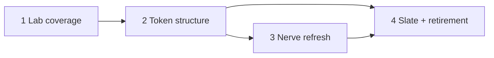

# Themes and design tokens

> **Status:** Proposal. This document describes intended changes, not current behaviour.

## Summary

Nerve ships four themes: Nerve (the default, and the one almost everyone uses), Rosé, Solar, and Midnight. Each has a light and a dark mode. Components are tuned mostly against Nerve, and several look wrong in the other three, mainly because those themes change radius and elevation as well as colour.

This proposal:

1. Lists every primitive and shared composite in the Design Lab (`/dev/components`), adds a side-by-side view of the themes, and adds a coverage test.
2. Assesses the token system and fixes the structural problems that make themes fragile.
3. Refines Nerve: less warm and darker in dark mode, with a cleaner paper tone in light mode.
4. Removes Rosé, Solar, and Midnight.
5. Adds **Slate**, one new cool theme that changes only colour, as Nerve's companion.

No database changes. The only persisted data affected is `ui.appearance.theme` in the home UI config document.

## Goals

- Every shared component can be viewed and checked in every theme and color mode from one place.
- Themes differ only in colour, so a component that looks right in Nerve also looks right in Slate.
- Surfaces get lighter in a strict order (monotonic) in both modes, and tests enforce it.
- Nerve dark looks like neutral graphite with an ember accent, not olive brown.
- Two themes, both kept to the same standard.

## Non-goals

- User-defined or imported themes.
- Changing typography, spacing, control heights, or motion tokens.
- Redesigning individual components beyond what the token fixes require.
- New Tailwind tokens beyond those listed under [Token changes](#token-changes).

## Current state

### Themes

All four themes are defined in `packages/ui-kit/src/styles/theme.css` (645 lines, eight blocks of about 40 hand-written OKLCH values each). The theme ID is validated by `colorThemeSchema` (`packages/contracts/src/domains/settings/settings.ts`). It is stored in `ui.appearance.theme`, mirrored to localStorage as `nerve-color-theme`, and applied as `data-theme` on the root element (`platform/appearance/appearance.svelte.ts`). It also appears in:

- the pre-paint bootstrap and splash palettes in `workbench-app/index.html`
- `desktop-shell/src/window/startup-splash-document.ts`
- the Design Lab theme controls
- `ThemePreviewPicker.svelte`
- `theme-contrast.test.ts`

Retired IDs already have a fallback mechanism: `retiredColorThemes` maps `ocean → solar` and `forest → rose`.

### Token system assessment

What works well:

- The semantic vocabulary is small and documented: the surface order `well < panel < background < card < popover` and one status vocabulary (`info`/`success`/`warning`/`destructive`).
- OKLCH values, a contrast test for text pairs, and theme-owned syntax colours for both highlighters.
- Elevation and overlay shadows are recipes driven by tokens, not values set per component.

Problems, roughly in order of how much they hurt:

1. **Themes change geometry and depth, not just colour.**
   - Radius varies from `0.125rem` (Midnight) to `0.5rem` (Rosé).
   - `--elevation-strength` varies from `0` (Solar, Midnight) to `1.1` (Rosé).

   Components tuned in Nerve rely on a shadow or corner that disappears elsewhere. Swatches use `shadow-sm`, and cards and popovers rely on shadows to separate from the surface below. This is the main reason components look wrong outside Nerve. Every component has to be correct in 4 × 2 × (radius, elevation) combinations.

2. **The surface ladder does not get lighter in order.**
   - Light Nerve: `card` (L 0.958) is darker than `background` (L 0.979).
   - Dark Nerve: `muted` (0.218) and `accent` (0.21) are darker than `background` (0.264) and even `panel` (0.228). Hover and quiet fills sink into the surface instead of lifting off it. `AGENTS.md` already works around this ("`muted`/`accent` are darker than `panel` in dark themes and disappear").

3. **There is an undeclared state layer.** About 330 token utilities with an opacity modifier (`bg-muted/50`, `bg-accent/60`, `bg-foreground/10`, `border-border/…`) and 55 `dark:` variants in primitives (shadcn defaults such as `dark:bg-input/30`) define hover, pressed, and field states ad hoc. Each one blends differently against each theme's surfaces, so states drift between themes and modes.

4. **`muted` and `accent` overlap.** Both are quiet fills (81 and 50 `bg-*` uses). Neither has a defined role relative to the surface it sits on.

5. **Near-duplicate text colours.** `card-foreground`, `popover-foreground`, and `accent-foreground` differ slightly from `foreground`. For example, in dark Nerve `card-foreground` is L 0.98 while `foreground` is 0.90, so text brightness jumps between surfaces for no reason.

6. **There is no structure to the values.** Every value is an independent literal, so retuning one theme means editing about 40 numbers per mode while keeping the relationships between them in your head. Nothing documents or tests those relationships.

7. **Duplicated values.** `--syntax-added/removed/changed/link` repeat the status colours as copied literals. `chart-1..5` is used on one page only (Storage settings).

### Design Lab coverage

The catalog has 12 pages. These are missing or only partly shown:

| Area       | Missing                                                                                                                                                                                                                        |
| ---------- | ------------------------------------------------------------------------------------------------------------------------------------------------------------------------------------------------------------------------------ |
| Primitives | AlertDialog, Resizable, ScrollArea, Separator, Sheet, Sonner (toasts). Dialog, Select, and ContextMenu appear only through their composites, not as primitives. Most primitives show only the variants the app currently uses. |
| Composites | ScrollRegion, VirtualScroller, FloatingToolbar, StreamingText, HeightFollow, SelectRow, GithubMark                                                                                                                             |
| Renderers  | Markdown, Mermaid, and PlainText renderer exports appear only inside Conversation fixtures                                                                                                                                     |
| Themes     | No way to compare a specimen across themes or modes; only the global theme toggle                                                                                                                                              |

## Proposal

### 1. Design Lab: complete coverage

- **New "Primitives" page (Foundations group).** It shows every `ui-kit/components/ui/*` primitive with its full variant × size × state matrix: default, hover, focus-visible, disabled, invalid, and checked/selected. This page is an exception to the README's "only variants in use" rule because it is a reference for the primitives themselves. The existing Controls page stays curated.
- **New "Composites" page (Shared group).** It covers the composites listed above, plus the Markdown, Mermaid, and PlainText renderers. Behaviour-only helpers (HeightFollow) get a small live demo.
- **Theme comparison.** `GallerySpecimen` gets a "Compare" toggle. It renders the specimen in a grid of themes and modes, using the existing `data-theme-preview`/`data-color-mode` scoping. Shadows already resolve per preview root. Any token added in this proposal must also resolve per preview root.
- **Coverage test.** A unit test next to `lab-route.test.ts` checks that every directory under `ui-kit/components/ui` and `ui-kit/components/composites` is imported by at least one section. Deliberate gaps go in a short exemption list, each with a reason.

### 2. Token changes

Keep the semantic vocabulary and change the rules underneath it.

- **Themes own colour only.** `--radius`, `--elevation-hsl`, and `--elevation-strength` become global values in `:root`, with a separate dark value for elevation colour. Theme blocks may no longer set them. This removes the biggest source of fragility.
- **Surfaces get lighter in order, with defined steps** (both modes): `well < panel < background < card < popover`. Each step is a fixed lightness change (ΔL) defined per mode.
- **Quiet fills get a defined direction.** `muted` and `accent` always sit _above_ the surface they appear on: one step lighter in dark mode and one step darker in light mode. `accent` is the hover/active fill. `muted` is the resting quiet fill for chips, tracks, and code spans. The meaning stays the same; the values are fixed.
- **One explicit state token.** Add `--hover` (and the Tailwind colour `hover`), defined as `color-mix(in oklab, var(--foreground) 6%, transparent)` in each mode. It is a translucent overlay that works on any surface. Then replace the repeated opacity-based hover recipes (`hover:bg-accent/60`, `hover:bg-muted/50`, `dark:hover:bg-accent/40`, …) with `hover:bg-hover`. `--selected` already follows this pattern.
- **Remove `dark:` from primitives.** Where a shadcn primitive needs a different value per mode (input background, invalid ring), that difference moves into the token values and the `dark:` utility is deleted. A style-policy check prevents new `dark:` utilities in `ui-kit/components`.
- **Point the duplicate text tokens at `foreground`.** `card-foreground`, `popover-foreground`, and `accent-foreground` become `var(--foreground)`. They stay as names so shadcn components keep working, but themes no longer set them.
- **Point the syntax diff and link roles at status tokens.** `--syntax-added: var(--success)`, and the same for removed/changed/link.
- **Keep the values as literals with tested relationships.** Generating colours with relative-colour syntax or a build step adds machinery for two themes. Instead, extend `theme-contrast.test.ts` with:
  - checks that surfaces get lighter in order, with a minimum ΔL per step
  - border and input visibility against `background`, `card`, and `popover` (≥ 1.3:1 and ≥ 1.6:1)
  - the existing text-contrast checks run for every theme in the `ColorTheme` union

Net token count drops: 3 per-theme character tokens move to global, 3 foreground variants and 4 syntax roles become aliases, and 1 token (`hover`) is added.

### 3. Nerve, refined

The direction is to **move from warm paper and olive-brown to warm graphite and paper-white, and keep the ember.** Neutral chroma drops from about 0.018 to about 0.006, and dark lightness drops from 0.264 to 0.205. The hue keeps a faint warmth (~65–85) so Nerve still reads as Nerve. The ember primary gets slightly more saturated so it stays the clear focal colour against the calmer surfaces.

Draft values. The OKLCH values are canonical; the hex values are an sRGB preview. Final values will be tuned in the Design Lab comparison view.

**Dark**

| Token                           | Current        | Proposed                                     | Hex       |
| ------------------------------- | -------------- | -------------------------------------------- | --------- |
| well                            | 0.205 0.018 78 | 0.165 0.005 65                               | `#100e0c` |
| panel                           | 0.228 0.020 70 | 0.185 0.006 65                               | `#151210` |
| background                      | 0.264 0.018 80 | 0.205 0.006 65                               | `#191714` |
| card                            | 0.289 0.020 82 | 0.228 0.007 65                               | `#1f1c19` |
| popover                         | 0.305 0.020 82 | 0.250 0.008 65                               | `#24211e` |
| muted                           | 0.218 0.018 78 | 0.255 0.007 65                               | `#25221f` |
| accent                          | 0.210 0.022 78 | 0.275 0.008 65                               | `#2a2724` |
| border                          | 0.353 0.022 82 | 0.305 0.008 65                               | `#322e2b` |
| input                           | 0.425 0.024 82 | 0.370 0.009 65                               | `#433f3b` |
| foreground                      | 0.900 0.012 95 | 0.910 0.006 80                               | `#e3e1dd` |
| muted-foreground                | 0.771 0.017 99 | 0.715 0.010 75                               | `#a7a29c` |
| primary                         | 0.672 0.131 39 | 0.700 0.150 40                               | `#eb7a52` |
| primary-foreground              | 0.191 0.008 80 | 0.170 0.010 40                               | `#130e0c` |
| success / warning / info        | —              | 0.78 0.15 150 / 0.82 0.14 75 / 0.78 0.12 250 | —         |
| destructive / destructive-solid | —              | 0.76 0.13 25 / 0.58 0.20 27                  | —         |

**Light**

| Token            | Current        | Proposed       | Hex       |
| ---------------- | -------------- | -------------- | --------- |
| well             | 0.938 0.014 95 | 0.945 0.004 80 | `#eeecea` |
| panel            | 0.952 0.018 95 | 0.958 0.004 80 | `#f2f1ee` |
| background       | 0.979 0.012 92 | 0.982 0.003 85 | `#faf9f7` |
| card             | 0.958 0.013 94 | 0.992 0.002 85 | `#fdfcfb` |
| popover          | 0.990 0.005 95 | 1.000 0 0      | `#ffffff` |
| border           | 0.872 0.017 95 | 0.890 0.006 80 | `#dddad6` |
| input            | 0.750 0.024 96 | 0.780 0.008 80 | `#bab7b2` |
| foreground       | 0.344 0.027 96 | 0.240 0.008 70 | `#221f1b` |
| muted-foreground | 0.534 0.008 98 | 0.500 0.010 70 | `#67625d` |
| primary          | 0.570 0.138 39 | 0.560 0.155 38 | `#bd4b26` |

Computed contrast for the draft:

- **Dark:** foreground on background is 13.7:1, which is softer than pure white. Muted text is ≥ 5.9:1 on every surface, and the primary is ≥ 5.2:1 on every surface. Primary-foreground on primary is 6.8:1.
- **Light:** foreground on background is 15.6:1. Muted text is ≥ 4.8:1, and white on primary is 5.0:1.

The syntax palette keeps its hue roles. Chroma comes down about 10% in dark mode so code does not look harsher against the darker surface. The `selected` mix drops from 22% to 16%: on the neutral surface the ember tint no longer looks muddy, as the current settings nav does.

### 4. Slate (new theme)

Slate is a cool counterpart to Nerve, for people who want a blue-grey workspace. It replaces what Solar and Midnight offered. It uses the same radius, elevation, and surface steps as Nerve, so only the colours change.

- **Surfaces:** blue-grey ink, hue 255, chroma 0.012–0.016. In dark mode this is `#14191f` background, `#0c1015` well, and `#1e242b` popover. In light mode it is `#f7f9fc` background and `#e9edf2` well.
- **Primary:** periwinkle. Dark is `oklch(0.72 0.12 265)` (`#80a3f0`) with dark text on it. Light is `oklch(0.52 0.16 265)` (`#3a61c4`) with white text on it.
- **Status colours:** shifted to sit well next to blue. Success is jade (hue 160) and info is cyan (hue 220), so neither competes with the primary.
- **Contrast (draft):** dark foreground on background is 13.6:1, muted text ≥ 5.6:1, and primary ≥ 5.8:1. Light muted text is ≥ 4.8:1, and white on primary is 5.7:1.
- **Syntax:** violet keywords, jade strings, amber numbers, and blue functions, using the same roles as Nerve.

### 5. Retire Rosé, Solar, and Midnight

- `colorThemeSchema = z.enum(["nerve", "slate"])`.
- `retiredColorThemes` maps each old ID to the closest remaining theme:

  | Old ID     | Maps to |
  | ---------- | ------- |
  | `rose`     | `nerve` |
  | `midnight` | `nerve` |
  | `forest`   | `nerve` |
  | `solar`    | `slate` |
  | `ocean`    | `slate` |

  The localStorage fallback in `appearance.svelte.ts` uses this map.

- **Persisted settings.** If the schema is narrowed, a stored `"rose"` would make the whole UI config document invalid. That document is then quarantined or reset in the settings health flow. Extend the current unreleased migration step (`0002`) with a pure converter that rewrites `ui.appearance.theme` through `retiredColorThemes`. This follows the rule of one migration step per release. No database change is needed.
- **Code to update:**
  - delete the three theme blocks in `theme.css` and add the Slate block
  - `ThemePreviewPicker` options become Nerve and Slate
  - Design Lab theme controls and the hard-coded options in `SettingsSection`
  - `index.html` bootstrap and splash palettes
  - `startup-splash-document.ts`, kept in sync by `startup-splash-sync.test.mjs`
  - remove the Midnight-specific assertions from `theme-contrast.test.ts`
- **Docs:** update `packages/workbench-app/AGENTS.md`:
  - remove the "darker than panel" workaround note
  - document the `hover` token
  - document the colour-only theme rule

## Rollout

Each step is a separate PR and can be reviewed in the Design Lab.

1. **Lab coverage.** Primitives page, Composites page, the Compare toggle, and the coverage test. This shows the current problems before anything changes.
2. **Token structure.** Global radius and elevation, the aliases, `--hover`, removing `dark:` from primitives, and the ordering tests. Visual changes are limited to Nerve's dark fills now sitting above their surface.
3. **Nerve refresh.** New Nerve values, tuned with the Compare view and a local wireframe of the main workbench.
4. **Theme lineup change.** Add Slate, retire the three themes, the schema and migration converter, the splash and bootstrap code, and the picker.

## Validation

- Unit tests: `theme-contrast.test.ts` with the ordering and visibility checks, the lab coverage test, the converter test in `0002`, and `startup-splash-sync`.
- Visual check: Compare view across Nerve and Slate in light and dark for Primitives, Composites, Shell, Panels, Conversation, Tool calls, and Settings.
- Migration rehearsal on a copied slot (`pnpm storage:copy --slot N`) with `ui.appearance.theme` set to each retired ID.

## Open questions

1. **Name.** Is "Slate" the right name for the companion theme? Alternatives: "Tide", "Ink".
2. **Primitives page scope.** Is a full state matrix (hover, focus, and so on, forced through `data-*` attributes) worth the maintenance, or are variants × sizes enough?
3. **Light-mode identity.** Should Nerve light keep a slight paper tint (as drafted), or go almost neutral to match the darker dark mode?
