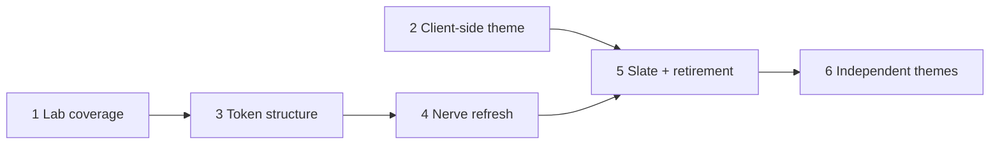

# Themes and design tokens

> **Status:** In implementation (revised). Steps 1–3 shipped as written. After a workbench review, sections 3–5 are superseded by [7. Independent themes](#7-independent-themes): the original warm Nerve stays as the identity, the graphite refresh becomes its own dark theme, and Slate is dropped.

## Summary

Nerve ships four themes: Nerve (the default, and the one almost everyone uses), Rosé, Solar, and Midnight. Each has a light and a dark mode. Components are tuned mostly against Nerve, and several look wrong in the other three, mainly because those themes change radius and elevation as well as colour.

This proposal:

1. Lists every primitive and shared composite in the Design Lab (`/dev/components`), adds a side-by-side view of the themes, and adds a coverage test.
2. Assesses the token system and fixes the structural problems that make themes fragile.
3. Keeps the original warm Nerve and fixes only its structure (ladder order, quiet fills, borders).
4. Removes Rosé, Solar, and Midnight.
5. Makes themes independent: each theme is light or dark. Ships **Nerve Light**, **Nerve Dark**, and **Graphite** (dark), the graphite refresh drafted in section 3.
6. Makes the theme and colour mode a per-client preference stored in the browser, so two clients of the same daemon can use different themes. Switching then has one owner and one code path.

No database changes. The only persisted data affected is `ui.appearance` in the home UI config document (`ui.json`): `theme` and `colorMode` are removed from it.

## Goals

- Every shared component can be viewed and checked in every theme and color mode from one place.
- Themes differ only in colour, so a component that looks right in one theme also looks right in the others.
- Surfaces get lighter in a strict order (monotonic) in both modes, and tests enforce it.
- Nerve dark looks like neutral graphite with an ember accent, not olive brown.
- Two themes, both kept to the same standard.
- Each client keeps its own theme. Switching applies at once, with no settings round trip.

## Non-goals

- User-defined or imported themes.
- Changing typography, spacing, control heights, or motion tokens.
- Redesigning individual components beyond what the token fixes require.
- New Tailwind tokens beyond those listed under [Token changes](#token-changes).

## Current state

### Themes

All four themes are defined in `packages/ui-kit/src/styles/theme.css` (645 lines, eight blocks of about 40 hand-written OKLCH values each). The theme ID is validated by `colorThemeSchema` (`packages/contracts/src/domains/settings/settings.ts`). It is stored in `ui.appearance.theme`, mirrored to localStorage as `nerve-color-theme`, and applied as `data-theme` on the root element (`platform/appearance/appearance.svelte.ts`). It also appears in:

- the pre-paint bootstrap and splash palettes in `workbench-app/index.html`
- `desktop-shell/src/window/startup-splash-document.ts`
- the Design Lab theme controls
- `ThemePreviewPicker.svelte`
- `theme-contrast.test.ts`

Retired IDs already have a fallback mechanism: `retiredColorThemes` maps `ocean → solar` and `forest → rose`.

### Token system assessment

What works well:

- The semantic vocabulary is small and documented: the surface order `well < panel < background < card < popover` and one status vocabulary (`info`/`success`/`warning`/`destructive`).
- OKLCH values, a contrast test for text pairs, and theme-owned syntax colours for both highlighters.
- Elevation and overlay shadows are recipes driven by tokens, not values set per component.

Problems, roughly in order of how much they hurt:

1. **Themes change geometry and depth, not just colour.**
   - Radius varies from `0.125rem` (Midnight) to `0.5rem` (Rosé).
   - `--elevation-strength` varies from `0` (Solar, Midnight) to `1.1` (Rosé).

   Components tuned in Nerve rely on a shadow or corner that disappears elsewhere. Swatches use `shadow-sm`, and cards and popovers rely on shadows to separate from the surface below. This is the main reason components look wrong outside Nerve. Every component has to be correct in 4 × 2 × (radius, elevation) combinations.

2. **The surface ladder does not get lighter in order.**
   - Light Nerve: `card` (L 0.958) is darker than `background` (L 0.979).
   - Dark Nerve: `muted` (0.218) and `accent` (0.21) are darker than `background` (0.264) and even `panel` (0.228). Hover and quiet fills sink into the surface instead of lifting off it. `AGENTS.md` already works around this ("`muted`/`accent` are darker than `panel` in dark themes and disappear").

3. **There is an undeclared state layer.** About 95 neutral `bg-*` utilities with an opacity modifier (`bg-muted/50`, `bg-accent/60`, `bg-foreground/10`), about 30 of them hover recipes (`hover:bg-accent/40`, `hover:bg-muted/60`, …), and about 49 `dark:` utilities define hover, pressed, and field states ad hoc. Most `dark:` utilities are shadcn defaults in 12 primitives (`dark:bg-input/30`, `dark:aria-invalid:ring-destructive/40`); 5 workbench files add their own. Each one blends differently against each theme's surfaces, so states drift between themes and modes.

4. **`muted` and `accent` overlap.** Both are quiet fills (81 and 50 `bg-*` uses). Neither has a defined role relative to the surface it sits on.

5. **Near-duplicate text colours.** `card-foreground`, `popover-foreground`, and `accent-foreground` differ slightly from `foreground`. For example, in dark Nerve `card-foreground` is L 0.98 while `foreground` is 0.90, so text brightness jumps between surfaces for no reason.

6. **There is no structure to the values.** Every value is an independent literal, so retuning one theme means editing about 40 numbers per mode while keeping the relationships between them in your head. Nothing documents or tests those relationships.

7. **Duplicated values.** `--syntax-added/removed/changed/link` repeat the status colours as copied literals. `chart-1..5` is used on one page only (Storage settings).
8. **Previews do not match the real theme.** Theme previews scope tokens with `data-theme-preview`/`data-color-mode`, but two things escape that scope:
   - The `dark` custom variant is `&:is(.dark *)`, so `dark:` utilities never apply inside a dark preview under a light document, and they always apply inside a light preview under a dark document.
   - `--chrome-track` is declared on `:root` only and mixes `--muted` with `--card`. Custom properties resolve where they are declared, so previews inherit the document theme's track colour.

   Portalled content (dialogs, menus, tooltips) also renders outside the preview root.

### Theme switching

The theme and colour mode are stored in three places, and four paths write to them:

- **The daemon:** `ui.appearance.theme`/`colorMode` in `ui.json`, which every client shares.
- **The theme mirror:** localStorage `nerve-color-theme`, read by the pre-paint bootstrap in `index.html`.
- **mode-watcher:** its own localStorage key for the mode.

The paths that write them:

- `WorkbenchSettingsPage` writes the settings draft, calls `onColorThemeChange`, and queues an immediate settings save.
- `settings-actions.setColorTheme/setColorMode` apply the change locally.
- `applySettings` re-applies the daemon value whenever settings load (`settings-actions.svelte.ts:144`), overwriting the local choice.
- `initializeWorkbench` applies the localStorage value before settings arrive.

So a theme change on one client repaints every other client on its next settings load, and the two stores can briefly disagree, which shows as a flash. Zoom also lives in `ui.appearance`, but the desktop main process reads it (`desktop-runtime.ts`, `desktop-settings.ts`), so it stays on the daemon.

### Design Lab coverage

The catalog has 12 pages. These are missing or only partly shown:

| Area       | Missing                                                                                                                                                                                                                        |
| ---------- | ------------------------------------------------------------------------------------------------------------------------------------------------------------------------------------------------------------------------------ |
| Primitives | AlertDialog, Resizable, ScrollArea, Separator, Sheet, Sonner (toasts). Dialog, Select, and ContextMenu appear only through their composites, not as primitives. Most primitives show only the variants the app currently uses. |
| Composites | ScrollRegion, VirtualScroller, FloatingToolbar, StreamingText, HeightFollow, SelectRow, GithubMark                                                                                                                             |
| Renderers  | Markdown, Mermaid, and PlainText renderer exports appear only inside Conversation fixtures                                                                                                                                     |
| Themes     | No way to compare a specimen across themes or modes; only the global theme toggle                                                                                                                                              |

## Proposal

### 1. Design Lab: complete coverage

- **New "Primitives" page (Foundations group).** It shows every `ui-kit/components/ui/*` primitive with its full variant × size × state matrix: default, hover, focus-visible, disabled, invalid, and checked/selected. This page is an exception to the README's "only variants in use" rule because it is a reference for the primitives themselves. The existing Controls page stays curated.
- **New "Composites" page (Shared group).** It covers the composites listed above, plus the Markdown, Mermaid, and PlainText renderers. Behaviour-only helpers (HeightFollow) get a small live demo.
- **State scope.** The page shows variants × sizes plus every state a prop can set: disabled, invalid (`aria-invalid`), checked, selected, and loading. Hover and focus-visible are checked live. Primitives get no lab-only selectors for forcing states.
- **Theme comparison.** `GallerySpecimen` gets a "Compare" toggle. It renders the specimen in a grid of themes and modes, using the existing `data-theme-preview`/`data-color-mode` scoping. Shadows already resolve per preview root. Every derived token (aliases, `--hover`, `--chrome-track`, `--overlay-highlight`) is declared on `:root, [data-theme-preview]` so that it re-resolves per preview. Compare is reliable only after step 2 removes `dark:` utilities (problem 8). Overlay specimens render their content inline (always open) or pass `portalProps={{ disabled: true }}` so it stays inside the preview root.
- **Coverage test.** A unit test next to `lab-route.test.ts` checks that every directory under `ui-kit/components/ui` and `ui-kit/components/composites` is imported by at least one section. Deliberate gaps go in a short exemption list, each with a reason.

### 2. Token changes

Keep the semantic vocabulary and change the rules underneath it.

- **Themes own colour only.** `--radius`, `--elevation-hsl`, and `--elevation-strength` become global values in `:root`, with a separate dark value for elevation colour. Theme blocks may no longer set them. This removes the biggest source of fragility.
- **Surfaces get lighter in order, with defined steps** (both modes): `well < panel < background < card < popover`. Each step is a fixed lightness change (ΔL) defined per mode.
- **Quiet fills sit beyond the ladder.** `muted` and `accent` are opaque, so they cannot be one step from every surface. Instead they sit past the end of the surface ladder, on the foreground side, which makes them visible on every surface:
  - dark: `popover < muted < accent`
  - light: `accent < muted < well`

  `accent` is the hover/active fill. `muted` is the resting quiet fill for chips, tracks, and code spans. Translucent hover on chrome uses `--hover` (below).

- **Tab track from the ladder.** `--chrome-track` becomes `color-mix(in oklab, var(--well) 50%, var(--panel))`, which sits below `panel` (the dock surface) and therefore below `background` (the editor) in both modes, because the ladder is ordered. Today's mix with `muted` would invert in dark mode, where `muted` is now lighter than `card`.
- **One explicit state token.** Add `--hover` (and the Tailwind colour `hover`), defined as `color-mix(in oklab, var(--foreground) 6%, transparent)` in each mode. It is a translucent overlay that works on any surface. Then replace the repeated opacity-based hover recipes (`hover:bg-accent/60`, `hover:bg-muted/50`, `dark:hover:bg-accent/40`, …) with `hover:bg-hover`. `--selected` already follows this pattern.
- **Remove `dark:` everywhere.** Where a shadcn primitive needs a different value per mode (input background, invalid ring), that difference moves into the token values and the `dark:` utility is deleted. The same goes for the 5 workbench files. Then the `@custom-variant dark` declaration is removed, and a new style-policy check rejects `dark:` utilities in `ui-kit` and `workbench-app` sources. The only token this needs is `--input-background`: transparent in light mode, `color-mix(in oklab, var(--input) 30%, transparent)` in dark mode. It replaces `bg-transparent dark:bg-input/30`. The invalid ring and border use one alpha that passes in both modes.
- **Point the duplicate text tokens at `foreground`.** `card-foreground`, `popover-foreground`, and `accent-foreground` become `var(--foreground)`. They stay as names so shadcn components keep working, but themes no longer set them.
- **Point the syntax diff and link roles at status tokens.** `--syntax-added: var(--success)`, and the same for removed/changed/link.
- **Keep the values as literals with tested relationships.** Generating colours with relative-colour syntax or a build step adds machinery for two themes. Instead, extend `theme-contrast.test.ts` with:
  - checks that surfaces get lighter in order, with a minimum ΔL per step
  - border and input visibility against `background`, `card`, and `popover` (≥ 1.3:1 and ≥ 1.6:1)
  - the existing text-contrast checks run for every theme in the `ColorTheme` union
  - quiet fills sit beyond the ladder (above)
  - the existing "not a hue swap" test, the Midnight test, and the "character tokens vary" test are removed. Themes now differ only in colour by design. The test for a separate semantic palette per theme stays.

The syntax diff roles still pass the code-contrast test, because the status colours already pass it on `well`, `card`, and `background`. The test resolves `var(--…)` aliases before measuring.

Net token count drops: 3 per-theme character tokens move to global, 3 foreground variants and 4 syntax roles become aliases, and 2 tokens (`hover`, `input-background`) are added.

### 3. Nerve, refined (superseded: these values now ship as Graphite)

The direction is to **move from warm paper and olive-brown to warm graphite and paper-white, and keep the ember.** Neutral chroma drops from about 0.018 to about 0.006, and dark lightness drops from 0.264 to 0.205. The hue keeps a faint warmth (~65–85) so Nerve still reads as Nerve. The ember primary gets slightly more saturated so it stays the clear focal colour against the calmer surfaces.

Draft values. The OKLCH values are canonical; the hex values are an sRGB preview. Final values will be tuned in the Design Lab comparison view.

**Dark**

| Token                           | Current        | Proposed                                     | Hex       |
| ------------------------------- | -------------- | -------------------------------------------- | --------- |
| well                            | 0.205 0.018 78 | 0.160 0.005 65                               | `#0f0d0b` |
| panel                           | 0.228 0.020 70 | 0.185 0.006 65                               | `#151210` |
| background                      | 0.264 0.018 80 | 0.220 0.006 65                               | `#1d1a18` |
| card                            | 0.289 0.020 82 | 0.245 0.007 65                               | `#23201d` |
| popover                         | 0.305 0.020 82 | 0.270 0.008 65                               | `#292622` |
| muted                           | 0.218 0.018 78 | 0.292 0.008 65                               | `#2f2b28` |
| accent                          | 0.210 0.022 78 | 0.312 0.009 65                               | `#34302c` |
| border                          | 0.353 0.022 82 | 0.350 0.009 65                               | `#3e3a36` |
| input                           | 0.425 0.024 82 | 0.410 0.010 65                               | `#4e4945` |
| foreground                      | 0.900 0.012 95 | 0.910 0.006 80                               | `#e3e1dd` |
| muted-foreground                | 0.771 0.017 99 | 0.715 0.010 75                               | `#a7a29c` |
| primary                         | 0.672 0.131 39 | 0.700 0.150 40                               | `#eb7a52` |
| primary-foreground              | 0.191 0.008 80 | 0.170 0.010 40                               | `#130e0c` |
| success / warning / info        | —              | 0.78 0.15 150 / 0.82 0.14 75 / 0.78 0.12 250 | —         |
| destructive / destructive-solid | —              | 0.76 0.13 25 / 0.58 0.20 27                  | —         |

**Light**

| Token            | Current        | Proposed       | Hex       |
| ---------------- | -------------- | -------------- | --------- |
| well             | 0.938 0.014 95 | 0.945 0.004 80 | `#eeecea` |
| panel            | 0.952 0.018 95 | 0.958 0.004 80 | `#f2f1ee` |
| background       | 0.979 0.012 92 | 0.982 0.003 85 | `#faf9f7` |
| card             | 0.958 0.013 94 | 0.992 0.002 85 | `#fdfcfb` |
| popover          | 0.990 0.005 95 | 1.000 0 0      | `#ffffff` |
| muted            | 0.928 0.018 91 | 0.930 0.005 80 | `#eae7e4` |
| accent           | 0.918 0.026 92 | 0.912 0.006 80 | `#e4e1de` |
| border           | 0.872 0.017 95 | 0.890 0.006 80 | `#dddad6` |
| input            | 0.750 0.024 96 | 0.780 0.008 80 | `#bab7b2` |
| foreground       | 0.344 0.027 96 | 0.240 0.008 70 | `#221f1b` |
| muted-foreground | 0.534 0.008 98 | 0.500 0.010 70 | `#67625d` |
| primary          | 0.570 0.138 39 | 0.540 0.155 38 | `#b6451f` |

Computed contrast for the draft (PoC: the same OKLCH → sRGB math as `theme-contrast.test.ts`):

- **Dark:** foreground on background is 13.7:1, which is softer than pure white. Muted text is ≥ 5.5:1 on every surface and fill, and the primary is ≥ 5.7:1 on every surface. Primary-foreground on primary is 6.8:1. Border is ≥ 1.31:1 and input ≥ 1.66:1 on `background`/`card`/`popover`. Status text on its 8% tint is ≥ 4.7:1.
- **Light:** foreground on background is 15.6:1. Muted text is ≥ 4.6:1 (on `accent`), primary text is ≥ 4.6:1 (on `well`), and white on primary is 5.4:1. Border is ≥ 1.32:1 and input ≥ 1.9:1.

The PoC changed four values from the first draft: dark `border` 0.305 → 0.330 (it measured 1.19:1 on `popover`), dark `muted`/`accent` moved above `popover` (0.255 was invisible on it), and light `primary` 0.56 → 0.54 (4.25:1 as text on `well`). The desktop loading page (`desktop-shell/src/window/loading-pages.ts`) mirrors Nerve tokens and is updated with them.

The first workbench review found that the hierarchy was hard to read, for two reasons:

- **Token roles.** Side docks rendered on `card` and the Conversations list on `bg-background/60`, so the list and the editor were about 0.01 L apart. Docks are shell chrome and now use `panel`, as `AGENTS.md` defines: `.dock-panel`, `PanelView`, `PanelToolbar`, `PanelSectionHeader`, and the active dock tab. The list overlay is removed. The order is now: chrome (titlebar, docks, status bar) on `panel`, the editor on `background`, and content inside the editor on `card`.
- **Step size.** The 0.02 dark steps were too tight to read at low luminance. The dark ladder now steps `well` 0.160, `panel` 0.185, `background` 0.220, `card` 0.245, `popover` 0.270, with the quiet fills, border, and input moved up by the same amount. Muted text stays ≥ 5.1:1 on every surface and fill, and border is ≥ 1.33:1.

The syntax palette keeps its hue roles. Chroma comes down about 10% in dark mode so code does not look harsher against the darker surface. The `selected` mix drops from 22% to 16%: on the neutral surface the ember tint no longer looks muddy, as the current settings nav does.

### 4. Slate (dropped)

> Dropped in the revision. Kept for the record; none of these values ship.

Slate is a cool counterpart to Nerve, for people who want a blue-grey workspace. It replaces what Solar and Midnight offered. It uses the same radius, elevation, and surface steps as Nerve, so only the colours change.

- **Surfaces:** blue-grey ink, hue 255. Lightness is identical to Nerve's at every step, and only the chroma and hue change.
- **Primary:** periwinkle, with dark text on it in dark mode and white text in light mode.
- **Status colours:** shifted to sit well next to blue. Success is jade (hue 160) and info is cyan (hue 220), so neither competes with the primary.

| Token              | Dark                      | Light                     |
| ------------------ | ------------------------- | ------------------------- |
| well               | 0.160 0.012 255 `#0a0e12` | 0.945 0.008 255 `#e9edf2` |
| panel              | 0.185 0.013 255 `#0f1318` | 0.958 0.007 255 `#eef1f6` |
| background         | 0.220 0.014 255 `#161b21` | 0.982 0.004 255 `#f7f9fc` |
| card               | 0.245 0.015 255 `#1c2128` | 0.992 0.003 255 `#fbfdfe` |
| popover            | 0.270 0.016 255 `#21272e` | 1.000 0 0 `#ffffff`       |
| muted              | 0.292 0.016 255 `#272c34` | 0.930 0.009 255 `#e4e8ee` |
| accent             | 0.312 0.017 255 `#2b3139` | 0.912 0.010 255 `#dee2e9` |
| border             | 0.350 0.018 255 `#343b44` | 0.890 0.012 255 `#d6dbe3` |
| input              | 0.410 0.020 255 `#434b55` | 0.780 0.016 255 `#b1b8c2` |
| foreground         | 0.910 0.008 250 `#dde2e6` | 0.250 0.020 260 `#1c222b` |
| muted-foreground   | 0.720 0.018 250 `#9ca6b0` | 0.490 0.022 255 `#58616d` |
| primary            | 0.720 0.120 265 `#80a3f0` | 0.520 0.160 265 `#3a61c4` |
| primary-foreground | 0.170 0.020 265 `#0b0f18` | 1 0 0 `#ffffff`           |
| success            | 0.78 0.13 160             | 0.48 0.12 160             |
| warning            | 0.82 0.13 80              | 0.50 0.15 70              |
| info               | 0.80 0.11 220             | 0.47 0.12 220             |
| destructive        | 0.76 0.13 20              | 0.51 0.19 25              |

- **Contrast (PoC):** dark foreground on background is 13.7:1, muted text ≥ 5.6:1, primary ≥ 6.3:1, and primary-foreground on primary 7.6:1. Light foreground on background is 15.2:1, muted text ≥ 4.8:1, primary text ≥ 4.8:1, and white on primary 5.7:1. Status text on an 8% tint is ≥ 4.7:1 in both modes. Light `info` went from 0.50 to 0.47 because it measured 4.3:1 on its tint.
- **Syntax:** violet keywords, jade strings, amber numbers, and blue functions, using the same roles as Nerve.

### 5. Retire Rosé, Solar, and Midnight (mapping superseded by section 7)

- `colorThemeSchema = z.enum(["nerve", "slate"])`.
- `retiredColorThemes` maps each old ID to the closest remaining theme:

  | Old ID     | Maps to |
  | ---------- | ------- |
  | `rose`     | `nerve` |
  | `midnight` | `nerve` |
  | `forest`   | `nerve` |
  | `solar`    | `slate` |
  | `ocean`    | `slate` |

  After section 6, the theme lives only in localStorage, so this map is applied only when the client reads its stored theme (`loadAppearancePreference` and the `index.html` bootstrap).

- **Code to update:**
  - delete the three theme blocks in `theme.css` and add the Slate block
  - `ThemePreviewPicker` options become Nerve and Slate
  - Design Lab theme controls and the hard-coded options in `SettingsSection`
  - `index.html` bootstrap and splash palettes
  - `startup-splash-document.ts`, kept in sync by `startup-splash-sync.test.mjs`
  - `appearance-options.ts`
  - remove the Midnight-specific assertions from `theme-contrast.test.ts`
- **Docs:** update `packages/workbench-app/AGENTS.md`:
  - remove the "darker than panel" workaround note
  - document the `hover` and `input-background` tokens and the quiet-fill rule
  - document the colour-only theme rule and the ban on `dark:` utilities

### 6. Theme is a client preference

The theme and colour mode describe one screen, not the daemon. Each client (a desktop window, a browser on another machine, a phone) keeps its own, and the daemon no longer stores either one.

- **One owner.** `platform/appearance/appearance.svelte.ts` owns both values:
  - `setColorTheme(theme)` updates `appearanceState`, sets `data-theme`, and writes localStorage `nerve-color-theme`.
  - `setColorMode(mode)` delegates to mode-watcher, which already persists the mode in localStorage and follows the system setting.

  Nothing else writes either value.

- **One path.** The appearance controls read `appearanceState` and call those two functions. There is no settings draft, no `onSettingsChange`, and no save. `applySettings` applies only the zoom level. The `onColorThemeChange`/`onColorModeChange` props that `SettingsView` and `SettingsPageContent` pass down become the only handlers, and the settings-page write to `settingsDraft.ui.theme`/`colorMode` is deleted.
- **Pre-paint.** The `index.html` bootstrap applies the stored theme (through `retiredColorThemes`) and also the stored or system colour mode, so the first paint matches without waiting for mode-watcher to mount.
- **Same-browser sync.** A `storage` event listener in the appearance module applies a theme changed in another tab or window of the same origin. Clients on other devices stay independent by design.
- **Contracts.** Remove `theme` and `colorMode` from `uiConfigSchema.appearance`, `defaultUiConfig`, the settings `ui` schema, its patch schema, and `defaultSettings`. `colorThemeSchema`, `ColorTheme`, and `retiredColorThemes` stay in `contracts/settings` as the client's vocabulary. `appearance` keeps `zoomLevel`, which the desktop main process reads.
- **Persisted settings.** `uiConfigSchema.appearance` is `.strict()`, so a `ui.json` that still contains `theme`/`colorMode` would fail validation. `readHomeConfiguration` would then serve defaults and report the file in Settings Health without rewriting it. To prevent that, extend the current unreleased migration step (`0002`) with a pure converter that deletes `appearance.theme` and `appearance.colorMode` from `ui.json` and preserves every other field. It skips a missing or unparseable file, which Settings Health already handles. It is tested for removal, for a document that has no such fields (no write), and for field preservation. This follows the rule of one migration step per release. No database change is needed.
- **No hand-off needed.** Every existing client already mirrors its theme to `nerve-color-theme`, and mode-watcher stores its mode, so upgraded clients keep their look. A client that has never connected before starts on Nerve with the system colour mode.

### 7. Independent themes

The first workbench review showed that the warm olive Nerve is the product's identity, and the darker graphite refresh is good but different. So both stay, as separate themes, and a theme no longer has to come with both modes.

- **Lineup.** Three themes, each with a fixed kind:

  | ID            | Kind  | Values                                                                  |
  | ------------- | ----- | ----------------------------------------------------------------------- |
  | `nerve-light` | light | Original warm Nerve light, with structural fixes only                   |
  | `nerve-dark`  | dark  | Original warm Nerve dark, with structural fixes only                    |
  | `graphite`    | dark  | Section 3's dark values, with the wider steps from the workbench review |

  The paper-white light from section 3 and Slate do not ship. Later, `melange-light` and `melange-dark` were added: based on Melange (savq/melange-nvim), warm with a soft orange accent and pastel highlights, adjusted only where the shared token tests require it.

- **Structural fixes to the original Nerve** (hue, chroma, and character unchanged):
  - light `card` and `popover` move above `background`, so the ladder is strictly ordered
  - dark `muted` and `accent` move above `popover`; light `accent < muted < well`
  - border ≥ 1.3:1 and input ≥ 1.6:1 on `background`, `card`, and `popover`
  - the aliases and colour-only rule from section 2 apply as before
- **Preference model (VS Code style).** Each client stores a light theme, a dark theme, and the colour mode (System/Light/Dark). The mode picks which of the two applies. Defaults are `nerve-light`, `nerve-dark`, and System.
  - localStorage `nerve-light-theme` and `nerve-dark-theme`; the mode stays with mode-watcher.
  - `data-theme` is the resolved theme ID and updates whenever the mode, the system preference, or either theme changes. The `.dark` class still follows the mode, and global mode-dependent values (elevation colour, overlay highlight, field fill) stay keyed on it.
  - Each theme has one CSS block, `:root[data-theme="<id>"], [data-theme-preview="<id>"]`. Preview roots set `data-color-mode` from the theme's kind. Before the bootstrap runs, `:root` falls back to Nerve Light and `:root.dark` to Nerve Dark.
- **Contracts.** `colorThemeSchema = z.enum(["nerve-light", "nerve-dark", "graphite"])`, plus `colorThemeKind`, the light and dark lists, and the two defaults. The daemon still stores no theme.
- **Legacy IDs.** The old single `nerve-color-theme` value maps to a pair, and the client then writes the new keys and removes the old one:

  | Old ID                       | Light theme   | Dark theme   |
  | ---------------------------- | ------------- | ------------ |
  | `nerve`, `rose`, `forest`    | `nerve-light` | `nerve-dark` |
  | `solar`, `ocean`, `midnight` | `nerve-light` | `graphite`   |

- **Settings.** Appearance shows the colour mode and two pickers, "Light theme" and "Dark theme", each listing only themes of that kind.
- **Design Lab.** The theme selector lists all three themes and sets the mode from the kind. Compare renders one cell per theme.
- **Workbench token roles.** The review also found docks rendered on `card` and the Conversations list on `bg-background/60`, so the list and the editor were about 0.01 L apart. Docks are shell chrome and now use `panel` (`.dock-panel`, `PanelView`, `PanelToolbar`, `PanelSectionHeader`, the active dock tab). The order is chrome (titlebar, docks, status bar) on `panel`, the editor on `background`, and content inside the editor on `card`. `--chrome-track` becomes `color-mix(in oklab, var(--well) 50%, var(--panel))`, so tab rows sit under the dock surface.
- **Mirrors.** The website tokens, desktop loading page, and server document theme mirror Nerve Light and Nerve Dark.

## Rollout

One branch, one commit per step. Each commit is validated on its own and can be reviewed in the Design Lab.

1. **Lab coverage.** Primitives page, Composites page, the Compare toggle, and the coverage test. This shows the current problems before anything changes.
2. **Client-side theme.** Section 6: the single appearance owner, removal of the contract fields, the `0002` converter, and the pre-paint bootstrap. Nothing visual changes.
3. **Token structure.** Global radius and elevation, the aliases, `--hover`, `--input-background`, the `--chrome-track` recipe, removing every `dark:` utility and the variant itself, the style-policy check, and the structural tests: theme blocks set no geometry, elevation, or foreground variants, and the aliases resolve. Theme colour values do not change.
4. **Nerve refresh.** New Nerve values, tuned with the Compare view, together with the ordering, quiet-fill, and border/input visibility tests. The tests apply only to Nerve until step 5.
5. **Theme lineup change** (superseded by step 6). Add Slate, retire the three themes, narrow `colorThemeSchema`, update the splash, bootstrap, and picker, and run every test across `ColorTheme`.

6. **Independent themes.** Section 7: restore and polish the original Nerve as Nerve Light and Nerve Dark, move the graphite values to Graphite, drop Slate, add the light/dark theme preference, and assign docks to `panel`.

## Validation

- Unit tests: `theme-contrast.test.ts` with the ordering and visibility checks, the lab coverage test, the converter test in `0002`, the appearance module (retired-ID mapping, storage-event sync), and `startup-splash-sync`.
- Visual check: Compare view across Nerve Light, Nerve Dark, and Graphite for Primitives, Composites, Shell, Panels, Conversation, Tool calls, and Settings.
- Migration rehearsal on a copied slot (`pnpm storage:copy --slot N`) with `ui.json` holding `theme`/`colorMode`, including a retired ID. The settings must load with no Health problem.
- Two clients on one dev daemon (desktop plus a browser) with different themes, each surviving a reload and a settings save from the other.

## Decisions

1. **Name.** "Slate" at first; dropped in the revision. The dark refresh is named "Graphite".
2. **Primitives page scope.** Variants × sizes plus prop-driven states. Hover and focus are checked live, with no forced-state selectors.
3. **Identity.** The original warm Nerve stays, with structural fixes only. The near-neutral paper light from section 3 is not shipped.
4. **Light card.** The strict ladder applies in both modes: light `card` sits above `background`, and there is no exception for message bubbles or tool cards.
5. **Delivery.** One branch, one commit per rollout step.
6. **Theme storage.** The theme and colour mode are per-client (localStorage), and the daemon stores neither. Zoom stays on the daemon because the desktop main process reads it.
7. **Independent themes.** Each theme is light or dark. Clients pick one light theme and one dark theme, and the colour mode chooses between them. Solar, Ocean, and Midnight users get Graphite as their dark theme.
