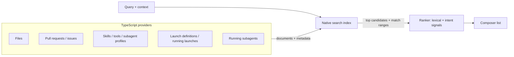

# Unified completion

> Proposal for discussion; not yet approved. No database schema changes are proposed. Builds on the native file-completion index from PR #458.

## Goal

Typing `@` in the composer should find whatever the user means—a file, a pull request, a skill, a running launch—without first choosing a category. Results must be ranked well enough that the intended item is usually first, and fast enough to update on every keystroke.

## Why the current results feel wrong

1. **Ranking is purely lexical.** The native matcher scores character alignment, word/path boundaries, file-versus-directory, depth and path length (`packages/native/native/src/completion/mod.rs`). It knows nothing about what the user recently opened, mentioned or edited, or which files the conversation is about.
2. **Each source ranks differently and is merged by position.** Files are ranked natively; launches and PRs are filtered in the app with simple substring checks and ordered by status/update time (`composer-reference-completions.ts`). Launch/PR starter entries are placed before file results, file results are reversed, and the selector picks the last file option (`composer-editor-completions.ts`). Scores from different sources are never compared.
3. **Only eight files, decided early.** With a hard cap of eight and no context signal, a plausible but unwanted file can push out the intended one.
4. **Many entity types are missing.** Skills, tools, subagent profiles, launch definitions, running subagents and issues are not completion sources.

Lexical matching is still needed; it is just not sufficient.

## Proposal

### Three layers

1. **Providers (TypeScript)** own data acquisition, permissions and freshness. Each produces documents: `{ id, kind, fields, metadata }`. Examples: a file document has a path field; a PR document has number, title, branch and author fields; a skill has name and description.
2. **Native search index (Rust)** generalizes today's file index. It stores typed text fields with weights—`path`, `name`, `title`, `identifier`, `description`—and performs fuzzy matching, top-k selection and UTF-16 match ranges off the Node thread. File-path scoring becomes the scoring rule for `path` fields rather than a separate engine.
3. **Ranker** combines the lexical score with intent signals into one comparable score:
   - **Context:** files already referenced or edited in this conversation, files open in the editor, the current repository.
   - **Usage:** recently and frequently selected items, with decay.
   - **State:** running launches and subagents above idle ones; open PRs above closed ones.
   - **Kind prior:** a small bias only, so a strong match of any kind can still win.

   Simple, explainable weights first. Tuning uses a judged query set (below), not intuition.

### Sources and freshness

| Source                               | Owner                               | Freshness                                   |
| ------------------------------------ | ----------------------------------- | ------------------------------------------- |
| Files/directories                    | `FileCompletionService`             | Existing snapshot cache + workspace monitor |
| Pull requests                        | GitHub service                      | Cached list, refreshed in background        |
| Issues                               | GitHub service (**new operation**)  | Same as PRs                                 |
| Skills, tools                        | Skill catalog / capability assembly | On configuration change                     |
| Subagent profiles                    | `SubagentProfileService`            | On configuration change                     |
| Launch definitions, running launches | Launch services                     | Live events                                 |
| Running subagents                    | Conversation core                   | Live events                                 |

Live sources update the index incrementally (upsert/remove a document) rather than rebuilding it. Remote sources never block typing: the index answers from cached documents and shows a subtle "refreshing" state.

### Usage history without a schema change

Store selection counts and last-used times per project as a small JSON file under the Nerve home (bounded size, exponential decay, pruned on write). Ranking still works if the file is missing or corrupt. No database table is proposed.

### Typing experience

- `@` searches all sources. Results show a kind icon and a short secondary line (folder, PR number and branch, profile description).
- Optional prefixes narrow the search: `@pr:`, `@issue:`, `@skill:`, `@launch:`, `@agent:`, `@file:`. Existing `@launch:` and `@pr:` keep working.
- One blended list ordered by final score, so the first item is the best guess. Grouping by kind can be offered as a display option without changing the order logic.
- Explicit match highlights for every kind, not just files.
- `/` slash commands can move to the same engine later; they are small and work today.

### Measuring "better"

Before tuning, collect 50–100 real examples: what was typed, the context, and the item the user wanted. Track:

- **Top-1 accuracy** — intended item first.
- **Top-3 accuracy** and **mean reciprocal rank**.
- p50/p95 latency per keystroke and index memory.

Run this set as a deterministic test in CI so ranking changes cannot silently regress. Your own "it picks the wrong one" cases are the best starting point.

## Native ownership

Rust owns matching, indexing and top-k. TypeScript owns providers, permission checks, usage history and protocol adaptation. This keeps live GitHub/runtime policy out of the native library, consistent with [Rust native boundaries](rust-native-boundaries.md) and the [native library organization](native-library-organization.md).

The same release should also reduce the cold-build and memory cost measured in PR #458: avoid sending duplicated lowercase/segment strings across N-API, derive them in Rust where parity allows, and build incrementally.

## Phasing

1. Judged query set and metrics against today's file completion.
2. Context and usage signals for files; fix client ordering/selection so the server's first result is selected.
3. Generalize the native index to typed documents; add PRs, launches and skills as providers; blended `@` list.
4. Remaining providers (issues, tools, subagent profiles, running subagents); incremental updates.

## Decisions

- **Commands:** runnable commands are suggested only through **launch definitions**. Agent tool-call history and terminal history are not completion sources.

## Open questions

- Should cross-project items (for example, PRs in another project) ever appear?
- Should tools be completable for every user, or only where they change behavior when mentioned?
