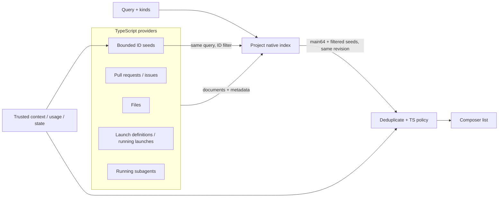

# Unified completion

> Approved direction; implemented capabilities and shared integration passed the final combined code checkpoint. No database/schema changes. PR #458 is merged. See implementation status below for synthetic correctness/visual evidence, measured tradeoffs and remaining limits.

## Goal

Typing `@` in the composer should find whatever the user means—a file, a pull request, a skill, a running launch—without first choosing a category. Results must be ranked well enough that the intended item is usually first, and fast enough to update on every keystroke.

## Original PR #458 behavior (before this work)

1. **Ranking is purely lexical.** The native matcher scores character alignment, word/path boundaries, file-versus-directory, depth and path length (`packages/native/native/src/completion/mod.rs`). It knows nothing about what the user recently opened, mentioned or edited, or which files the conversation is about.
2. **Each source ranks differently and is merged by position.** Files are ranked natively; launches and PRs are filtered in the app with simple substring checks and ordered by status/update time (`composer-reference-completions.ts`). Launch/PR starter entries are placed before file results, file results are reversed, and the selector picks the last file option (`composer-editor-completions.ts`). Scores from different sources are never compared.
3. **Only eight files, decided early.** With a hard cap of eight and no context signal, a plausible but unwanted file can push out the intended one.
4. **Many entity types are missing.** Skills, tools, subagent profiles, launch definitions, running subagents and issues are not completion sources.

Lexical matching is still needed; it is just not sufficient.

## Proposal

### Three layers

1. **Providers (TypeScript)** own data acquisition, permissions and freshness. Each produces documents: `{ id, kind, fields, metadata }`. Examples: a file document has a path field; a PR document has number, title, branch and author fields; a skill has name and description.
2. **Native search index (Rust)** generalizes today's file index. It stores typed text fields with weights—`path`, `name`, `title`, `identifier`, `description`—and performs fuzzy matching, top-k selection and UTF-16 match ranges off the Node thread. File-path scoring becomes the scoring rule for `path` fields rather than a separate engine.
3. **Ranker** combines the lexical score with intent signals into one comparable score:
   - **Context:** files already referenced or edited in this conversation, files open in the editor, the current repository.
   - **Usage:** recently and frequently selected items, with decay.
   - **State:** running launches and subagents above idle ones; open PRs above closed ones.
   - **Kind prior:** a small bias only, so a strong match of any kind can still win.

   Simple, explainable weights first. Tuning uses a judged query set (below), not intuition.

### Sources and freshness

| Source                               | Owner                               | Freshness                                   |
| ------------------------------------ | ----------------------------------- | ------------------------------------------- |
| Files/directories                    | `FileCompletionService`             | Existing snapshot cache + workspace monitor |
| Pull requests                        | GitHub service                      | Cached list, refreshed in background        |
| Issues                               | GitHub service (**new operation**)  | Same as PRs                                 |
| Skills, tools                        | Skill catalog / capability assembly | On configuration change                     |
| Subagent profiles                    | `SubagentProfileService`            | On configuration change                     |
| Launch definitions, running launches | Launch services                     | Live events                                 |
| Running subagents                    | Conversation core                   | Live events                                 |

Live sources update the index incrementally (upsert/remove a document) rather than rebuilding it. Remote sources never block typing: the index answers from cached documents and shows a subtle "refreshing" state.

### Usage history without a schema change

Store selection counts and last-used times per project as a small JSON file under the Nerve home (bounded size, exponential decay, pruned on write). Ranking still works if the file is missing or corrupt. No database table is proposed.

### Typing experience

- `@` searches all sources. Results show a kind icon and a short secondary line (folder, PR number and branch, profile description).
- Optional prefixes narrow the search: `@pr:`, `@issue:`, `@skill:`, `@launch:`, `@agent:`, `@file:`. Existing `@launch:` and `@pr:` keep working.
- One blended list ordered by final score, so the first item is the best guess. Grouping by kind can be offered as a display option without changing the order logic.
- Explicit match highlights for every kind, not just files.
- `/` slash commands can move to the same engine later; they are small and work today.

### Measuring "better"

No real examples are available. The user approved a deterministic synthetic judged set before tuning; real examples can supplement it later. Track:

- **Top-1 accuracy** — intended item first.
- **Top-3 accuracy** and **mean reciprocal rank**.
- p50/p95 latency per keystroke and index memory.

Run this set as a deterministic test in CI so ranking changes cannot silently regress. Your own "it picks the wrong one" cases are the best starting point.

## Native ownership

Rust owns matching, indexing and top-k. TypeScript owns providers, permission checks, usage history and protocol adaptation. This keeps live GitHub/runtime policy out of the native library, consistent with [Rust native boundaries](rust-native-boundaries.md) and the [native library organization](native-library-organization.md).

The same release should also reduce the cold-build and memory cost measured in PR #458: avoid sending duplicated lowercase/segment strings across N-API, derive them in Rust where parity allows, and build incrementally.

## Phasing

1. Judged query set and metrics against today's file completion.
2. Context and usage signals for files; fix client ordering/selection so the server's first result is selected.
3. Generalize the native index to typed documents; add PRs, launches and skills as providers; blended `@` list.
4. Remaining providers (issues, tools, subagent profiles, running subagents); incremental updates.

## Decisions

- **Commands:** runnable commands are suggested only through **launch definitions**. Agent tool-call history and terminal history are not completion sources.

- **Scope:** completion is current-project only; running subagents are additionally current-conversation only.
- **Ranking:** explainable weighted policies and synthetic judgments are approved. The existing native index remains the sole lexical production owner; TS owns context, usage, acquisition, access and final policy scoring.
- **Disabled entries:** authorized disabled skills/tools/profiles must remain discoverable with truthful enable state. Selecting can enable through owning configuration APIs; explicit keyboard disable must be available. Invalid/untrusted profiles are never promoted to executable entries. Tool approval/access checks remain unchanged.

## Implementation status (2026-10-18)

### Implemented capabilities and bounded scope

- Typed search/select/change contracts and real providers cover files/directories, PRs, issues, running launches, launch definitions, skills, tools, profiles and current-conversation children. Selection is a mutation, never execution. Remote acquisition is nonblocking; partial/failed/stale siblings retain healthy rows without fabricated freshness.
- **One native index/FIFO per project**, shared file/global corpus and small atomic conversation capability/profile/child overlays. Default bounds: eight projects/eight contexts each, 32 accepted calls per project, 32 provider loads, aggregate one million documents/64 Mi retained UTF-16 units. Incremental revisions, generation guards, access revocation, eviction/disposal, failed-build recovery and overlay-update/idle-eviction races have owning tests.
- Shared raw file enumeration owns Git/fallback walking, filters and directory synthesis once. The new provider consumes only `{relativePath, kind}` entries, without building/discarding lowercase/name/stem/segment graphs or locale sorting. The legacy route adapts those entries through its original candidate normalization/sort. Owning Git/fallback fixtures verify entry path/kind parity and filters. File metadata retains compact immutable path/kind identity, not per-file item JSON/version hashes; display projects only retrieved candidates. Directory native path fields append `/`, while raw `item.info`, label offset one and ID/version stay stable. Actual native nonempty folder scores/UTF-16 ranges match the legacy adapter. This is structural evidence, not an RSS claim.
- **Main64 plus bounded native-filtered seeds, display8.** TS selects at most 256 known IDs, prioritized edited/referenced paths, decayed usage, open paths and strongest non-file state. Paths use direct identity lookup; state lists are built on provider refresh and bounded per source. No file corpus/item walk occurs per query. One supplemental native query uses the same text/kinds plus `documentIds`; matching/top-k/UTF-16 ranges stay native-owned. Both reads share the project FIFO, overlay and revision; results merge/deduplicate before policy. Wrong revision or an ignored ID filter fails closed. No post-hoc nonmatching context items or fabricated lexical scores.
- Nonempty calibrated policy remains: file/directory prior +320, referenced +640, edited +1280, open +320, usage `min(1600, 480 × log2(1 + min(100, decayed count)))`, plus existing small state boosts. **Empty query/prefix-empty disables the static file prior** because no lexical intent exists; context/usage/state can then blend. These are explainable synthetic-calibrated weights, not learned ranking.
- B forwards optional `refreshCause: 'uncertain_poll'` into provider invalidation. Unknown/periodic polls expire and mark metadata stale without superseding active loads or revoking eligibility. Repeated polls coalesce one revalidation for active demand; stale completion satisfies its original waiters instead of waiting forever for follow-ups. No eager idle retry loop. Hard config/trust/actual filesystem changes retain generation supersession, immediate access-sensitive revocation and owner-fresh selection checks. Fake-clock 35-second read with polls at 10/20/30 seconds, hard revocation and awaited native close are tested. No second filesystem fingerprint engine.
- Context uses lightweight server metadata and at most 64 history events on cache miss, with project-relative bounded sequence caching. No full snapshot/tool-call/queue/async-bash/child materialization or shell parsing. Open-editor paths are not yet supplied. Configured-home JSON usage is kind/project scoped, decays over 30 days, serializes/prunes to 1,000 entries/256 KiB and tolerates corrupt/unwritable storage. A near-256-KiB Unicode/escaping fixture verifies true byte pruning below the count cap and retention of the new selection; traversal-looking opaque IDs cannot select the fixed storage path. No DB/schema change.
- Issued results are bounded per context and preserve selection across overlay switches. Enable/disable reloads owning configuration, checks identity/version/digest/scope and never trusts imported untrusted project files implicitly. `enabled` reports effective configured state only, separately from trust/usability/approval and action eligibility; a blocked configured-enabled profile remains `enabled:true`, `available:false`, with no setter/disable action. The UI's unavailable label/action guard dominates the configured flag. Authorized disabled entries remain discoverable; invalid/untrusted profiles stay non-executable. No mention invokes a tool, launches commands, changes approval policy or spawns an agent.
- Real UI callback wiring is complete from active project/viewed conversation through the conversation/composer adapters and typed presentation model into `ComposerEditor`; inactive centers supply no source. Construction/subscription does not fetch. Unified native order/first selection, every prefix, primary/detail highlights, enable-before-insertion, **Alt+Shift+D** disable, and stale source/doc/new-request error/notice/close guards are implemented. Successful insertion closes its owned completion before document-change invalidation. Explicit eligible entity selection is preserved by ID across deliberate same-query metadata refresh (including repeated notices while pending); new query/source/document and removed/blocked entities default to best0. Repeated acceptance shares one pending editor/doc/source action; stale finalizers cannot unlock a newer action. Core directory rendering separates the existing RTL overflow box (left ellipsis) from an inline LTR `bdi` containing the highlighted path text. No new CSS class/wrapper component or UTF-16 projection change; `plaintext` and the LRM prefix were removed because the former caused right truncation. Runtime/browser evidence remains separate from source wiring.

### Actual synthetic correctness evidence

Original 56 and adversarial 19 invented judgments remain unchanged. Original top-one is now strict **56/56**, not the historical 44/56 coverage floor; provider-nine and policy-eight assertions also stay strict. Historical file-only baseline: Linux x64/Node 24.21.0 top-1/top-3 78.57%, MRR 0.786, with all 12 typed-intent cases missing; method/limits: `test/benchmarks/completion-judged.benchmark.md`. Pre-scored tests are structural only, not native quality evidence.

The final frozen addon (SHA256 `12405115cab5fad125576b23866df4a882ac90059b37fb471f2fc7229ab10252`), actual raw providers and production coordinator pass the four touched actual-native correctness units:

| Set                                    | Count |  Top-1 | Top-3 |   MRR |
| -------------------------------------- | ----: | -----: | ----: | ----: |
| Original judgments                     |    56 |   100% |  100% | 1.000 |
| Additional adversarial judgments       |    19 | 94.74% |  100% | 0.965 |
| Typed provider coverage                |     9 |   100% |  100% | 1.000 |
| Actual cross-kind/context/usage policy |     8 |   100% |  100% | 1.000 |

The earlier `session.ts` rank-four failure was concrete: exact basename scores `18000 + fileBoost180 - depth`; docs/generated/intended paths tied and opaque IDs decided. The native owner added a generic typed shorter-path tie then stable ID, preserving legacy file-facade scores/order. Intended `src/auth/session.ts` is now third, satisfying the unchanged top-three assertion, without a source-directory bias or fixture relabeling.

### Initial `@`, seed recall and honest limits

Actual-native fixtures cover empty string, bare `@`, every empty prefix, mixed13, dense54 and crowded218 documents (80 directories/129 files/nine other entries). Editor tests verify empty tokens really route to unified search. Native empty lexical scores are zero; the typed structural path tie and stable IDs order main retrieval, **not legacy file empty depth/path scores**. No empty-score parity is claimed.

- Mixed/dense lists expose the edited/recent file, used disabled tool and running launch/subagent state without a static empty file prior.
- The original crowded fixture's short wanted file now enters main64 by the approved structural tie; its used tool/running entities still require filtered seeds. A strengthened additional crowded fixture uses a longer wanted path, verifies it is absent from main64, and nevertheless requires it first after native-filtered context/usage retrieval. Both retain the intended mixed visible results.
- A separate nonempty fixture verifies a matching context file beyond64 is retrieved, an unrelated context file is **not** returned by the same native matcher, prefix filters apply to seed IDs, both reads share revisions, and another conversation's child never leaks into the index/query. One project index remains shared.

Recall remains bounded: at most main64 plus 256 known seeds (deduplicated), then visible8. Unknown/unseeded items outside both sets cannot be rescued; signals beyond the seed-priority cap can still lose. No quotas, hard-coded path/source priors, alternate matcher, ML or real-user accuracy claim. These invented sets establish deterministic regression evidence only.

### Whole-service API measurement (provisional, not RPC/UI end-to-end)

Completed in the exclusive lead-approved window against the final frozen addon, then released the window. Full method, unrounded observations, event-loop/heap/disposal/counters and separate quality metrics: `packages/workbench-server/test/benchmarks/completion-whole-api.benchmark.md` and adjacent `completion-whole-api.results.json`.

Actual `FileCompletionService` with unchanged A/PR458 facade uses **retrieval8/display8, no context/usage policy**. Unified uses **main64 + at most256 native-filtered seeds/display8**, typed providers and policy. This is intentionally different capability/work, **not a pure-kernel or blanket no-regression comparison**. A's max8 is the intended baseline, not an error; no preflight forces64, no clamp or baseline mutation.

| Entries | A cold ms | Unified cold ms | A warm p50/p95 ms | Unified warm p50/p95 ms |
| ------- | --------: | --------------: | ----------------: | ----------------------: |
| 20k     |    113.43 |          108.31 |     4.772 / 9.574 |           4.898 / 9.542 |
| 100k    |    556.20 |          463.26 |   22.690 / 48.347 |         24.037 / 48.640 |

**Warm p50 regresses +2.6%/+5.9% (20k/100k)** despite lower cold wall time in these samples; p95 is approximately unchanged/+0.6%. Initial RSS differs: at 20k, cold RSS 188.07→194.57 MiB and increment 38.72→40.84 MiB both increase; at 100k, total 409.95→381.36 MiB and increment 258.05→227.55 MiB decrease. Unified retained JS heap is higher at both sizes. No unqualified memory/performance win is claimed.

One cold sample per isolated process/size/variant, 90 warm calls on a fixed invented query mix, generated discovery (raw entries for unified, legacy normalized graph/sort for A) inside cold time; no workspace filesystem discovery, network, RPC, transport or populated usage history. Empty isolated usage-store startup is included only for unified. GC is outside timings. Each row discovers/indexes its file corpus once and never reindexes files on context switching; unified makes two native queries per service call versus A's one. Quality is tested separately, not inferred from latency.

Both 128-entry smoke variants and all four heavy rows passed; the timing window is complete. Subsequent focused visual retests also passed and their browser/UI server were stopped. Platform-specific single-run limitations, cold event-loop blocking and RSS retention after disposal remain explicit in the report.

### Integration, validation and remaining limits

- Shared event/catalog/registry/bootstrap/runtime wiring bridges Git cache-settled status/cause notifications. Cause classification units cover periodic directory polls versus hard Git fingerprint/config/trust changes, launch-output suppression and filesystem invalidation for files/skills/tools/profiles; service units exercise the actual deferred-load policy. Completion remote aggregation also retains discovery staleness, including empty results, rather than allowing fresh remote siblings to conceal stale discovery. Failure-safe shutdown drains producers before dependent resources and Activity disposal.
- The contracts completion unit was moved out of production `src` into `packages/contracts/test/unified-completion.test.ts`; its unit/build checks passed. Only its four orphan test emits were removed; no production Node types were introduced. Normal package aliases and coherent tools artifacts passed final declaration/package checks. The handler/service default-input type blockers are resolved through canonical schema parsing, not casts or duplicated defaults.
- Owning pre-checkpoint evidence remains 47 mocked/provider/context/discovery/coalescing units, four actual-native units, sixteen editor/controller units and two contracts units. The final combined code checkpoint additionally passed root `pnpm fix:focused && pnpm check:focused`, **528 distinct owning tests (475 JS/TS + 53 scoped Rust)** and `git diff --check`; both Svelte package checks reported zero errors and warnings. Exact commands, counts and logs: `/tmp/nerve-final-validation/HANDOFF.md`. The frozen release addon was not rebuilt during final validation. No suites/integration files or cross-platform/live GitHub validation were run.
- B's production-editor synthetic mock covered light/dark, prefixes, keyboard/pointer enable/disable, freshness, errors and stale-response scenarios. Its refresh-selection/duplicate-accept defects and path bidi/truncation findings were corrected and focused retests passed. The final path-only light/dark retest confirms short and Unicode slash/highlight order, plus left ellipsis preserving long-path suffixes, with no browser errors; the lead reviewed its screenshots. Local evidence: `/tmp/nerve-completion-visual/path-final/handoff.md` (superseding the earlier path-only failure). The browser and UI server are stopped. This synthetic mock evidence does not establish real server authorization, native ranking, configuration writes or RPC performance.
- Remaining limits include missing open-editor context, main64 plus at most256 seed recall/display8, noninterruptible native sections and platform-specific behavior. Whole-service measurements retain the documented +2.6%/+5.9% warm p50 regressions and 20k RSS increase; no RPC, ML or real-user accuracy/performance claim follows. Heavy evidence is complete; no further timing window is requested. No DB/schema change or access/approval/trust bypass is part of this work.
