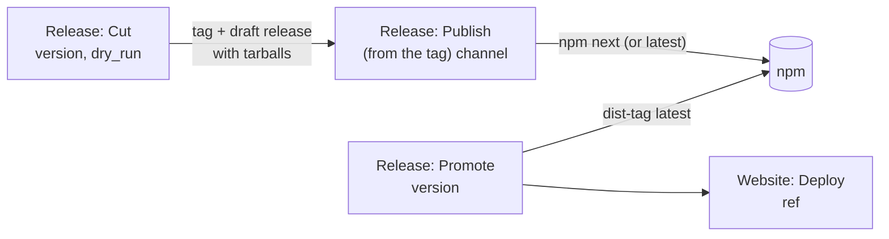

# Release checklist

> **Scope:** Maintainer procedure. The release workflows and release scripts are authoritative when this document differs.

Every release goes to the **staging** channel (npm `next`) first. A maintainer later **promotes** a staging version to **stable** (npm `latest`) once it has had time to show bugs. Four manual GitHub workflows cut, publish, promote and deploy; nothing is tagged until the release commit has passed the full test suite, and the tarballs tested at cut time are the ones published.



## Packages

Ten public npm packages share Nerve's version and move together through the channels:

- `@nervekit/desktop`, the launcher. Its tarball bundles the private runtime workspaces (`contracts`, `native`, `protocol`, `harness`, `tools`, `workbench-server`, built workbench web assets) and pins the six platform packages as exact-version optional dependencies. Third-party dependencies such as Electron stay normal dependencies.
- `@nervekit/native-<triple>` for `linux-x64-gnu`, `linux-arm64-gnu`, `darwin-x64`, `darwin-arm64`, `win32-x64-msvc` and `win32-arm64-msvc`.
- `@nervekit/extension-api`, `@nervekit/ui-kit` and `@nervekit/extension-sdk` for extension authors. `scripts/checks/check-lockstep-versions.ts` (part of `pnpm check`) fails when one differs from the root version, because the version tracks extension compatibility. When a release breaks extensions, add a section to `packages/extension-sdk/UPGRADING.md` before cutting it.

Extensions that pin a caret range such as `^0.42.0` can resolve to a staging-only patch version. That is acceptable: patch versions are bug fixes and do not change the extension contract.

`scripts/release/release-artifacts.ts` is the single list of the ten tarballs and their publish order: platform packages, desktop, `extension-api`, `ui-kit`, then `extension-sdk` (it depends on both at the exact version).

Version numbers are plain SemVer (`0.42.1`) with no pre-release suffix; a staging version becomes stable unchanged. Minor versions bring features and improvements, patch versions bring bug fixes. Every staging version is a real release: the root `package.json` version is the latest release, staging or stable.

## Release: Cut

**Actions → Release: Cut → Run workflow** from `main`, with `version` (`X.Y.Z`, no `v`) and `dry_run`. With GitHub CLI:

```sh
gh workflow run release-cut.yml --ref main -f version=X.Y.Z            # real cut
gh workflow run release-cut.yml --ref <branch> -f version=X.Y.Z -f dry_run=true
```

1. **Prepare.** `pnpm release:prepare X.Y.Z` on the dispatched commit (`scripts/release/prepare-release.ts`) checks that the version is plain SemVer above the current version and that `vX.Y.Z` does not exist, then updates every workspace `package.json`, the native `Cargo.toml` and the `nerve-native` entry in `Cargo.lock`, stamps Discover announcements authored with `releasedIn: "next"`, marks every draft migration step released (`stage: "released"`, `releasedIn`, folder hash as checksum, a drifted draft label kept in `previousChecksums`, `rerunOnChange` dropped) and formats the changed steps. The migration lock check runs in the Test stage (`ci.yml`), because it needs built packages and the native addon.
2. **Commit.** `scripts/release/commit-release.ts` creates `release/vX.Y.Z` at the base and commits the changes through the GraphQL `createCommitOnBranch` mutation. GitHub signs it, which satisfies the `main` ruleset's signature rule.
3. **Test**, in parallel: `ci.yml` (called with the commit as `ref`; full coverage), native prebuilds on architecture-matched runners for the six targets, build, smokes and packing on Ubuntu, package smokes on Windows and macOS, and the extension packages (`pnpm pack` for the three, then the SDK end-to-end test against those tarballs).
4. **Finalize**, only when everything passed and `dry_run` is false: fast-forward `main` to the release commit (fails when `main` moved during the run; rerun the cut), create the annotated tag `vX.Y.Z` with the `nervekit-release` app token, and create a **draft** GitHub release with the ten tarballs and `SHA256SUMS`.
5. **Clean up.** `release/vX.Y.Z` is deleted whether the run passed, failed or was a dry run.

A dry run may start from any branch; it tests the release commit built on that branch and stops before finalize. Real cuts must start from `main`.

Finalize is idempotent: when it fails partway (for example after moving `main`), use **Re-run failed jobs** on the same run. A fresh cut of the same version would fail, because `main` already carries it. The fast-forwarded `main` commit gets no `push` CI run of its own; it already passed the same jobs.

To preview the bump locally on a clean checkout: `pnpm release:prepare X.Y.Z --dry-run` prints the migration steps it would release and changes nothing. Without `--dry-run` it edits the working tree only; discard the result with `git restore .`.

## Release: Publish

**Actions → Release: Publish**, choose the tag `vX.Y.Z` in "Use workflow from", and pick `channel`:

```sh
gh workflow run release-publish.yml --ref vX.Y.Z -f channel=staging
```

It refuses unless the tag has a draft GitHub release whose ten tarballs match `SHA256SUMS` and the tag's names and versions. It publishes them with provenance under `next` (`staging`, the default) or `latest` (`stable`), skipping versions already on npm so a partial failure can be rerun, then publishes the GitHub release: as a pre-release for `staging`, as the latest release for `stable`.

Use `stable` only when a release should not wait, such as an urgent fix. Nothing is rebuilt.

## Release: Promote

```sh
gh workflow run release-promote.yml --ref main -f version=X.Y.Z
```

Checks that all ten packages are published at `version` and that it is above the current `latest` (set `rollback` to move `latest` back deliberately), runs `npm dist-tag add <pkg>@X.Y.Z latest` for each, marks the GitHub release as latest and not a pre-release with notes regenerated from the previous stable release, and calls **Website: Deploy** with `ref: vX.Y.Z`. `next` keeps pointing at the newest staging version. There is no minimum time on staging.

Check the channels with `npm view @nervekit/desktop dist-tags`.

## Website: Deploy

The website describes what `@latest` installs, so it is deployed by Promote, not by every release. To redeploy by hand (for example a docs fix on the stable tag):

```sh
gh workflow run website-deploy.yml --ref main -f ref=vX.Y.Z
```

## Fixes while staging is ahead

There are no maintenance branches. When stable has an urgent bug, fix it on `main`, cut a new staging version and promote it (or publish it with `channel: stable`). If `main` holds work that is not ready, finish or revert it first.

## Storage migrations

Each staging version releases its draft migration steps, so "all unreleased data changes since the latest release belong in one migration step" applies per staging version. A bug in a step that staging users have already applied is fixed by a new step. Promotion is safe: stable users apply the same steps in the same order. A home migrated by a staging version cannot be opened by an older stable version (the ledger rejects unknown step IDs); the install docs tell staging users to use a separate `NERVE_HOME`.

Never validate a release or migration against the live home. Copy the source home to an isolated directory under `/tmp`, set an explicit `NERVE_HOME`, use explicit non-default ports, and give Electron a separate `userData` profile (`NERVE_ELECTRON_USER_DATA`) when desktop browser state must also be isolated. See [Storage, cleanup, and migration](https://nerve.tlmtech.dev/operations/storage-migration/) and the repository [storage architecture](../architecture/storage.md).

## Local validation

The local commands validate a release; they do not tag or publish.

```sh
pnpm install --frozen-lockfile
pnpm check
pnpm run test:full
pnpm build
node scripts/release/pack-npm.ts                  # needs all six native prebuilds
node scripts/release/smoke-workbench-release.ts   # built workbench server HTTP/WS parity
node scripts/release/smoke-desktop-release.ts     # desktop --version/--help and server resolution
node scripts/release/smoke-desktop-package.ts
pnpm --filter @nervekit/extension-sdk e2e         # packs the extension packages, installs them with npm (needs network)
```

`release/npm` is generated and must not be committed. Final packing requires the exact six-file native prebuild inventory in `packages/native/prebuilds` (`node scripts/release/verify-native-prebuilds.ts`), which only Release: Cut produces; ordinary development needs only the host binding under `packages/native/prebuilds/local`. `pack-npm.ts` verifies names, versions, contents, bundled package resolution, entrypoints, native prebuilds and the launcher through an isolated install.

Requirements: Node.js 24+, pnpm 11.28.10, rustup with the toolchain pinned in `rust-toolchain.toml`.

## One-time setup

- **`nervekit-release` GitHub App**, owned by the maintainer and installed on this repository with **Contents: read and write**. It is the only actor that can create release tags; an app is needed because `GITHUB_TOKEN` cannot be a ruleset bypass actor. Everything else in Cut uses `GITHUB_TOKEN`.
- **`release` environment** used only by `release-cut.yml`: variable `RELEASE_APP_CLIENT_ID` and secret `RELEASE_APP_PRIVATE_KEY`. Add required reviewers to get an approval step before `main` moves and the tag is created.
- **Tag ruleset** on `refs/tags/v*` restricting creation, update and deletion, with the `nervekit-release` app as the only bypass actor (no repository admins), so release tags cannot be pushed by hand.
- **`main` ruleset**: `GITHUB_TOKEN` must be able to fast-forward `main` (signed commits and linear history are satisfied by the API commit).
- **`github-pages` environment**: allow deployments from `main` (workflows are dispatched from `main`).
- **npm trusted publishers** (no npm token is stored). For each of the ten packages on npmjs.com, Settings → Trusted Publisher → GitHub Actions, repository `ThilinaTLM/nerve`:
  - workflow `release-publish.yml` with **npm publish** allowed;
  - workflow `release-promote.yml` with **npm dist-tag** allowed only (OIDC dist-tags need npm 11.21.0+; the workflow upgrades npm when needed).

  Remove the old `release.yml` publishers. Trusted publishing can only be configured for a package that already exists on npm; a new package needs one manual first publish (`npm publish --access public --tag next` on a packed tarball).

Do not unpublish desktop versions or legacy packages: pinned older installs may still need them.

## Scope

The npm launcher supports Linux, Windows and macOS. Signed or notarized app bundles and native installers are not part of the release path. Every smoke uses temporary homes and workspaces and random loopback ports, terminates its child processes and removes the temporary install projects it creates.
